# Code Snippets, Project Artifacts, and System Screenshots

Sections 1–3 and 5 retain image placeholders. Section 4 includes the main system pages captured with fictional demonstration data; remaining placeholders identify additional screens not captured. Hide credentials and private information.

## 1. Sample Code Snippets

### 1.1 Login and Account Security

[IMAGE PLACEHOLDER: Sign-in and Registration Interface]

**Figure 1.** Sign-in and Registration Interface

This figure shows the code for the sign-in and registration forms.

[IMAGE PLACEHOLDER: Authentication and Session Handling]

**Figure 2.** Authentication and Session Handling

This figure illustrates the code that checks accounts and maintains signed-in sessions.

[IMAGE PLACEHOLDER: Administrator Security Verification]

**Figure 3.** Administrator Security Verification

This figure shows the administrator identity checks for sensitive settings.

### 1.2 Student Records and Enrollment

[IMAGE PLACEHOLDER: Student Profile and Progress Interface]

**Figure 4.** Student Profile and Progress Interface

This figure shows the code displaying student details and requirement progress.

[IMAGE PLACEHOLDER: Student Record Request Handler]

**Figure 5.** Student Record Request Handler

This figure depicts the code handling a request for a student record.

[IMAGE PLACEHOLDER: Enrollment Completion Logic]

**Figure 6.** Enrollment Completion Logic

This figure demonstrates the code that marks an eligible student as enrolled.

### 1.3 Requirement Evidence and Review

[IMAGE PLACEHOLDER: Evidence Upload Interface]

**Figure 7.** Evidence Upload Interface

This figure shows the code for choosing and uploading requirement evidence.

[IMAGE PLACEHOLDER: Evidence Submission Request Handler]

**Figure 8.** Evidence Submission Request Handler

This figure depicts the code handling a student evidence submission.

[IMAGE PLACEHOLDER: Requirement Approval and Feedback Logic]

**Figure 9.** Requirement Approval and Feedback Logic

This figure illustrates the code for approving requirements and saving correction notes.

### 1.4 Enrollment Queue

[IMAGE PLACEHOLDER: Student Queue Interface]

**Figure 10.** Student Queue Interface

This figure shows the code displaying a student’s place in the enrollment line.

[IMAGE PLACEHOLDER: Adviser Queue Interface]

**Figure 11.** Adviser Queue Interface

This figure shows the code for the adviser’s queue and serving controls.

[IMAGE PLACEHOLDER: Queue Join and Serving Logic]

**Figure 12.** Queue Join and Serving Logic

This figure illustrates the code for joining the queue and serving the next student.

### 1.5 Departments and Adviser Assignments

[IMAGE PLACEHOLDER: Department and Assignment Interface]

**Figure 13.** Department and Assignment Interface

This figure shows the code displaying departments and adviser assignments.

[IMAGE PLACEHOLDER: Department Request Handler]

**Figure 14.** Department Request Handler

This figure depicts the code handling department-management requests.

[IMAGE PLACEHOLDER: Adviser Assignment Logic]

**Figure 15.** Adviser Assignment Logic

This figure illustrates the code assigning departments and year levels to advisers.

### 1.6 Office Hours and Calendar

[IMAGE PLACEHOLDER: Office-Hour Schedule Interface]

**Figure 16.** Office-Hour Schedule Interface

This figure shows the code for entering and displaying office hours.

[IMAGE PLACEHOLDER: Schedule Validation]

**Figure 17.** Schedule Validation

This figure demonstrates the checks for missing schedule details and overlapping times.

[IMAGE PLACEHOLDER: Calendar Connection and Synchronization]

**Figure 18.** Calendar Connection and Synchronization

This figure shows the code connecting office-hour schedules to Google Calendar.

### 1.7 Notifications and Reports

[IMAGE PLACEHOLDER: Notification Interface and Retrieval]

**Figure 19.** Notification Interface and Retrieval

This figure shows the code retrieving and displaying user notifications.

[IMAGE PLACEHOLDER: Report Interface]

**Figure 20.** Report Interface

This figure shows the code for selecting and previewing report information.

[IMAGE PLACEHOLDER: Report Data and PDF Preparation]

**Figure 21.** Report Data and PDF Preparation

This figure illustrates the code preparing records for a printable PDF report.

### 1.8 Account and Integration Administration

[IMAGE PLACEHOLDER: Account Management Request Handler]

**Figure 22.** Account Management Request Handler

This figure depicts the code handling permitted account-management requests.

[IMAGE PLACEHOLDER: Integration Settings Interface]

**Figure 23.** Integration Settings Interface

This figure shows the code displaying connected services and their settings.

[IMAGE PLACEHOLDER: Credential Validation and Saving]

**Figure 24.** Credential Validation and Saving

This figure demonstrates the code checking and saving service credentials.

### 1.9 Audit Logs and Enrollment Assistant

[IMAGE PLACEHOLDER: Activity Log Request Handler]

**Figure 25.** Activity Log Request Handler

This figure shows the code retrieving recorded system activity.

[IMAGE PLACEHOLDER: Assistant Interface]

**Figure 26.** Assistant Interface

This figure shows the code displaying enrollment questions and assistant replies.

[IMAGE PLACEHOLDER: Assistant Reply Stream]

**Figure 27.** Assistant Reply Stream

This figure illustrates the code sending an assistant reply in small parts.

### 1.10 Database and Concurrency

[IMAGE PLACEHOLDER: Database Access Helper]

**Figure 28.** Database Access Helper

This figure shows the shared code used to read and save database records.

[IMAGE PLACEHOLDER: Timestamp-Ordering Rules]

**Figure 29.** Timestamp-Ordering Rules

This figure illustrates the checks that prevent an older edit from replacing newer information.

[IMAGE PLACEHOLDER: Stale-Update Handling]

**Figure 30.** Stale-Update Handling

This figure demonstrates the handling of an outdated record change.

## 2. Coding Standards and Guidelines

### 2.1 Code Formatting

[IMAGE PLACEHOLDER: Code Formatting Example]

**Figure 31.** Code Formatting Example

This figure shows consistent indentation and spacing in the code.

### 2.2 Naming Conventions

[IMAGE PLACEHOLDER: Naming Convention Example]

**Figure 32.** Naming Convention Example

This figure shows clear names used for variables and functions.

### 2.3 API and Concurrency Comments

[IMAGE PLACEHOLDER: API Documentation Comment Example]

**Figure 33.** API Documentation Comment Example

This figure shows an API comment listing the request, access rules, and response.

[IMAGE PLACEHOLDER: Concurrency Comment Example]

**Figure 34.** Concurrency Comment Example

This figure shows a comment describing the checks for competing record changes.

### 2.4 Code Structure

[IMAGE PLACEHOLDER: Routes, Services, Models, and Infrastructure Structure]

**Figure 35.** Routes, Services, Models, and Infrastructure Structure

This figure depicts the project folders for requests, business rules, records, and shared tools.

### 2.5 Validation and Error Handling

[IMAGE PLACEHOLDER: Input Validation and Error Handling Example]

**Figure 36.** Input Validation and Error Handling Example

This figure demonstrates the checks for invalid information and the resulting error handling.

## 3. Project Management Artifacts

### 3.1 Sprint Planning

[IMAGE PLACEHOLDER: Sprint Board]

**Figure 37.** Sprint Board

This figure shows project tasks arranged on the sprint board.

[IMAGE PLACEHOLDER: Product Backlog]

**Figure 38.** Product Backlog

This figure shows the list of project features and unfinished tasks.

[IMAGE PLACEHOLDER: Sprint Tasks and Progress]

**Figure 39.** Sprint Tasks and Progress

This figure shows sprint tasks and their recorded progress.

### 3.2 Development and Testing Records

[IMAGE PLACEHOLDER: Version-Control History]

**Figure 40.** Version-Control History

This figure shows the recorded history of code changes.

[IMAGE PLACEHOLDER: Code Review or Change Review]

**Figure 41.** Code Review or Change Review

This figure shows proposed changes and their review details.

[IMAGE PLACEHOLDER: Test Results]

**Figure 42.** Test Results

This figure shows the recorded test results, including any reported failures.

## 4. Screenshots of the System

These desktop screenshots render the actual React page components with temporary, read-only sample data. All names, student numbers, email addresses, queue positions, and totals are fictional. No live database or account was used. Captures use a 1440 × 900 light-theme viewport and wait for fonts, images, and chart reveal animations to settle. These are interface illustrations, not evidence of live-service testing.

### 4.1 System Access

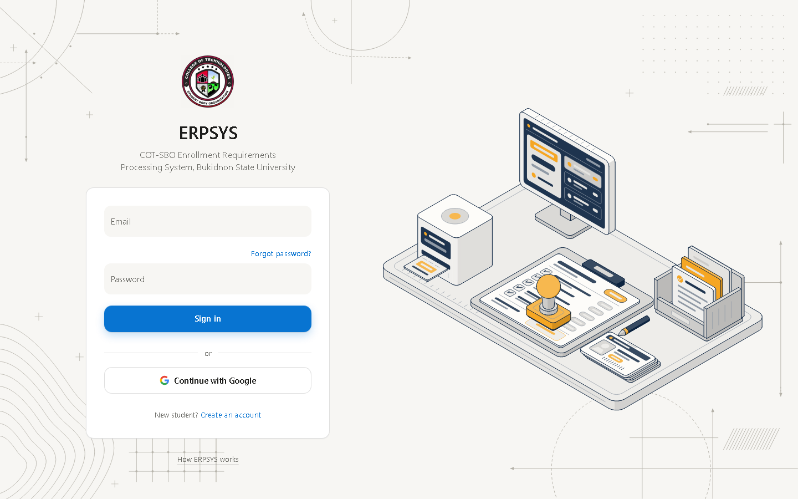

**Figure 43.** Sign-In Page

This figure shows the account fields and available sign-in methods.

[IMAGE PLACEHOLDER: Student Registration Page]

**Figure 44.** Student Registration Page

This figure shows the fields for creating a student account and choosing enrollment details.

[IMAGE PLACEHOLDER: Password Recovery Page]

**Figure 45.** Password Recovery Page

This figure shows the password-recovery screen and its instructions.

### 4.2 Student Interface

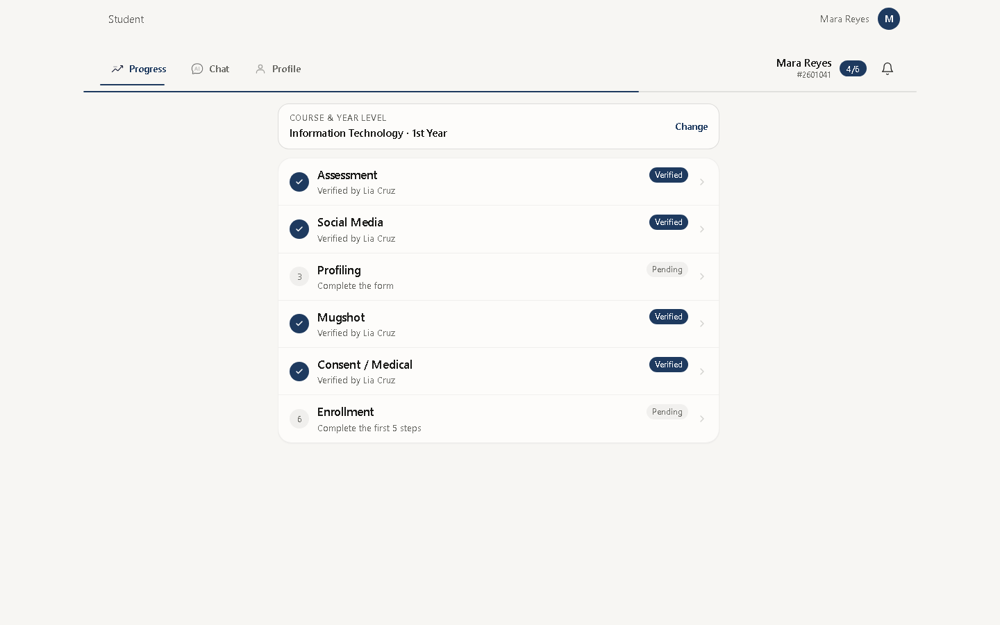

**Figure 46.** Student Dashboard and Requirement Progress

This figure shows the student dashboard with completed and unfinished requirements.

[IMAGE PLACEHOLDER: Enrollment Placement]

**Figure 47.** Enrollment Placement

This figure shows the selected school year, department, and year level.

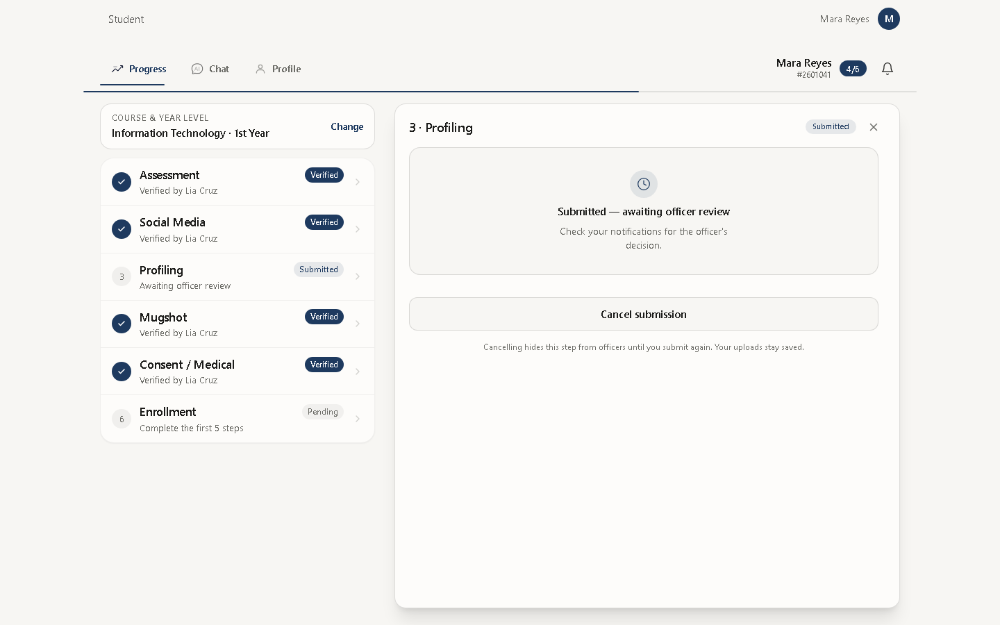

**Figure 48.** Requirement Evidence Submission

This figure shows the student's profiling requirement after submission, awaiting officer review. Other requirement types use their own evidence-upload controls.

[IMAGE PLACEHOLDER: Returned Requirement and Feedback]

**Figure 49.** Returned Requirement and Feedback

This figure shows a returned requirement and the officer’s correction notes.

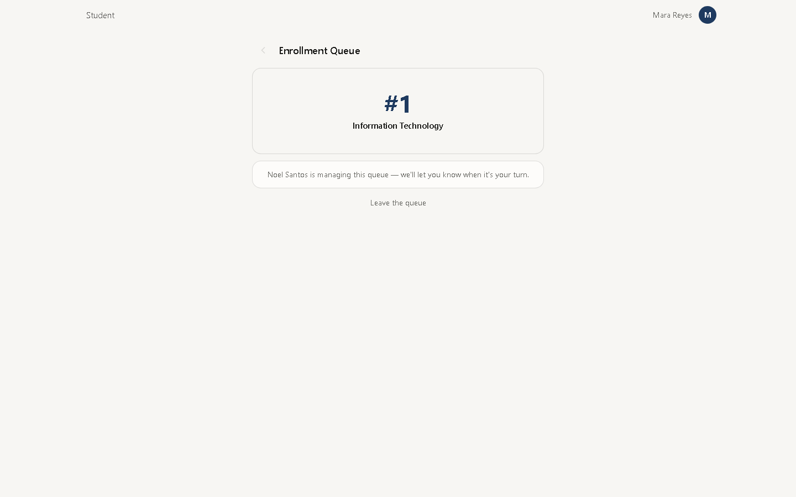

**Figure 50.** Enrollment Queue Position

This figure shows the student’s current place in the enrollment line.

[IMAGE PLACEHOLDER: Completed Enrollment Record]

**Figure 51.** Completed Enrollment Record

This figure shows the student details and verified requirements in the completed enrollment record.

[IMAGE PLACEHOLDER: Student Notifications]

**Figure 52.** Student Notifications

This figure shows enrollment reminders and updates in the student’s notification list.

[IMAGE PLACEHOLDER: Enrollment Assistant]

**Figure 53.** Enrollment Assistant

This figure shows an enrollment question and the assistant’s reply.

### 4.3 SBO Officer Interface

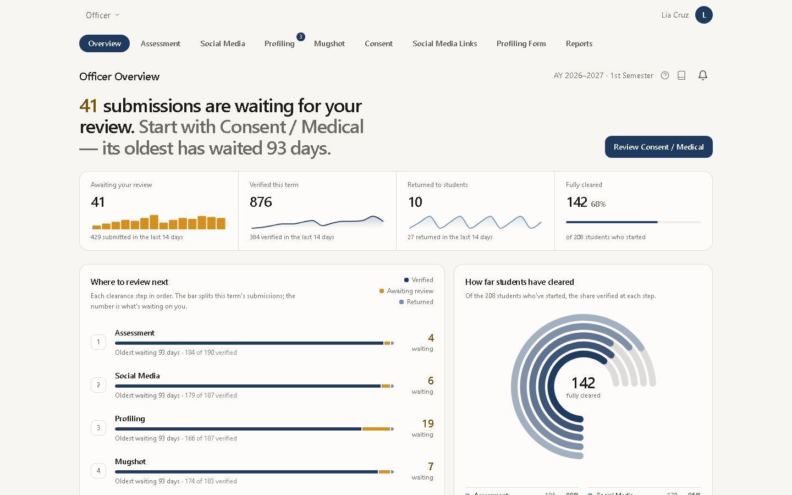

**Figure 54.** Officer Dashboard

This figure shows the requirement summary on the SBO officer dashboard.

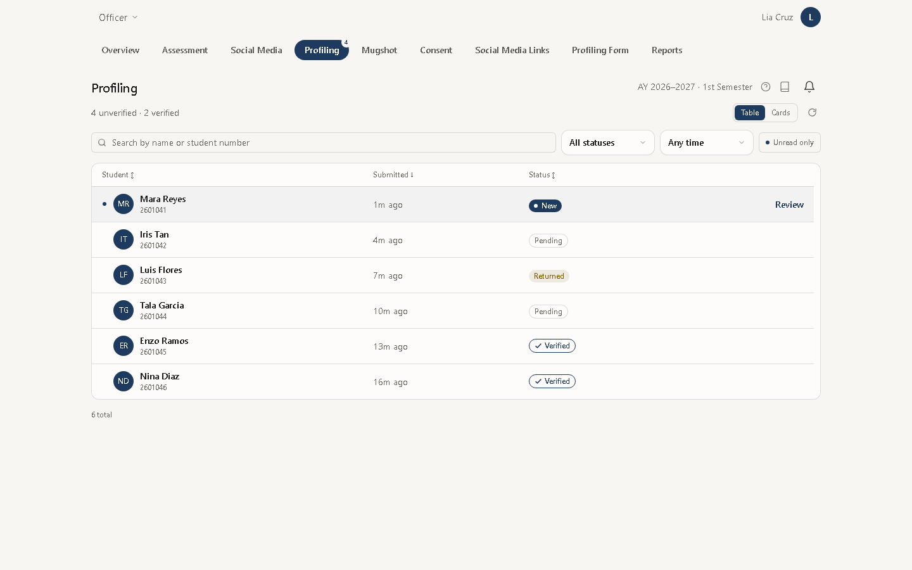

**Figure 55.** Requirement Submission List

This figure shows student submissions and their current review status.

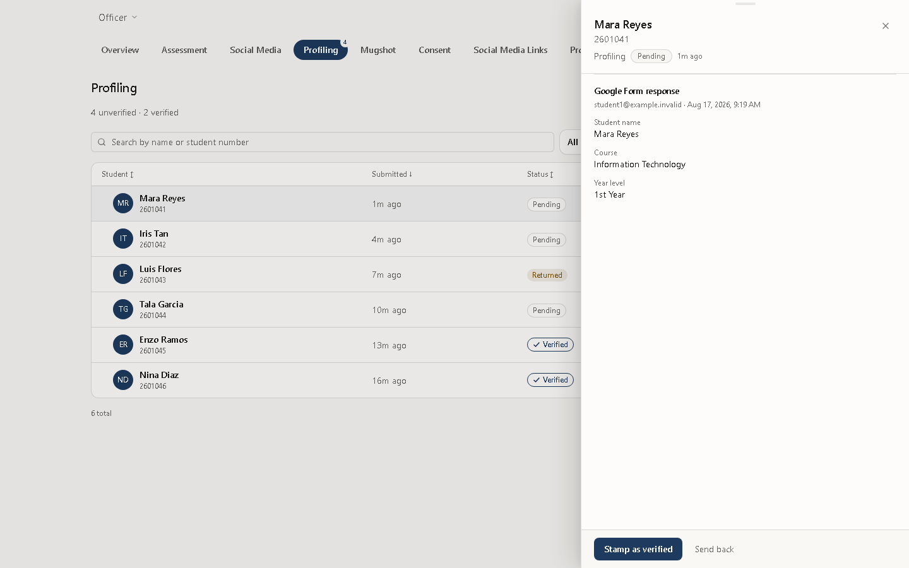

**Figure 56.** Submission Review and Feedback

This figure shows submitted evidence alongside approval and feedback controls.

[IMAGE PLACEHOLDER: Mugshot Capture]

**Figure 57.** Mugshot Capture

This figure shows the student-photo capture screen.

[IMAGE PLACEHOLDER: Digital Stamp Settings]

**Figure 58.** Digital Stamp Settings

This figure shows the officer’s stamp name, graphic, and signature settings.

### 4.4 Enrollment Adviser Interface

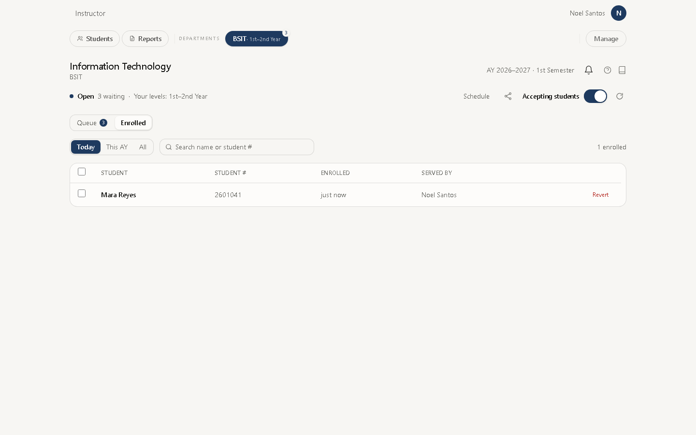

**Figure 59.** Adviser Dashboard and Student Roster

This figure shows the adviser's Enrolled tab, including a sample completed enrollment and its responsible adviser.

[IMAGE PLACEHOLDER: Department and Year-Level Assignment]

**Figure 60.** Department and Year-Level Assignment

This figure shows the department and year levels assigned to an adviser.

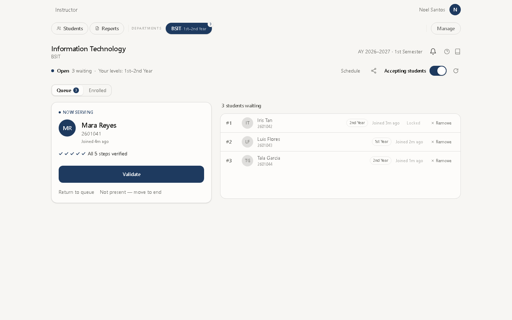

**Figure 61.** Queue Serving and Enrollment Completion

This figure shows the student being served and the enrollment-completion controls.

[IMAGE PLACEHOLDER: Department Handover]

**Figure 62.** Department Handover

This figure shows a department handover request and its response controls.

[IMAGE PLACEHOLDER: Office-Hour Schedule]

**Figure 63.** Office-Hour Schedule

This figure shows the adviser’s posted office hours and schedule entries.

[IMAGE PLACEHOLDER: Google Calendar Connection]

**Figure 64.** Google Calendar Connection

This figure shows the adviser’s Google Calendar connection status.

### 4.5 Administrator Interface

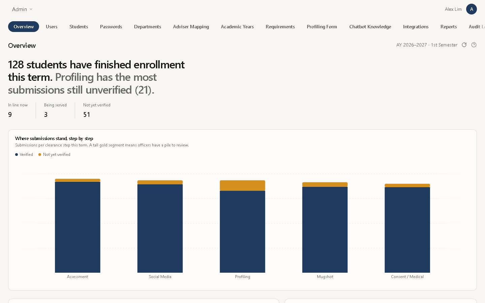

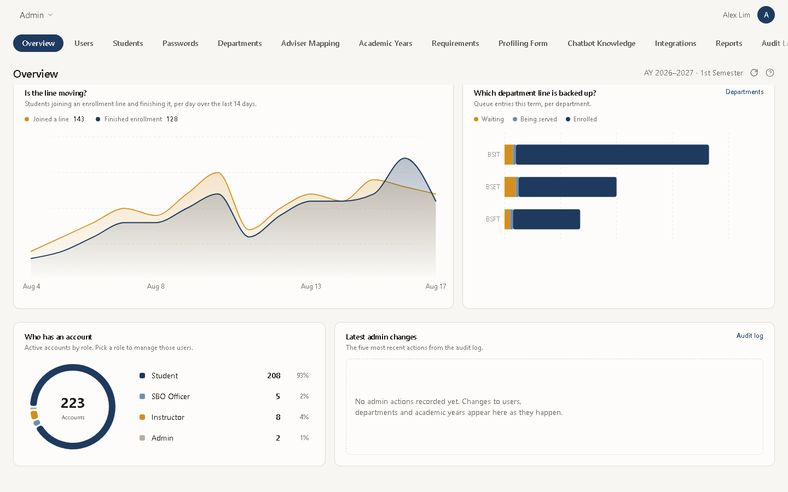

**Figure 65.** Administrator Dashboard

This figure shows the administrator overview and its lower activity section. Populated sample charts show clearance status, daily queue movement, department totals, and account roles; the totals are not measured operational results.

[IMAGE PLACEHOLDER: Academic Year Management]

**Figure 66.** Academic Year Management

This figure shows the school-year list and the selected active period.

[IMAGE PLACEHOLDER: Assessment Requirement Management]

**Figure 67.** Assessment Requirement Management

This figure shows the assessment checklist and its management controls.

[IMAGE PLACEHOLDER: User Account Management]

**Figure 68.** User Account Management

This figure shows the user directory and available account actions.

[IMAGE PLACEHOLDER: Adviser Assignment Management]

**Figure 69.** Adviser Assignment Management

This figure shows advisers and their department and year-level assignments.

[IMAGE PLACEHOLDER: Integration Settings]

**Figure 70.** Integration Settings

This figure shows connected services and their configuration status.

[IMAGE PLACEHOLDER: Administrator Security Verification]

**Figure 71.** Administrator Security Verification

This figure shows the administrator identity checks for sensitive settings.

[IMAGE PLACEHOLDER: Activity Logs]

**Figure 72.** Activity Logs

This figure shows recorded user actions and their results.

[IMAGE PLACEHOLDER: Report Preview]

**Figure 73.** Report Preview

This figure shows the report layout before printing or downloading.

## 5. Stakeholder Validation Documents

### 5.1 Partnership and Approval

[IMAGE PLACEHOLDER: Partnership Document — Page 1]

**Figure 74.** Partnership Document — Page 1

This figure shows the first page of the project partnership document.

[IMAGE PLACEHOLDER: Partnership Document — Additional Page]

**Figure 75.** Partnership Document — Additional Page

This figure shows an additional page of the project partnership document.

[IMAGE PLACEHOLDER: Project Approval Document — Page 1]

**Figure 76.** Project Approval Document — Page 1

This figure shows the first page of the project approval document.

[IMAGE PLACEHOLDER: Project Approval Document — Additional Page]

**Figure 77.** Project Approval Document — Additional Page

This figure shows an additional page of the project approval document.
