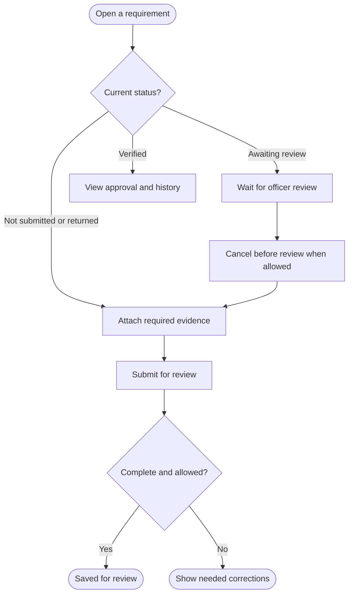
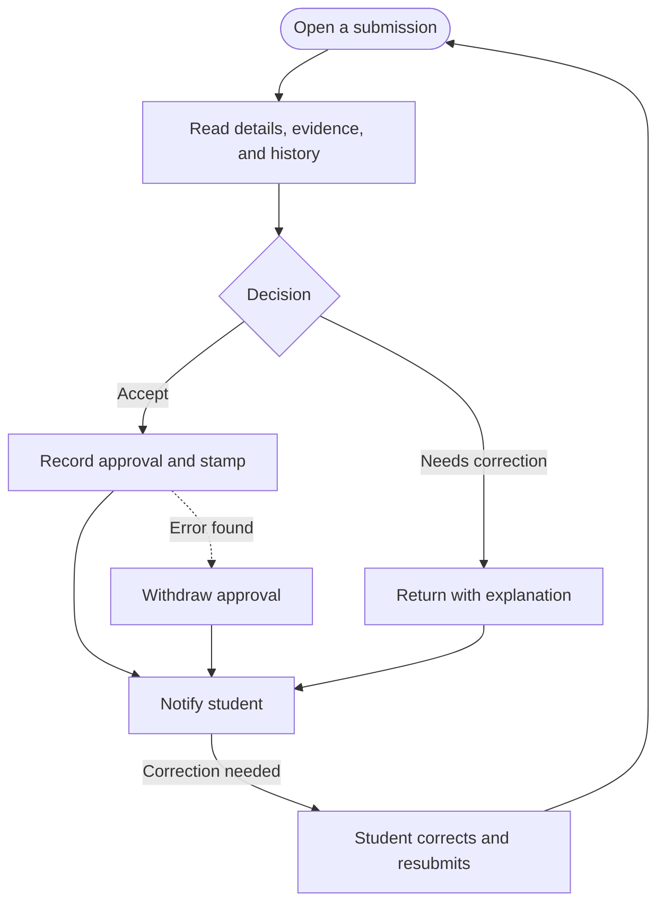
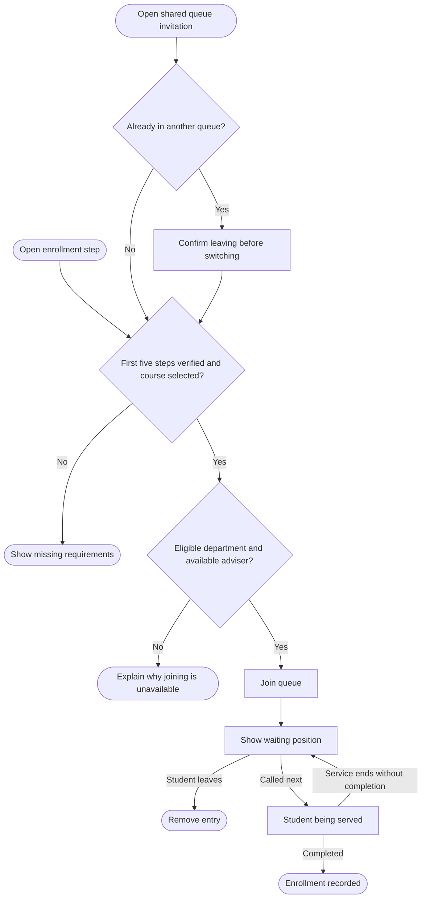
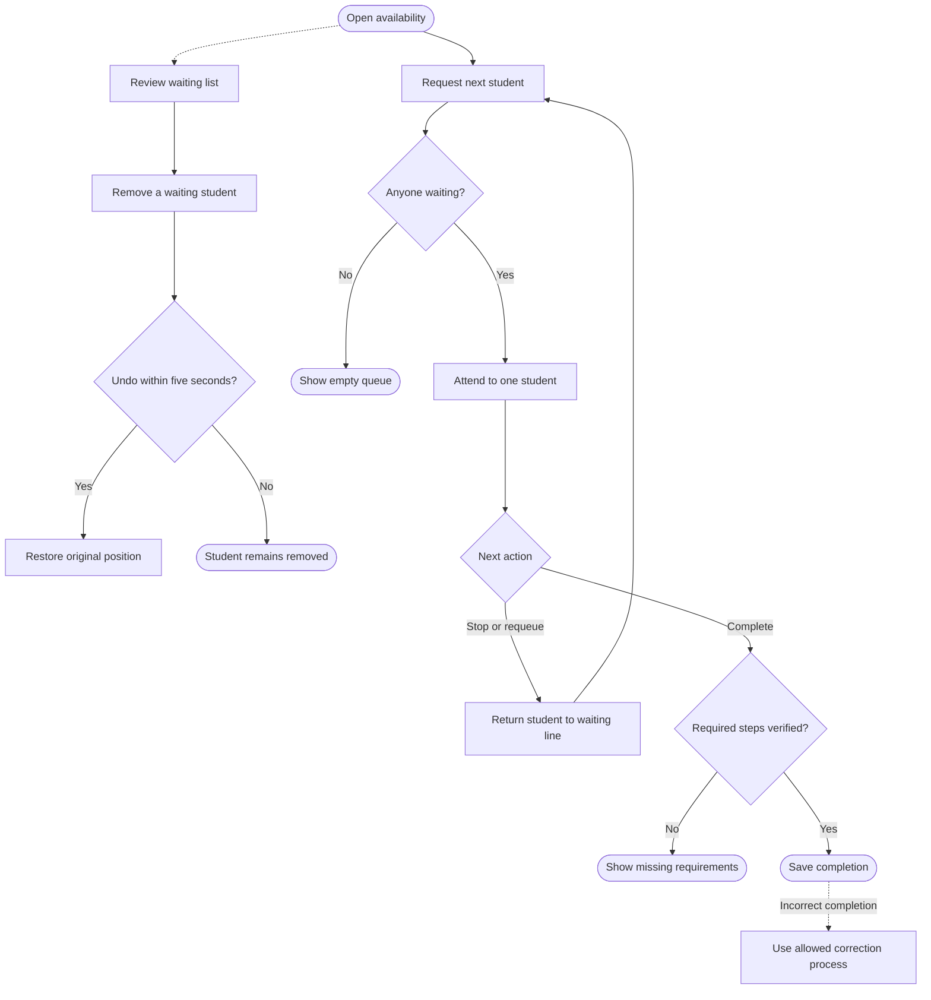
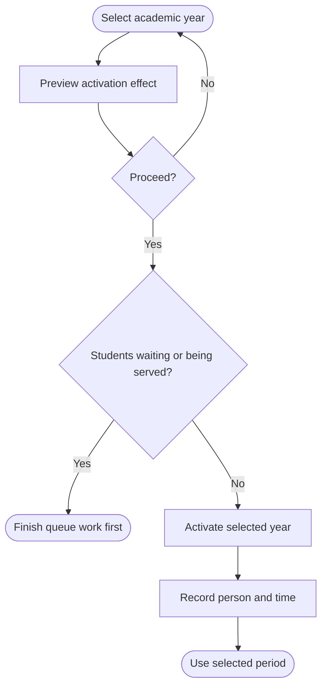
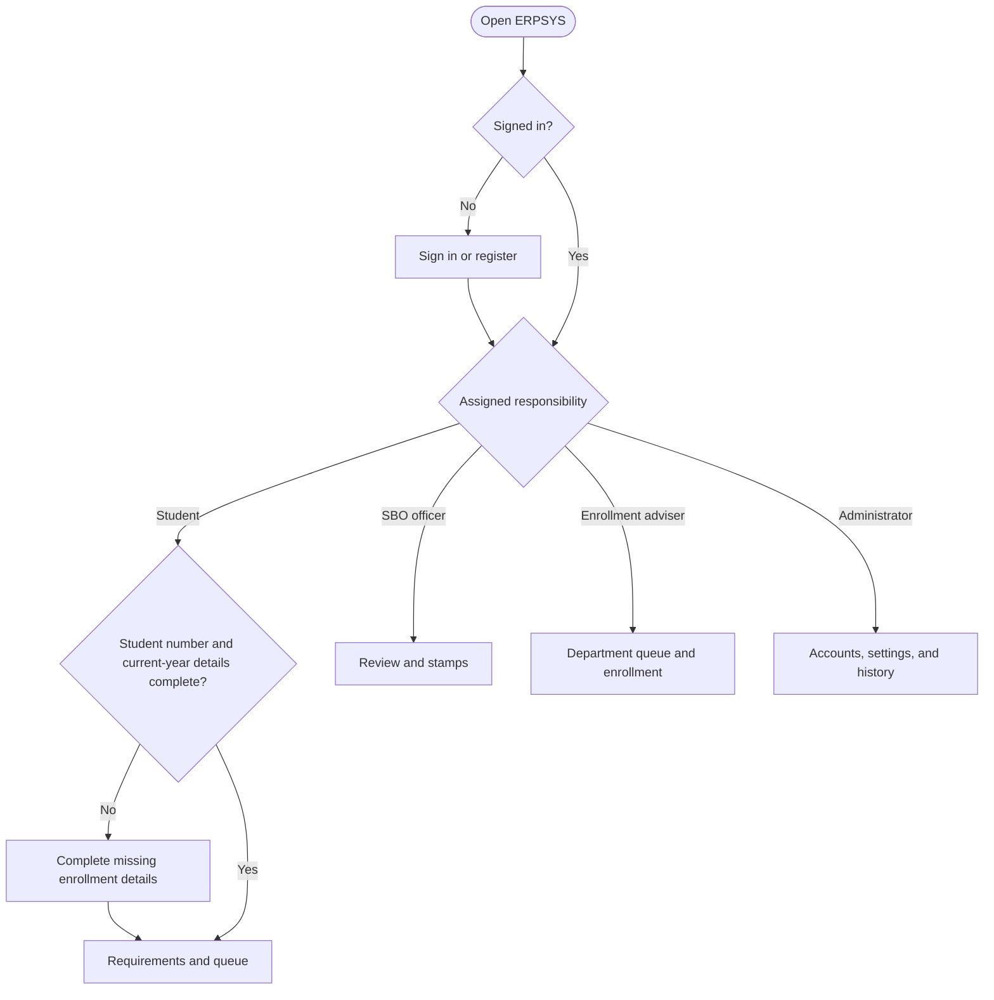
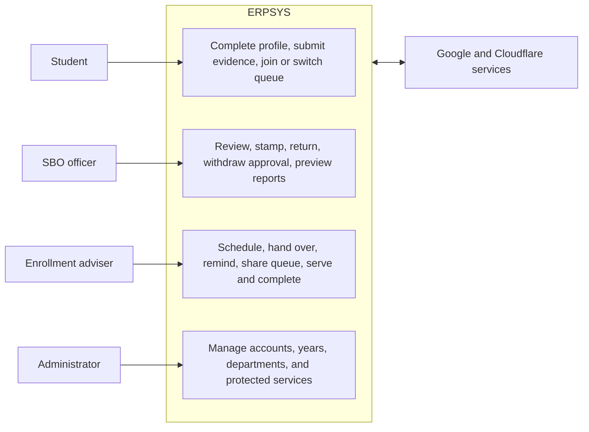
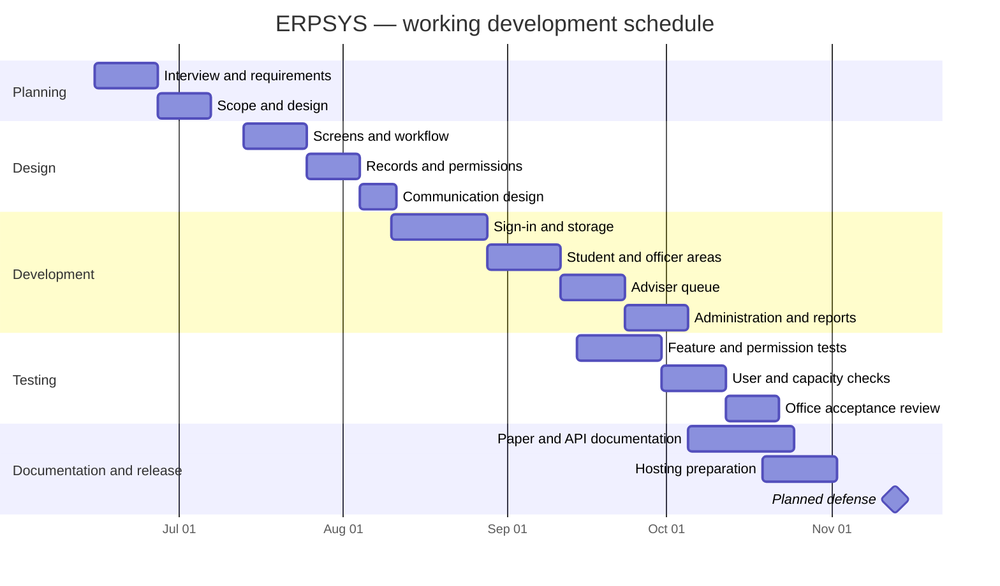
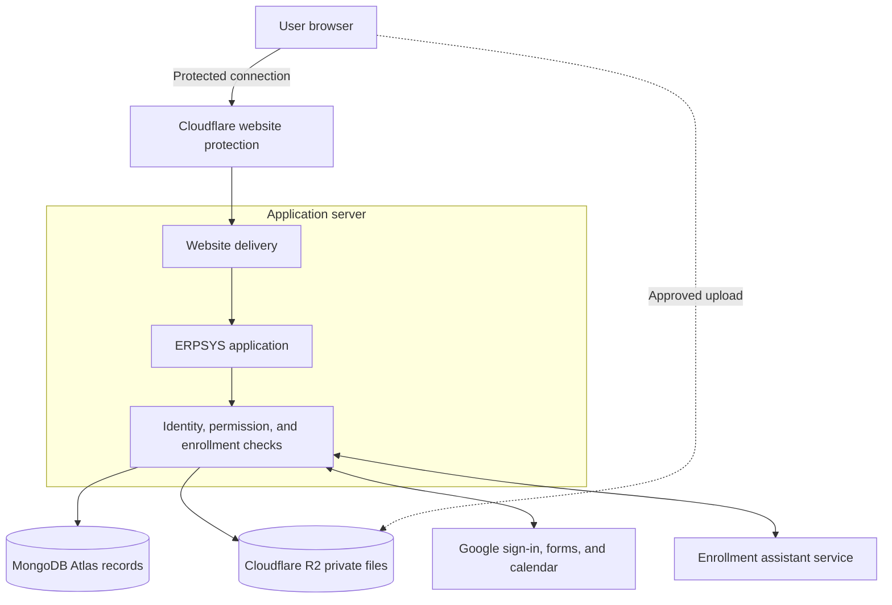
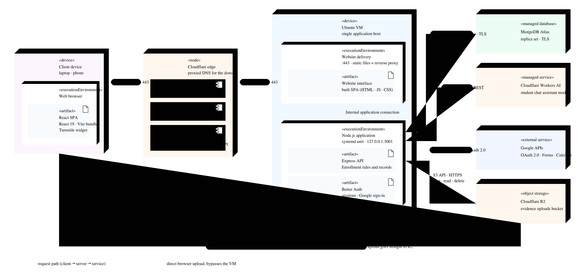

# ERPSYS — Enrollment Records and Processing System

**BUKIDNON STATE UNIVERSITY**
**COLLEGE OF TECHNOLOGIES**
**INFORMATION TECHNOLOGY DEPARTMENT**

A Project Presented to

> **TODO (author):** Add the panel members and adviser in the format required by the department.

Of the Information Technology Department

In Partial Fulfillment of the Requirements for the Courses

- IT133 — Systems Integration and Architecture 1
- IT137 — Elective 3: Integrative Programming and Technologies 2
- IT132 — Advanced Database Systems
- IT135 — Information Assurance and Security 1

**By:**

Ybanez, Alistair
Digal, John Paul
Cantiver, Miershan
Palmares, Melvis Alfonse

**1st Semester, AY 2026–2027**

## Document Scope

This paper presents Chapters 1–5, references, and supporting appendices. Detailed API documentation is provided in a separate companion document. The chapters use ordinary language, with technical terms explained in Section 1.6.

Items marked **TODO (author)** or **TODO (figure)** require information, images, or measured results from the project team. A proposed target is not a verified result. Interview findings, actual deployment arrangements, test results, and office approval must be confirmed before final submission.

## Table of Contents

The Word version includes an automatic table of contents. Update its fields after the final layout.

> **TODO (author):** Complete the list of figures and list of tables after all required exhibits are supplied.

# Chapter 1 — INTRODUCTION

## 1.1. Background of the Organization

The client of this project is the College of Technology Student Body Organization of Bukidnon State University, referred to as the SBO. The organization helps students complete the requirements checked before enrollment. SBO officers review these requirements and coordinate with the enrollment advisers assigned to the departments.

> **TODO (author):** Confirm the organization's official name, office location, interview date, and interviewee.

### 1.1.1. History

The process described for this project used printed requirement sheets. Students brought receipts, screenshots, photographs, and forms to the office. An officer checked the materials and stamped the sheet when a requirement was accepted. The student then approached an adviser for the final enrollment step.

This process depended on the officer's availability and the safekeeping of printed sheets. Students might have to return because an officer was unavailable or a requirement was incomplete. A lost sheet could make it difficult to confirm earlier checks.

ERPSYS keeps the officer's and adviser's responsibilities but records their work online. Students submit evidence through the website, officers review it, and the system keeps the decision and the person responsible.

> **TODO (author):** Support this account with the interview record. Add the organization's founding year, mandate, and the period when the printed process was used.

### 1.1.2. Nature of Operations

The workflow has six steps: Assessment, Social Media, Profiling, Mugshot, Consent / Medical, and Enrollment. The first five must be verified before a student joins an enrollment queue. An officer can accept a submission, return it with an explanation, or withdraw an earlier approval when a correction is needed.

The office keeps the evidence and decision history. Advisers manage department queues, attend to students in order, and record completion. Reports summarize step completion, department student lists, and individual enrollment records.

### 1.1.3. Demographics

The office's working estimate is approximately 1,400–1,500 students. ERPSYS serves four user groups.

| User group          | Responsibility                                                       |
| ------------------- | -------------------------------------------------------------------- |
| Students            | Submit requirements, follow progress, and join the enrollment queue. |
| SBO officers        | Review submissions and record verification decisions.                |
| Enrollment advisers | Manage department queues and complete enrollment.                    |
| Administrators      | Manage accounts, departments, academic years, and settings.          |

> **TODO (author):** Confirm the student estimate and the numbers of departments, officers, and advisers using approved office records.

### 1.1.4. Organizational Chart

> **TODO (figure):** Figure 1.1 — Approved SBO organizational chart showing its adviser, officers, and supervisory relationships.

The chart identifies who supervises the people using ERPSYS. The administrator assigns permissions according to approved duties. A user does not receive officer or administrator privileges simply by requesting them.

### 1.1.5. Functional Chart

> **TODO (figure):** Figure 1.2 — Functional chart connecting each task to its responsible person or office.

| Function                                | Responsible user   | Working area            |
| --------------------------------------- | ------------------ | ----------------------- |
| Review and approve submissions          | SBO officer        | Officer dashboard       |
| Return submissions or withdraw approval | SBO officer        | Officer dashboard       |
| Capture and review photographs          | SBO officer        | Officer dashboard       |
| Manage required social-media links      | SBO officer        | Officer dashboard       |
| Attend to the department queue          | Enrollment adviser | Adviser dashboard       |
| Complete or correct enrollment          | Enrollment adviser | Adviser dashboard       |
| Manage accounts and permissions         | Administrator      | Administrator dashboard |
| Manage departments and academic years   | Administrator      | Administrator dashboard |

## 1.2. Business Processes

### 1.2.1. Information Asset Identification

Information assets are the records and materials the office needs to protect:

- **Account information:** Names, email addresses, sign-in information, and permissions.
- **Student records:** Student numbers, year levels, departments, contact details, and enrollments.
- **Evidence:** Assessment proof, screenshots, profiling responses, photographs, and consent or medical forms.
- **Decisions:** Approvals, digital stamps, feedback, and withdrawn approvals.
- **Office settings:** Academic years, departments, adviser assignments, requirements, schedules, and connected services.
- **Activity records:** Notifications, administrative actions, and service-usage information.

### 1.2.2. List of Information Assets

Table 1.1 List of Information Assets for ERPSYS

| Asset                         | Responsible party   | Sensitivity | Purpose                                                |
| ----------------------------- | ------------------- | ----------- | ------------------------------------------------------ |
| Student identity              | Administrator       | High        | Identify students and their department and year level. |
| Enrollment evidence           | Student and officer | High        | Support requirement review.                            |
| Photographs and consent forms | SBO officer         | High        | Support identity checks and required consent.          |
| Verification decisions        | SBO officer         | High        | Show who checked a requirement and when.               |
| Queue records                 | Enrollment adviser  | Medium      | Keep the service order clear and fair.                 |
| Enrollment completion         | Enrollment adviser  | High        | Record completion for the academic year.               |
| Reports                       | SBO and department  | Medium      | Summarize progress and completed work.                 |
| Activity history              | Administrator       | Medium      | Help review important changes.                         |
| Office settings               | Administrator       | Medium      | Keep periods, requirements, and departments correct.   |

Student identity, evidence, and decisions need particular care because they contain personal information or support official work. Reports can also contain personal data and must go only to authorized recipients. Evidence is not intended for public file links; the system checks whether a person may view it.

### 1.2.3. Weighted Factor Analysis

Records are prioritized according to their privacy, importance to enrollment, and the difficulty of correcting loss or misuse.

- **Identity records — High:** Exposure or mistakes may harm privacy or prevent identification.
- **Evidence and photographs — High:** These may contain faces, signatures, and private details.
- **Verification decisions — High:** A missing or wrong approval can affect a student's progress.
- **Enrollment completion — High:** The office must rely on the final record.
- **Queue records — Medium:** Errors can delay students or cause unfair service.
- **Settings and history — Medium:** Wrong settings may affect many students; missing history makes investigation harder.

These are qualitative priorities, not a completed numerical weighting study.

> **TODO (author):** Add approved weights and calculations if the course requires numerical weighted analysis.

### 1.2.4. Threat Identification

Possible threats include human mistakes, shared or stolen accounts, automated attacks, unavailable services, lost or exposed records, and heavy enrollment traffic. Each can affect privacy, record accuracy, or the office's ability to continue working.

For example, an officer might review the wrong submission, an administrator might choose the wrong academic year, or several users might attempt conflicting queue actions. A provider outage can also interrupt a connected feature.

### 1.2.5. Vulnerability Database

Table 1.2 Vulnerability Database for ERPSYS

| Possible weakness               | Affected information         | Priority | Protective measure                                  |
| ------------------------------- | ---------------------------- | -------- | --------------------------------------------------- |
| Weak or reused passwords        | Accounts and private records | High     | Sign-in protection and limits on repeated attempts. |
| Unprotected file access         | Evidence and photographs     | High     | Private storage and access checks.                  |
| Actions outside assigned duties | Decisions and queues         | High     | Permission checks and rules for allowed actions.    |
| Incorrect settings              | Enrollment records           | Medium   | Restricted changes and an activation preview.       |
| Excessive requests              | Overall service              | Medium   | Request limits and efficient screen loading.        |
| Slow searches                   | Student and queue lists      | Medium   | Organized searches and limited list sizes.          |

These entries guide review. They do not replace a security assessment of the hosted system.

### 1.2.6. Vulnerability Assessment

**High-priority controls:** Check identity and permissions, protect private evidence, and record important administrative actions. Officers should use personal accounts so that decisions can be traced to the responsible person.

**Medium-priority controls:** Check queue actions against the latest saved information, load common screens efficiently, and review office settings before each enrollment period.

Testing and office review are needed to establish how well these controls work in practice.

## 1.3. Background of the System

ERPSYS brings requirements, review decisions, department queues, and completion records together in one website. Students can check what is missing before visiting the office. Officers can review evidence and explain corrections. Advisers can see who is waiting and record completed enrollment.

The website has a part users see in their browser and a server that checks requests and saves records. MongoDB Atlas keeps records, while Cloudflare R2 stores files privately. Other connections support Google sign-in, protection against automated requests, profiling forms, adviser schedules, and enrollment guidance.

The project applies four courses. Database concepts support consistent records. Systems integration connects services. Information security guides privacy and permissions. Integrative programming brings the screens and supporting services together.

## 1.4. Objectives

### 1.4.1. General Objectives

To develop and evaluate a web-based enrollment records and processing system for the SBO that replaces paper-based checks and the physical waiting line with an organized online process.

### 1.4.2. Specific Objectives

The project aims to:

1. Identify the office's requirements, review steps, and queue rules.
2. Design working areas for students, officers, advisers, and administrators.
3. Develop the six steps, evidence submission, feedback, digital stamps, queues, completion records, reports, and settings.
4. Connect the services needed for sign-in, storage, request protection, profiling, schedules, and guidance.
5. Test functions, permissions, and simultaneous actions.
6. Prepare the paper, separate API documentation, and operating instructions.

## 1.5. Scope and Limitations

The project covers account registration through the final enrollment record. Students follow six steps, submit evidence, receive feedback, and join an eligible department queue after the first five steps are verified. Officers review submissions. Advisers manage queues and complete or correct enrollments. Administrators manage users, departments, years, requirements, and connected services. Reports, website notifications, and an assistant support the workflow.

ERPSYS does not process tuition payments, grades, class scheduling, or curriculum records. Assessment records the office's check, while payment remains in the university's existing process. Notifications do not include SMS delivery.

A screenshot or scan is not automatically proof of authenticity; the officer must examine it. The assistant provides office-approved guidance and does not make enrollment decisions.

The design uses one application server. A server or internet interruption can prevent users from continuing. External services have their own availability and usage limits. Proposed safeguards and unmeasured targets must not be presented as proven results.

## 1.6. Definition of Terms

Following the reference's approach, this section explains technical concepts used in the study, adapted to ERPSYS.

- **API (Application Programming Interface):** An agreed way for software systems to exchange requests and information. It connects the ERPSYS screens to the server and other services.
- **Authentication:** Checking who a person is, such as through a password or trusted sign-in service.
- **Authorization:** Checking what a signed-in person is allowed to view or change.
- **Concurrency:** Two or more users or tasks working at the same time, such as advisers updating a queue.
- **Concurrency Control:** Rules that prevent simultaneous actions from producing conflicting records.
- **Database:** An organized collection of information, such as student details and decisions.
- **Encryption:** Protecting information by changing it into a form that requires the correct key to read.
- **FIFO (First In, First Out):** Serving the student who joined the queue first before later arrivals, under normal conditions.
- **Google Calendar API:** A service that can copy an adviser's schedule to a connected Google Calendar.
- **Google Forms API:** A service that helps create and manage the student profiling form.
- **Google Sign-In:** Signing in with a Google account rather than entering a separate password into ERPSYS.
- **HTTPS (Hypertext Transfer Protocol Secure):** A protected connection between a browser and a website.
- **JWT (JSON Web Token):** A signed digital token that can carry identity claims. Its signature helps detect changes but does not itself hide the contents. The reference discusses JWT; ERPSYS uses server-managed sessions and browser cookies for regular sign-in, not a custom JWT login scheme.
- **MERN Stack:** MongoDB, Express, React, and Node.js used together to build a website and server.
- **MongoDB Atlas:** A hosted database service used for ERPSYS records.
- **OAuth 2.0:** A standard for granting limited access without sharing a user's password. It supports the configured Google connections.
- **RBAC (Role-Based Access Control):** Assigning permissions according to duties, such as student, officer, adviser, or administrator. RBAC is the standard abbreviation.
- **Responsive Interface:** A layout that adjusts to phones, computers, and other screen sizes.
- **RESTful API:** An API design using web requests to read, add, change, or remove information.
- **Session:** A record allowing the system to recognize a user after sign-in until expiration or sign-out.
- **Timestamp Ordering:** A concurrency-control method using transaction order to prevent older operations from conflicting with newer work.
- **Cloudflare R2:** Private storage for evidence, photographs, and stamp images.
- **Cloudflare Turnstile:** A service helping distinguish ordinary requests from automated activity.
- **Cloudflare Workers AI:** A service supporting the enrollment assistant within configured limits.
- **Audit Trail:** A history of who performed an important action, what it affected, and when.
- **Digital Stamp:** An officer's recorded approval with the configured name, stamp, or signature image.
- **Evidence:** A file, form response, or permitted link supporting a requirement.

# Chapter 2 — RISK & SYSTEM ANALYSIS

## 2.1. Risk Analysis

Risk analysis considers what could go wrong, how likely it is, and how serious the effect might be. Ratings below are planning judgments for office review.

### 2.1.1. TVA Worksheet

The Threat–Vulnerability–Asset worksheet links an important asset to a threat and possible weakness.

Table 2.1 ERPSYS Threat–Vulnerability–Asset Worksheet

| Asset             | Threat                      | Possible weakness                  | Effect                                      | Priority |
| ----------------- | --------------------------- | ---------------------------------- | ------------------------------------------- | -------- |
| Student account   | Account takeover            | Reused password                    | Private records accessed by another person. | High     |
| Evidence          | Unauthorized viewing        | Unprotected file access            | Private documents exposed.                  | High     |
| Verification      | Incorrect approval          | Action outside assigned duties     | A requirement wrongly accepted.             | High     |
| Queue             | Conflicting actions         | Two updates accepted for one place | Duplicate or unfair service.                | Medium   |
| Enrollment        | Wrong completion            | Insufficient checking              | Incorrect status.                           | High     |
| Settings          | Accidental change           | Wrong year or service selected     | Many users blocked.                         | Medium   |
| Website           | Heavy traffic               | Limited capacity                   | Delayed or interrupted work.                | High     |
| Server            | Unauthorized access         | Poor access protection             | Records exposed or changed.                 | High     |
| Connected service | Outage or leaked credential | Provider dependence                | A feature unavailable.                      | Medium   |
| Assistant         | Usage limit reached         | Shared daily allowance             | Guidance temporarily unavailable.           | Low      |

### 2.1.2. Likelihood Scale

Table 2.2 ERPSYS Likelihood Scale

| Rating | Label          | Meaning                                         |
| ------ | -------------- | ----------------------------------------------- |
| 1      | Rare           | Expected only in unusual circumstances.         |
| 2      | Unlikely       | Possible but not expected in a normal semester. |
| 3      | Possible       | Could happen during ordinary use.               |
| 4      | Likely         | Expected during an enrollment period.           |
| 5      | Almost certain | Expected repeatedly.                            |

### 2.1.3. Risk Impact Scale

Table 2.3 ERPSYS Risk Impact Scale

| Rating | Label       | Meaning                                                   |
| ------ | ----------- | --------------------------------------------------------- |
| 1      | Negligible  | Small inconvenience without record loss.                  |
| 2      | Minor       | One student or task affected; straightforward correction. |
| 3      | Moderate    | A department or task interrupted for hours.               |
| 4      | Significant | Several departments affected or a working day lost.       |
| 5      | Severe      | Private data exposed or important records damaged.        |

The score is likelihood multiplied by impact. Scores of 15–25 are High, 6–14 are Medium, and 1–5 are Low. These are priority judgments, not measured probabilities.

### 2.1.4. Risk Control Strategy

Table 2.4 ERPSYS Risk Control Strategies

| Risk                          | Likelihood × Impact | Score | Strategy                                                   |
| ----------------------------- | ------------------- | ----- | ---------------------------------------------------------- |
| Password attacks              | 4 × 4               | 16    | Limit attempts and protect sign-in.                        |
| Evidence exposure             | 3 × 5               | 15    | Keep files private and check access.                       |
| Unauthorized review           | 3 × 5               | 15    | Check the user's role and review permission.               |
| Conflicting queue actions     | 3 × 3               | 9     | Check the latest records before updating.                  |
| Wrong enrollment status       | 3 × 5               | 15    | Check prerequisites and allow controlled corrections.      |
| Wrong academic year           | 3 × 4               | 12    | Preview activation and restrict it to administrators.      |
| Heavy traffic                 | 4 × 5               | 20    | Reduce requests, set limits, and test capacity.            |
| Server compromise             | 3 × 5               | 15    | Restrict management access and maintain software.          |
| Service outage                | 3 × 4               | 12    | Disable the affected feature and explain the interruption. |
| Assistant allowance exhausted | 3 × 1               | 3     | Limit usage and direct students to an officer.             |

Hosting controls and office procedures must be checked in the deployed environment rather than assumed from the application alone.

## 2.2. Requirements

### 2.2.1 Functional Requirements

The following requirements cover the implemented user workflows and are grouped by user. The tables contain only requirements and descriptions.

Table 2.5 Functional Requirements — Student

| Requirement                      | Description                                                                                                        |
| -------------------------------- | ------------------------------------------------------------------------------------------------------------------ |
| Registration                     | Register using the required student number and email details.                                                      |
| Login                            | Sign in with email and password or Google.                                                                         |
| Enrollment progress              | View the six steps and their status.                                                                               |
| Assessment application           | Request the assessment check.                                                                                      |
| Evidence upload                  | Upload required screenshots, photographs, or scans.                                                                |
| Evidence submission and deletion | Submit evidence for review and remove uploads when allowed.                                                        |
| Queue entry                      | Join an eligible queue after prerequisites are complete and an adviser is available.                               |
| Queue position and exit          | View the waiting position and leave before service.                                                                |
| Notifications                    | Read requirement and queue updates.                                                                                |
| Read indicators                  | Mark notifications as read.                                                                                        |
| Onboarding                       | Complete missing student-number and current-year enrollment details before continuing.                             |
| Profile corrections              | Update eligible course and year-level details; changes are restricted while queued or after enrollment completion. |
| Enrollment history               | View available records from earlier enrollment periods.                                                            |
| Queue invitations                | Open a shared queue link and confirm leaving another queue before switching.                                       |
| Published office hours           | View an adviser's published hours separately from live queue availability.                                         |
| Enrollment record                | Preview and download the student's own enrollment record.                                                          |

Table 2.6 Functional Requirements — SBO Officer

| Requirement               | Description                                                      |
| ------------------------- | ---------------------------------------------------------------- |
| Login                     | Sign in using email and password or Google.                      |
| Logout                    | Sign out.                                                        |
| Submission filtering      | Find submissions by requirement, status, and date.               |
| Submission details        | Inspect student details, evidence, and history.                  |
| Digital verification      | Record approval with a digital stamp.                            |
| Return or withdrawal      | Return with feedback or withdraw an earlier approval.            |
| Social-media links        | Add and edit required links.                                     |
| Link order and deletion   | Reorder or remove social-media links.                            |
| Profiling form viewing    | View the form linked to the enrollment period.                   |
| Profiling form management | Create or unlink the form when the service is available.         |
| Stamp viewing             | View personal stamp details.                                     |
| Stamp updates             | Change the stamp name, image, and signature.                     |
| Photograph review         | Review and verify student photographs.                           |
| Consent review            | Review and verify consent forms.                                 |
| Reports                   | Filter, preview, and download reports for assigned requirements. |

Table 2.7 Functional Requirements — Enrollment Adviser

| Requirement              | Description                                                                                                 |
| ------------------------ | ----------------------------------------------------------------------------------------------------------- |
| Login                    | Sign in using email and password or Google.                                                                 |
| Logout                   | Sign out and close availability.                                                                            |
| Department availability  | Open or close the department for students.                                                                  |
| Availability maintenance | Confirm continuing activity so outdated availability can close.                                             |
| Queue monitoring         | See waiting students and current service.                                                                   |
| Enrolled-student lists   | View completed enrollments by department.                                                                   |
| Next student             | Attend to the next eligible waiting student.                                                                |
| End service or requeue   | Stop service or move a student to the end.                                                                  |
| Enrollment completion    | Complete enrollment after required checks.                                                                  |
| Enrollment correction    | Undo an incorrect completion through the allowed process.                                                   |
| Department details       | Create and update department information when permitted.                                                    |
| Department assignment    | Select an eligible department and offered year levels without overlapping another adviser's responsibility. |
| Queue invitations        | Create and share an invitation to the department queue for the current academic year.                       |
| Waiting-student removal  | Remove a waiting student and briefly undo the removal to restore the original position.                     |
| Department handover      | Request, accept, decline, or cancel a transfer of department or year-level responsibility.                  |
| Unanswered handover      | Allow the defined waiting period before an unanswered request transfers responsibility automatically.       |
| Office-hour scheduling   | Publish recurring or one-off hours, cancel specific dates, and remove schedule entries.                     |
| Calendar connection      | Connect, synchronize, or disconnect an optional Google Calendar copy of published hours.                    |
| Student reminders        | Send in-app reminders to selected students with unfinished requirements.                                    |
| Student roster           | View students in assigned departments.                                                                      |
| Reports                  | Filter, preview, and download department reports.                                                           |

Table 2.8 Functional Requirements — Administrator

| Requirement                   | Description                                                                                                                                  |
| ----------------------------- | -------------------------------------------------------------------------------------------------------------------------------------------- |
| Login                         | Sign in using email and password or Google.                                                                                                  |
| Logout                        | Sign out.                                                                                                                                    |
| Statistics                    | View user, verification, and queue summaries.                                                                                                |
| Activity history              | Review recorded administrative actions.                                                                                                      |
| User search and management    | Find accounts using available filters.                                                                                                       |
| Permissions                   | Change allowed account roles individually or in groups.                                                                                      |
| Student search                | Find students by name, email, or student number.                                                                                             |
| Password assistance           | Help restore access through the password-reset process.                                                                                      |
| Department names and codes    | Create and update department information.                                                                                                    |
| Department status             | Activate or deactivate departments.                                                                                                          |
| Academic-year management      | Create, edit, and delete eligible year records.                                                                                              |
| Year activation               | Preview and confirm the active period.                                                                                                       |
| Adviser assignments           | View department assignments.                                                                                                                 |
| Adviser mapping               | Assign advisers to departments.                                                                                                              |
| Assessment requirements       | Create, edit, and delete assessment items.                                                                                                   |
| Requirement order             | Reorder assessment items.                                                                                                                    |
| Assistant information         | View approved guidance.                                                                                                                      |
| Assistant updates             | Revise the guidance used by the assistant.                                                                                                   |
| Reports                       | Filter, preview, and download administrative reports.                                                                                        |
| Account blocking              | Block accounts with recorded activity, end their sessions, and clear affected queue or availability state.                                   |
| Account deletion              | Delete eligible inactive accounts or permanently remove an already-blocked non-administrator account through the separate permitted process. |
| Integration switches          | Enable or disable optional connected services.                                                                                               |
| Integration credentials       | Edit credentials, receive validation feedback, and save protected settings.                                                                  |
| Credential recovery           | Restore configured defaults or export credentials after additional identity checks.                                                          |
| Sensitive-action confirmation | Confirm identity through the ordered security checks before changing protected integration settings.                                         |
| Authenticator management      | View administrator enrollment status and perform an authorized authenticator reset.                                                          |

Students can submit only when submission is allowed. Officers review items awaiting a decision. All five pre-enrollment steps must be verified before queue entry and final enrollment. An adviser must not serve more than one student at a time. Important administrative changes must be recorded.

Advisers can share a department by taking responsibility for different offered year levels. A handover request lets the current owner accept or decline, and the requester may cancel. An unanswered request can transfer automatically after ten minutes for an active owner or one minute for an inactive owner. A partial handover leaves the owner's other year levels unchanged.

Only waiting students may be removed through the queue-removal action. A five-second Undo option restores the original position, and the student receives an in-app notice. This is separate from moving a student to the end or undoing enrollment completion.

Published office hours tell students when an adviser plans to be available; they do not automatically open or close the queue. Advisers can remind selected students about unfinished requirements in batches of up to 200. Students whose enrollment is already complete are skipped.

Password recovery has two paths. Administrators can set a replacement student password. The system also supports emailed reset links when email is configured, but the current forgot-password screen directs users to staff rather than requesting a link itself.

> **TODO (figure):** Figure 2.1 — Traceability matrix linking requirements to screens, API operations, and test evidence.

### 2.2.2 Non-Functional Requirements

These are quality requirements and operating targets, not claims of measured achievement.

| Attribute       | Requirement                                                                                  |
| --------------- | -------------------------------------------------------------------------------------------- |
| Performance     | Load common screens promptly without repeatedly downloading unchanged information.           |
| Capacity        | Test 300 simultaneous students and a peak of 1,000 without lost queue or enrollment records. |
| Availability    | Aim for 99% availability during enrollment week and limit update interruptions.              |
| Recovery        | Aim to restore service within one hour and lose no more than 24 hours of database changes.   |
| Security        | Check identity, permission, and submitted information before protected actions.              |
| Integrity       | Check changes against the latest saved records.                                              |
| Accountability  | Record who made important changes, what was affected, and when.                              |
| Usability       | Show the next action clearly on phones and computers.                                        |
| Maintainability | Keep the application organized and changes testable.                                         |
| Portability     | Support a suitably configured server with protected settings.                                |
| Monitoring      | Provide enough information to recognize and investigate failures.                            |

The application already combines landing-screen information into one request and restores selected saved browser data before refreshing it. This reduces repeated requests but does not establish a measured speed improvement. Saved data has a 24-hour ceiling; queue positions older than two minutes are hidden until refreshed, and sign-out clears the saved information.

Capacity figures remain targets. A load-testing tool and automated load checks exist, but parts still expect an older request format and operational services not exposed by the current application. They must be reconciled before a run can support claims about 300 or 1,000 simultaneous students.

### 2.2.3. Database Schema

A schema describes how information is organized. MongoDB groups related records into collections. Identifiers connect accounts, evidence, decisions, and queue entries to the correct student and enrollment period.

Table 2.9 Main Record Groups

| Record group                   | Information kept                                                          |
| ------------------------------ | ------------------------------------------------------------------------- |
| Accounts and sessions          | Identity, email, permission, and sign-in sessions.                        |
| Academic years                 | Enrollment periods and active year.                                       |
| Student profiles               | Student number, department, year level, and contacts.                     |
| Enrollments                    | A student's record for a particular year.                                 |
| Requirements and verification  | Definitions, status, decisions, and feedback.                             |
| Evidence                       | Ownership, file type and size, and private storage reference.             |
| Profiling and social links     | Linked form and required social-media links.                              |
| Notifications                  | Updates for individual users.                                             |
| Departments and advisers       | Department details and assignments.                                       |
| Queues                         | Waiting order, current service, and completed work.                       |
| Availability and schedules     | Current availability and office hours.                                    |
| Transfers                      | Requests to hand over department responsibility.                          |
| Activity history               | Important changes and responsible users.                                  |
| Administrator verification     | Temporary confirmation progress and authenticator enrollment information. |
| Protected integration settings | Encrypted credential overrides and their saved version.                   |
| Assistant and settings         | Approved guidance, usage, and connected-service settings.                 |

Records include creation and update times. Database checks help avoid conflicting queue records. Files remain in private storage; the database keeps the information linking them to their owner and requirement.

> **TODO (figure):** Figures 2.2–2.6 — Relationship diagrams for accounts, evidence, queues, enrollment, and settings.

### 2.2.4 System Interface and Execution

The following guide follows the reference's sequence of preparing the environment, starting the program, opening the interface, and stopping the program.

**A. System Environment Setup**

1. **Browser:** Use a current Chrome, Edge, Firefox, or Safari browser. Internet access and JavaScript are required. Ordinary users do not install development tools.
2. **Server requirements:** The maintainer needs a supported Node.js version compatible with the project dependencies, pnpm, and a configured MongoDB database.
3. **Service settings:** Configure credentials for the features being used. Keep them in protected settings, not in the paper or shared screenshots.
4. **Website requirements:** A phone or computer can access the site. A larger screen is recommended for document review and student-list management.

**B. Starting the Program for Development**

The maintainer opens a terminal in the project's main folder. Install dependencies once, or after the dependency list changes:

```bash
pnpm install
```

Start the server and website together:

```bash
pnpm dev
```

Wait for both applications to report readiness. The server normally uses port 3001. Open the website address printed by the development process, which may change if the usual port is occupied. The server address alone is not the student interface.

**C. Using the Interface**

Sign in to open the working area allowed by the account. Students see progress, officers see submissions, advisers see queues, and administrators see accounts and settings. Sign out after work, especially on a shared device.

**D. Stopping the Program**

For local development, return to the running terminal and press **Ctrl+C**. Wait for the processes to stop. Closing a browser or signing out does not stop the shared server.

Only an authorized maintainer should start, stop, or restart the hosted service using the approved hosting procedure. Inform users before planned interruptions.

Some credential changes are saved before they take effect in the running service. The administrator must check any pending-restart notice and coordinate a restart with the maintainer. Restoring configured defaults is different from importing a backup, and a downloaded credential export must be treated as confidential.

# Chapter 3 — SYSTEM DESIGN & DEVELOPMENT

## 3.1. Solution Design

The browser displays screens. The server checks identity, permission, and enrollment rules. The database saves records, and private storage keeps files.

| Part          | Technology             | Responsibility                                        |
| ------------- | ---------------------- | ----------------------------------------------------- |
| Interface     | React                  | Displays the four user working areas.                 |
| Communication | REST API over HTTPS    | Exchanges protected requests and responses.           |
| Server        | Node.js and Express    | Checks actions and applies rules.                     |
| Records       | MongoDB Atlas          | Saves student, review, queue, and office information. |
| Files         | Cloudflare R2          | Stores evidence privately.                            |
| Hosting       | One application server | Makes the site available.                             |

A screen button is not the final authority. The server checks the latest records before allowing submissions, approvals, queue actions, or completion. This matters when people use the system at the same time.

The website and API use the same site address, simplifying sign-in and communication. Administrators can change office settings without rebuilding the whole application.

## 3.2. Architectural Views

The diagrams show activities, user journeys, and responsibilities using ordinary descriptions.

### 3.2.1. Logical View (Activity Diagram)

**Figure 3.1** Student submission of evidence.



The system checks whether submission is allowed and the evidence is complete. Assessment is similar, but the student requests a check rather than uploading evidence for that request.

**Figure 3.2** Officer review.



The officer accepts or returns a submission. An incorrect approval can be withdrawn. The student receives the outcome and can act on feedback.

**Figure 3.3** Student queue entry.



The first five requirements must be verified before queue entry. If joining is unavailable, the system explains why. Waiting students can view their position and leave when allowed. A shared invitation shows the target queue; switching from another queue requires confirmation before the old place is given up.

**Figure 3.4** Adviser service and completion.



Advisers serve one student at a time. Completion requires verified prerequisites. Availability must stay current so students are not directed to an inactive adviser. Waiting-list removal has a brief Undo option that restores the original position; it cannot remove a student being served or already completed.

Adviser responsibility is managed separately through department and year-level assignments. Handover requests may be accepted, declined, cancelled, or resolved after the defined waiting period. Published hours describe planned service, while live availability controls whether students can join.

**Figure 3.5** Academic-year activation.



The administrator previews the change before activation. Connecting records to a year helps prevent one period's work from being mixed with another's.

### 3.2.2. Process View (User Flow Diagram)

**Figure 3.6** Sign-in and working areas.



The assigned responsibility determines the first working area. Students with missing identity or current-year enrollment details complete onboarding before continuing. Eligible profile corrections and earlier enrollment records are available from the student area. The server checks permission even when a user types a protected address directly.

| User               | Main area               | Other permitted area                      |
| ------------------ | ----------------------- | ----------------------------------------- |
| Student            | Student dashboard       | None by default.                          |
| SBO officer        | Officer dashboard       | Student dashboard.                        |
| Enrollment adviser | Adviser dashboard       | None by default.                          |
| Administrator      | Administrator dashboard | Other areas permitted by the role policy. |

### 3.2.3. Scenario View (Use-Case Diagram)

**Figure 3.7** Users and main functions.



Connected services support sign-in, forms, schedules, storage, request protection, and guidance. They do not replace officer review or the adviser's decision.

## 3.4. Project Schedule

**Figure 3.8** Working schedule for the first semester of AY 2026–2027.



This is a working plan, not proof that every activity finished on these dates.

Table 3.1 Project Phases

| Phase         | Activities                                            | Planned dates                 |
| ------------- | ----------------------------------------------------- | ----------------------------- |
| Planning      | Interview, requirements, scope, and overall design.   | June 15–July 10, 2026         |
| Design        | Screens, records, permissions, and queue rules.       | July 13–August 7, 2026        |
| Development   | Working areas, integrations, reports, and assistant.  | August 10–September 25, 2026  |
| Testing       | Feature, permission, capacity, and acceptance checks. | September 14–October 16, 2026 |
| Documentation | Paper, API documentation, and operating guidance.     | October 5–30, 2026            |
| Deployment    | Hosting setup and release preparation.                | October 19–November 6, 2026   |

> **TODO (author):** Confirm dates using the approved schedule and completion records.

## 3.5. Integration Strategies

Following the reference, each integration is described through its role, benefits, and conclusion rather than a table.

### 3.5.1. API Integrations and Interactions

**A. Google Sign-In**

- **Role:** Lets users sign in with Google while ERPSYS checks account permissions.
- **Benefits:** Offers a familiar sign-in process and reduces the need for another password.
- **Conclusion:** Google provides convenient sign-in; ERPSYS still decides what the user may do.

**B. Cloudflare Turnstile**

- **Role:** Helps detect automated registration and sign-in requests.
- **Benefits:** Reduces unwanted automated activity on public forms.
- **Conclusion:** It supports protection but does not replace password safeguards or permissions.

**C. Cloudflare R2**

- **Role:** Stores evidence, photographs, and stamp images privately.
- **Benefits:** Separates larger files from ordinary records and supports controlled access.
- **Conclusion:** Private storage assists document handling; the system controls access and review.

**D. Cloudflare Workers AI**

- **Role:** Supports answers based on office-approved enrollment information.
- **Benefits:** Helps students find routine guidance without immediately asking an officer.
- **Conclusion:** The assistant gives guidance, not enrollment decisions. Students should ask an officer when it cannot help.

**E. Google Forms**

- **Role:** Supports creation and linking of the profiling form when configured.
- **Benefits:** Provides a familiar way to collect profiling information.
- **Conclusion:** The form collects information; ERPSYS tracks progress and review. Related Google Drive permissions support form management, not primary evidence storage.

**F. Google Calendar**

- **Role:** Optionally copies an adviser's published office hours to a connected calendar.
- **Benefits:** Makes the schedule available in a familiar calendar.
- **Conclusion:** Calendar copying is optional and requires a separate connection. Published hours do not automatically open or close the queue.

**G. MongoDB Atlas**

- **Role:** Hosts student, requirement, decision, queue, and office records.
- **Benefits:** Provides a managed database for related information.
- **Conclusion:** It is essential infrastructure, not an optional student feature. Access and backups require maintainer confirmation.

**H. Report Generation**

- **Role:** Creates record sheets, step summaries, step registers, rosters, enrollment summaries, and user directories.
- **Benefits:** Provides permitted filters and preview before PDF download.
- **Conclusion:** Supports recordkeeping. Registers, rosters, and directories have a 1,000-row limit and warnings when shortened; summary totals are handled separately.

**I. Brevo Email**

- **Role:** Sends password-reset links and administrator confirmation codes.
- **Benefits:** Helps users recover access and confirm sensitive actions.
- **Conclusion:** Supports recovery and security when email is configured and delivered. It does not currently send requirement reminders by email.

**J. Authenticator**

- **Role:** Checks an app-generated code after the administrator's PIN, password, and emailed-code checks.
- **Benefits:** Adds protection before sensitive integration changes; successful confirmation grants a five-minute authorization window.
- **Conclusion:** Protects sensitive actions rather than every ordinary sign-in. Passwordless accounts skip the password check, and lost authenticator access requires an authorized reset.

Administrators control optional integrations through settings and can edit their credentials. The system checks required fields and, where supported, asks the provider to validate access before saving. Calendar settings receive local checks, and a successful email-service account check does not prove message delivery.

Saved credential overrides are encrypted, and ordinary settings responses hide their secret values. Additional identity checks protect changes, exports, and restoration of configured defaults. An export contains actual credentials and must not be attached to the paper or shared publicly.

Disabled or unavailable features should be explained clearly. A service switch is not a recovery plan, and a database interruption can affect the entire system.

### 3.5.2. Integration of Subject Components

**A. Advanced Database Systems**

- **Role:** Guides record organization, searches, and simultaneous updates.
- **Benefits:** Helps keep student details, decisions, and queue positions consistent.
- **Conclusion:** Database design supports accurate enrollment records.

**B. Systems Integration and Architecture**

- **Role:** Defines how screens, server, database, and services work together.
- **Benefits:** Gives each part a clear responsibility and communication method.
- **Conclusion:** Integration connects separate features into one workflow.

**C. Information Assurance and Security**

- **Role:** Guides identity checks, permissions, privacy, and action records.
- **Benefits:** Reduces unauthorized access and helps investigate mistakes.
- **Conclusion:** Protection belongs in every enrollment action.

**D. Integrative Programming and Technologies**

- **Role:** Connects screens and services through requests, responses, and updates.
- **Benefits:** Supports submissions, feedback, and queue work in one website.
- **Conclusion:** Programming turns the design into usable tasks.

### 3.5.3. Data Flow and Communication

**A. User Requests**

- **Role:** The browser sends a requested action through a protected connection.
- **Benefits:** The same rules apply across devices.
- **Conclusion:** The browser presents the action; the server decides if it is allowed.

**B. Checking and Saving**

- **Role:** The server checks identity, permissions, and transaction order before accepting a change.
- **Benefits:** Prevents older work from overwriting newer information; eligible server-started requests may retry up to three times before any write.
- **Conclusion:** A refused outdated action refreshes the affected information and asks the user to retry. Ordering assumes one application process and does not undo earlier writes across several records.

**C. Files and Connected Services**

- **Role:** Approved uploads go to private storage, and records link them to their owner. Enabled services support the remaining tasks.
- **Benefits:** Separates document storage from ordinary records and controls connected features.
- **Conclusion:** A successful upload is not approval; officer review remains separate.

**D. Responses and Updates**

- **Role:** The system returns current information or explains a refused action. Selected saved screen data can appear first while fresh data is requested, and assistant responses may arrive gradually.
- **Benefits:** Keeps users informed without treating an old screen as current truth.
- **Conclusion:** Clear feedback helps users correct problems and avoid outdated information.

**Figure 3.9** Deployment and communication overview.



The application checks actions and communicates with records, private files, and enabled services. Direct uploads require approval, and later file access still requires permission.

# Chapter 4 — SECURITY POLICY

## 4.1. IS Policy Document

These policies include application safeguards and operating duties. Hosting settings and office procedures must be confirmed before they are described as fully in place.

### 4.1.1. Hardware Security Policy

- **Server access:** Limit management to authorized maintainers.
- **Devices:** Lock unattended computers and avoid leaving private files on shared devices.
- **Maintenance:** Keep software updated and schedule disruptive work outside active enrollment when possible.

### 4.1.2. Software Security Policy

- **Updates:** Review and test changes before release.
- **Input:** Check submitted information before accepting it.
- **Errors:** Give understandable messages without exposing private internal details.
- **Settings:** Keep credentials out of shared documents and screenshots.

### 4.1.3. Network Communications Policy

- **Connections:** Use HTTPS and protected connections to supporting services.
- **Sessions:** Protect sign-in information and sign out after work.
- **Management:** Restrict server and database access.
- **Evidence:** Do not publish unrestricted file links.
- **Status information:** Review public service information and restrict sensitive details.

### 4.1.4. Data Policy

- **Collection:** Collect only what enrollment needs.
- **Access:** Limit viewing and changes according to duties.
- **Retention:** Obtain office approval for how long records and evidence remain stored.
- **Sharing:** Send personal-data reports only to authorized recipients.
- **Disposal:** Follow the approved process for deleting records and exported copies.

> **TODO (author):** Supply the approved retention period and disposal procedure. Indefinite storage is not automatically an approved policy.

### 4.1.5. Process Policy

Review and test changes, announce planned interruptions, record important administrative actions, and follow the response procedures in Section 4.5.

### 4.1.6. People Policy

Use personal accounts rather than shared staff logins. Grant privileges only to approved users. Explain why evidence is collected and who may see it. Report suspected misuse to the SBO adviser and responsible university office.

## 4.2. IT Security Management Framework

The framework connects safeguards with the people responsible for applying them.

### 4.2.1. Legal Compliance

The Data Privacy Act of 2012 provides the Philippine legal context for personal information. The university must confirm the proper basis for collection, privacy notice, retention rules, and breach response. Software controls alone do not establish legal compliance.

Applicable university IT policies and software-license conditions must also be followed.

> **TODO (author):** Cite approved university policies and record the responsible office's review.

### 4.2.2. Security Governance Standard

The design uses common web-security practices informed by OWASP guidance. This is not a claim of certification.

| Area       | Practice                                                      |
| ---------- | ------------------------------------------------------------- |
| Identity   | Use maintained sign-in tools and protect sessions.            |
| Permission | Refuse actions outside assigned duties.                       |
| Input      | Check format and allowed values.                              |
| Display    | Prevent unsafe submitted content from acting as instructions. |
| History    | Record useful actions without secrets.                        |
| Updates    | Review dependencies and test changes.                         |
| Errors     | Explain problems without exposing private details.            |

## 4.3. Network Security Testing

Testing must examine the actual hosted system. A design description does not establish which network protections are enabled.

### 4.3.1. Network and Server Profiling

Check internet-reachable services, the protected website connection, restricted management access, approved database connections, browser security settings, and error messages.

> **TODO (author):** Supply the authorized test scope, dated profiling report, and actual findings without credentials or private access details.

### 4.3.2. CVSS

The Common Vulnerability Scoring System, or CVSS, describes the seriousness of confirmed security weaknesses. Assign scores only after a finding and its conditions are established.

Table 4.1 Vulnerability Assessment Record

| Confirmed finding                          | Evidence        | CVSS version and score | Required action   | Retest      |
| ------------------------------------------ | --------------- | ---------------------- | ----------------- | ----------- |
| To be supplied from the actual assessment. | To be supplied. | Not assessed.          | To be determined. | Not tested. |

No confirmed scan results are supplied in this draft. Earlier possible risks are not automatically confirmed vulnerabilities.

## 4.4. Solution Design

The security design supports permitted work while making mistakes easier to detect and correct.

### 4.4.1. Policy Design

Check who made the request, their permission, and whether the action is allowed at that stage. Hiding a button is not enough because requests can be sent in other ways.

### 4.4.2. Logical Design

| Area               | Main functions                                                  |
| ------------------ | --------------------------------------------------------------- |
| Public             | Sign-in, registration, and public guidance.                     |
| Student            | Requirements, evidence, queue, and notices.                     |
| Officer            | Review, stamps, feedback, and reports.                          |
| Adviser            | Availability, queue, completion, and rosters.                   |
| Administrator      | Users, years, departments, requirements, services, and history. |
| Protected services | Records, private files, and service settings.                   |

Signed-out users must sign in. Users without the required permission receive an access refusal.

### 4.4.3. Physical Design



**Figure 4.1** Physical deployment diagram.

One application server hosts the website and its processing functions. Managed services keep records and files and support enabled features. Hosting templates are available, but they do not prove an active deployment or enabled provider protections.

The maintainer must confirm access restrictions, backups, and monitoring against the current application. Older readiness, detailed-metrics, and controlled-shutdown assumptions in the hosting material require review; the current application retains basic health checking, request limits, periodic cleanup, and simple shutdown handling.

### 4.4.4. Information Security Implementation Design

| Control                | Application                                                                               |
| ---------------------- | ----------------------------------------------------------------------------------------- |
| Sign-in checking       | Recognize valid sessions.                                                                 |
| Role permissions       | Limit actions to approved duties.                                                         |
| Password assistance    | Provide controlled account recovery.                                                      |
| Input checks           | Reject missing or unsuitable details.                                                     |
| File access            | Check who may upload or view files.                                                       |
| Request limits         | Reduce repeated or excessive requests.                                                    |
| History                | Record important administrative changes.                                                  |
| Secrets                | Encrypt saved credential overrides and hide secret values in ordinary settings responses. |
| Optional services      | Allow an affected feature to be disabled.                                                 |
| Sensitive settings     | Require ordered identity checks and limit the unlocked period.                            |
| Credential validation  | Check required fields and supported provider access before saving.                        |
| Authenticator recovery | Allow an authorized reset that clears enrollment and requires fresh setup.                |
| Blocked accounts       | End sessions and refuse new sign-in sessions for blocked users.                           |

The sensitive-settings check follows PIN, password, emailed code, and authenticator confirmation, with attempt limits. Accounts without a password skip that step. Successful confirmation lasts five minutes. Authenticator status can be reviewed, and an authorized reset removes the existing factor and its temporary authorization.

Account removal depends on activity. An account with recorded work is blocked rather than immediately erased; its sessions end and affected queue or availability records are cleared. Eligible inactive accounts can be deleted. Permanent removal of an already-blocked non-administrator account is a separate action, not the normal first step.

### 4.4.5. Intrusion and Detection Systems

The design does not claim a dedicated intrusion-detection installation. Detection depends on available application records, failed sign-in and request checks, hosting logs, and enabled provider protections. Someone must be assigned to review these records and respond.

> **TODO (author):** Name the monitoring person, warning signs, and notification method. Confirm enabled provider protections.

### 4.4.6. Secure Process Model

Follow planning, design, implementation, testing, review, and release. Test allowed actions, refused actions, and conflicting updates. Check changes for exposed credentials before sharing or release.

The project includes automated API tests, transaction-ordering tests, and checks triggered when changes are proposed. These check types, tests, the website build, and the size of the delivered website files. Their existence is not evidence of a passing run; dated results, hosted security testing, and office acceptance must be supplied separately.

The load-testing workflow also needs updating to match the current application before its output is used as capacity evidence. A completed script run alone is not proof that the intended workload or every required limit was tested.

## 4.5. Business Continuity Plan

The plan describes how the office should inform users and restore work after an interruption.

### 4.5.1. Incident Response Plan

| Severity | Example                                       | First response                                                        |
| -------- | --------------------------------------------- | --------------------------------------------------------------------- |
| Critical | Website unavailable or suspected data loss.   | Contact maintainer, pause changes, notify office, and begin recovery. |
| High     | A department cannot review or serve students. | Pause affected work and notify the adviser.                           |
| Moderate | An optional feature is unavailable.           | Explain the interruption and continue unaffected work.                |
| Low      | Display problem or isolated user issue.       | Record and arrange correction.                                        |

Identify the problem, limit harm, communicate, correct the cause, check recovery, and record the incident. Suspected privacy breaches must follow university reporting procedures.

### 4.5.2. Disaster Recovery Plan

- **Database:** Arrange backups and practise restoration before enrollment. Available backup features depend on the service plan and setup.
- **Files:** Plan recovery of evidence and its links to records. Storage durability alone is not protection from mistaken deletion.
- **Application:** Keep recoverable released software and protected settings under restricted access.
- **Office settings:** Include years, departments, requirements, and service settings in recovery.
- **Credential recovery:** Protect exported credentials separately from the paper and shared records. Confirm whether recovery requires restoring saved settings, returning to configured defaults, or restarting the service; these are different operations.
- **Recovery checks:** Test sign-in, evidence, review, queue order, and completion before normal work resumes.

Proposed targets are restoration within one hour and no more than 24 hours of lost database changes. These are goals, not proven results. Confirm backup frequency, file recovery, and practice restoration against them.

> **TODO (author):** Record the backup schedule, responsible maintainer, latest restoration exercise, measured recovery time, and gaps.

# Chapter 5 — CONCLUSION

## 5.1. Reflection on Architecture Decisions

The main choice was to put enrollment work in one website while keeping each person's duties clear. Students submit requirements, officers check them, advisers complete enrollment, and administrators manage settings. Users can follow the process without everyone receiving the same access.

Keeping final checks on the server is important. Two people may act on the same queue at nearly the same time. The system can refuse an outdated change and ask the user to refresh and try again instead of replacing newer work.

Queue invitations, removal with Undo, adviser handovers, published hours, and in-app reminders support everyday office work. Student onboarding helps complete missing details, while report previews let staff check documents before downloading. Additional administrator checks protect sensitive service settings.

Private storage helps protect student evidence. Obtaining a document's address should not be enough to view it; the system checks permission first.

One application server makes the current setup simpler, but it also creates a limit. If it stops working, the website may remain unavailable until restored. The office needs a clear maintenance, backup, and recovery plan.

## 5.2. Difficulties Encountered

Keeping a waiting line fair is difficult when people act at the same time. The system must avoid serving the same student twice or accepting an action based on old information.

Another challenge is distinguishing an upload from approval. Uploading means a file was received. The requirement must still be submitted and reviewed. Clear labels help students understand these separate stages.

Records must also remain connected to the correct academic year. Selecting a new period must not make earlier decisions look current. An activation preview helps explain the effect before the administrator proceeds.

Connected services require setup and may have outages or limits. The system needs clear messages and ways to continue unaffected work.

These are design and implementation challenges, not evidence of particular past failures. Dated tests and office feedback are still needed to show how successfully each was addressed.

## 5.3. Improvements and Extensions

Improvements should begin with feedback from students and staff. Check whether the next step is clear, whether records are easy to find, and whether screens work on small devices and with assistive tools.

In-app reminders already let advisers contact selected students about unfinished requirements. Email is already used for account recovery and administrator codes, but extending requirement reminders to email or text remains future work requiring office approval and privacy safeguards.

Better summaries could show which steps cause delays and where departments need support. More reliable evidence checks could help identify misleading documents while keeping the officer responsible for review.

If demand exceeds one server's capacity, hosting may need to expand. First update the load-testing setup to match the current system and measure demand before adding complexity. Practise backup and restoration regardless of user numbers.

## 5.4. Conclusion

ERPSYS brings requirements, evidence, decisions, waiting lines, and completion records into one online process. It is intended to help students understand their next task and help staff keep a clear record of their work.

The system supports six enrollment steps and working areas suited to students, officers, advisers, and administrators. Privacy and permission checks matter because personal information and enrollment decisions are involved.

A feature list does not prove faster enrollment, busy-period capacity, or ease of use. These conclusions require measured tests and acceptance by the office.

Before final submission and operational approval, the team must complete the missing evidence, confirm security and recovery arrangements, and obtain office feedback. These checks allow ERPSYS to be evaluated fairly as a tool for more organized enrollment work.

# References

> **TODO (author):** Verify publication details and the department's APA requirements before submission.

- Better Auth. (n.d.). _Better Auth documentation._ [Documentation](https://www.better-auth.com/docs).
- Cloudflare. (n.d.). _Cloudflare R2 documentation._ [Documentation](https://developers.cloudflare.com/r2/).
- Cloudflare. (n.d.). _Turnstile documentation._ [Documentation](https://developers.cloudflare.com/turnstile/).
- Cloudflare. (n.d.). _Workers AI documentation._ [Documentation](https://developers.cloudflare.com/workers-ai/).
- Express. (n.d.). _Express documentation._ [Documentation](https://expressjs.com/).
- FIRST. (n.d.). _CVSS v4.0 specification document._ [Specification](https://www.first.org/cvss/v4-0/).
- Google. (n.d.). _Google Calendar API._ [Documentation](https://developers.google.com/workspace/calendar/api).
- Google. (n.d.). _Google Forms API._ [Documentation](https://developers.google.com/workspace/forms/api).
- Google. (n.d.). _OAuth 2.0._ [Documentation](https://developers.google.com/identity/protocols/oauth2).
- MongoDB. (n.d.). _MongoDB manual._ [Documentation](https://www.mongodb.com/docs/manual/).
- OWASP Foundation. (n.d.). _Application Security Verification Standard._ [Standard](https://owasp.org/www-project-application-security-verification-standard/).
- React. (n.d.). _React documentation._ [Documentation](https://react.dev/).
- Republic Act No. 10173. (2012). _Data Privacy Act of 2012._ [Act](https://www.officialgazette.gov.ph/2012/08/15/republic-act-no-10173/).

# Appendices

## Summary of Achievements

Table 5. Summary of Achievements

| Objective     | Evidence to supply                                                                                       | Date            |
| ------------- | -------------------------------------------------------------------------------------------------------- | --------------- |
| Requirements  | Approved interview and requirement list.                                                                 | To be supplied. |
| Design        | Approved workflow, records, and permission diagrams.                                                     | To be supplied. |
| Development   | Demonstration of implemented features.                                                                   | To be supplied. |
| Testing       | Automated checks exist; supply dated results and reconcile load tests before claiming measured capacity. | To be supplied. |
| Documentation | Reviewed paper, API document, and operating guidance.                                                    | To be supplied. |
| Deployment    | Approved hosting and release record.                                                                     | To be supplied. |

## Member Contributions and Roles

Table 6. Member Contributions and Roles

| Team member              | Role             | Confirmed contribution |
| ------------------------ | ---------------- | ---------------------- |
| Ybanez, Alistair         | To be confirmed. | To be supplied.        |
| Digal, John Paul         | To be confirmed. | To be supplied.        |
| Cantiver, Miershan       | To be confirmed. | To be supplied.        |
| Palmares, Melvis Alfonse | To be confirmed. | To be supplied.        |

## Project Management Evidence

> **TODO (figure):** Project board showing planned, completed, and remaining work, with its capture date.

## Screenshots of the System

> **TODO (figure):** Capture sign-in and sign-out; student onboarding, profile corrections, progress, evidence, shared queue invitation, notifications, and assistant; officer review and stamps; adviser schedules, handovers, removal with Undo, reminders, completion, and report preview; administrator account blocking, years, requirements, protected integration changes, authenticator status, and history.

Screenshots must come from the tested version and hide private records and credentials. Captions should explain the task demonstrated.

## Stakeholder Validation Documents

> **TODO (author):** Attach approved partnership, project charter, evaluation, and acceptance records. Do not describe the system as accepted until the responsible office supplies approval.
