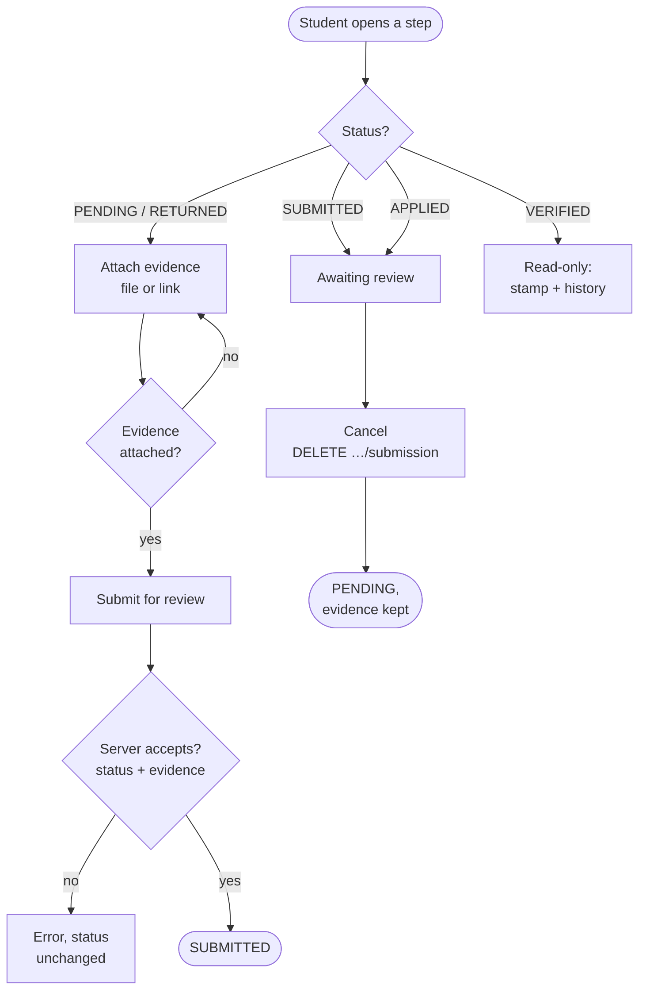
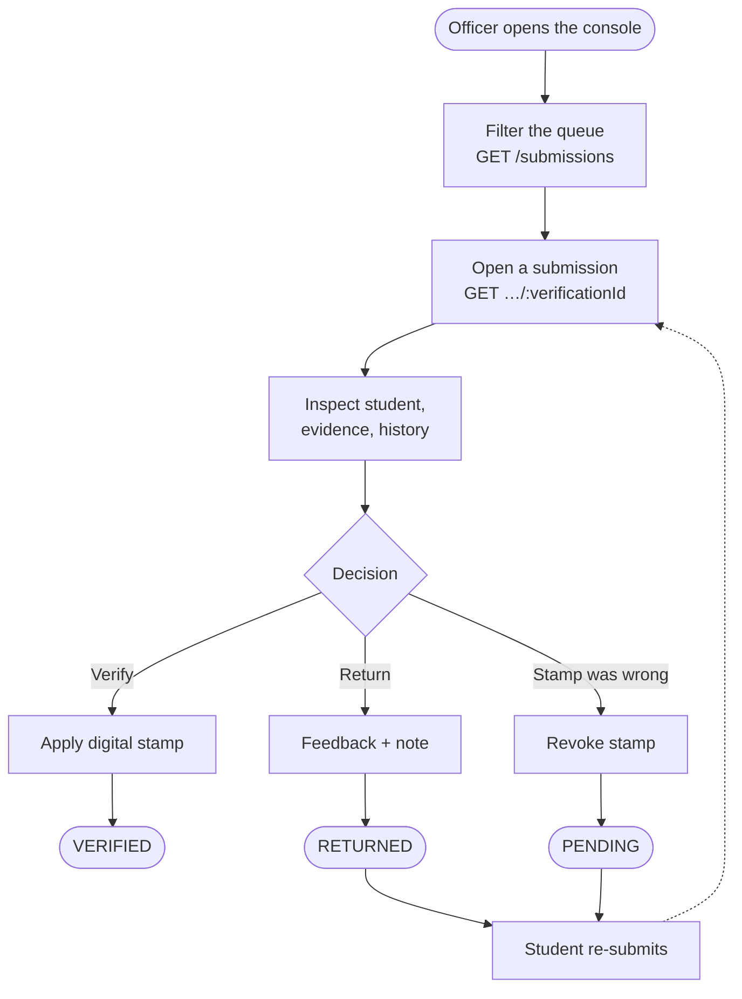
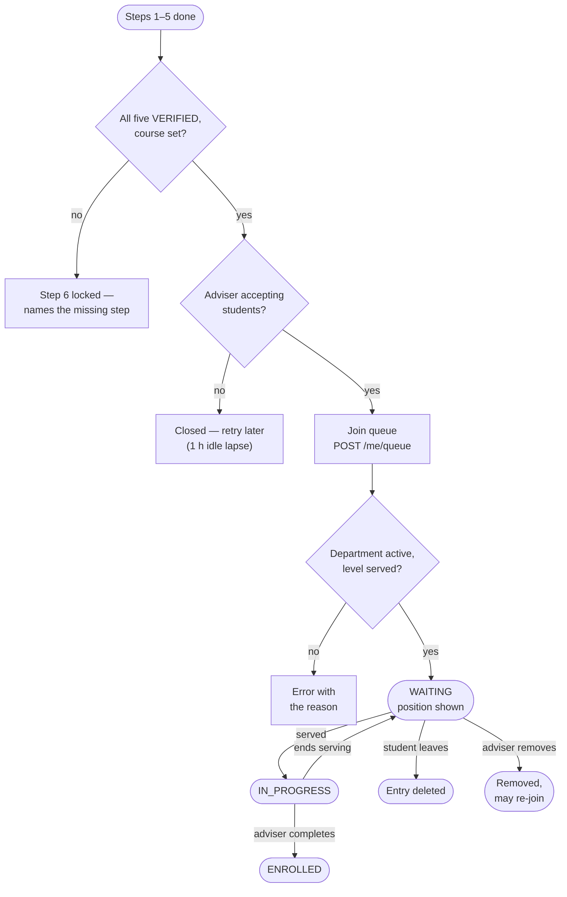
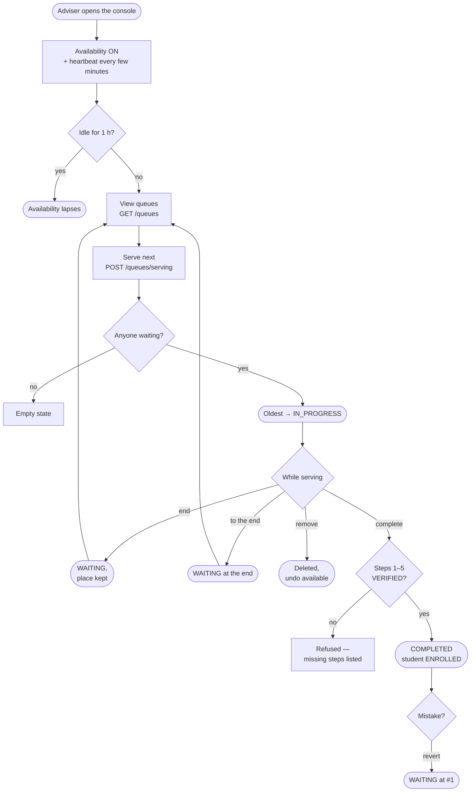
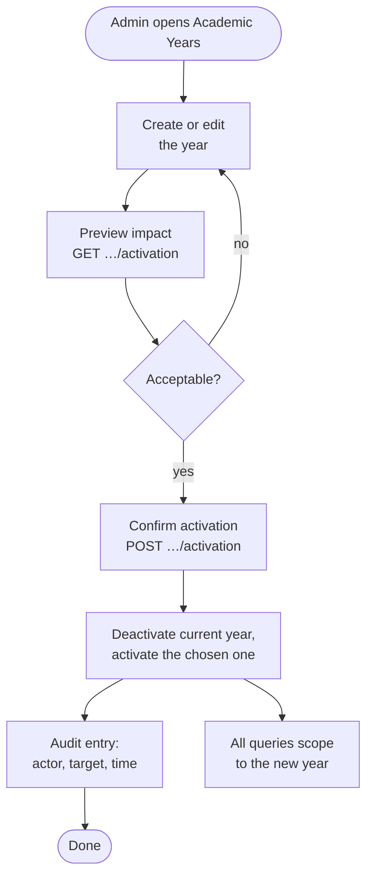
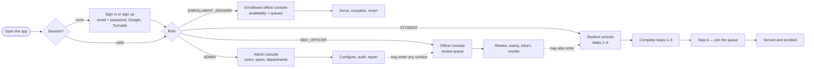
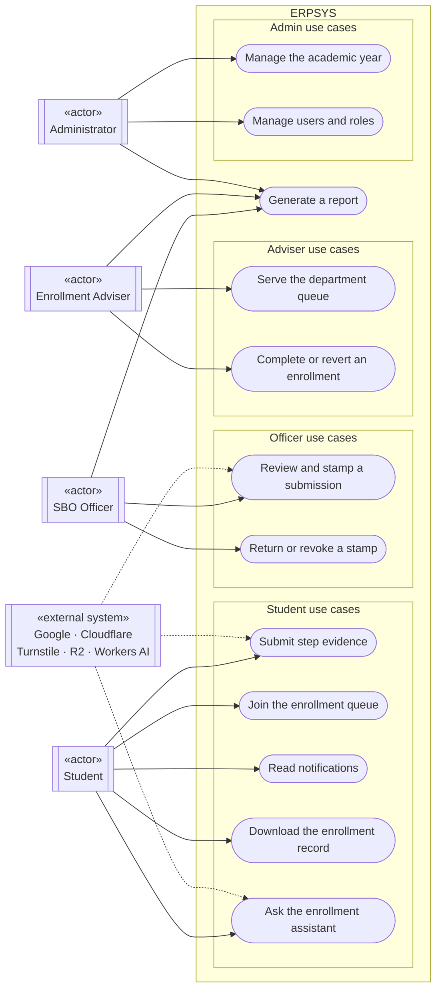
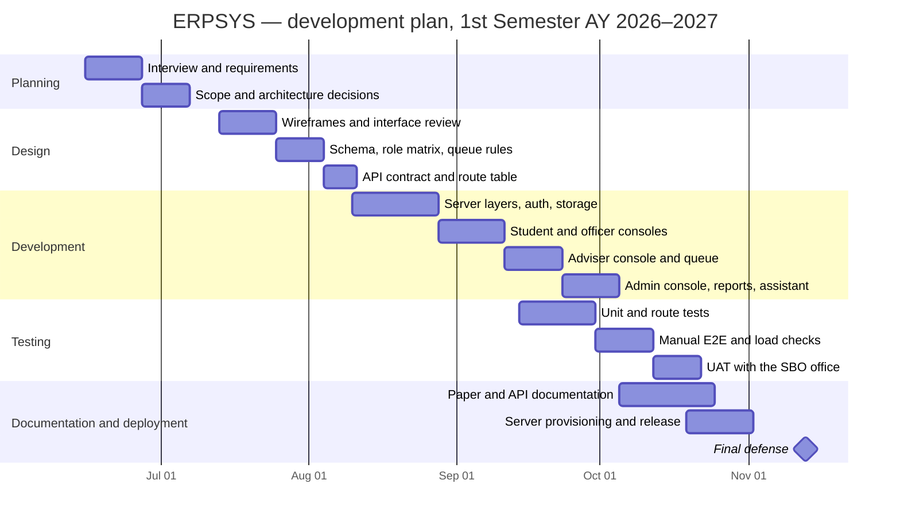
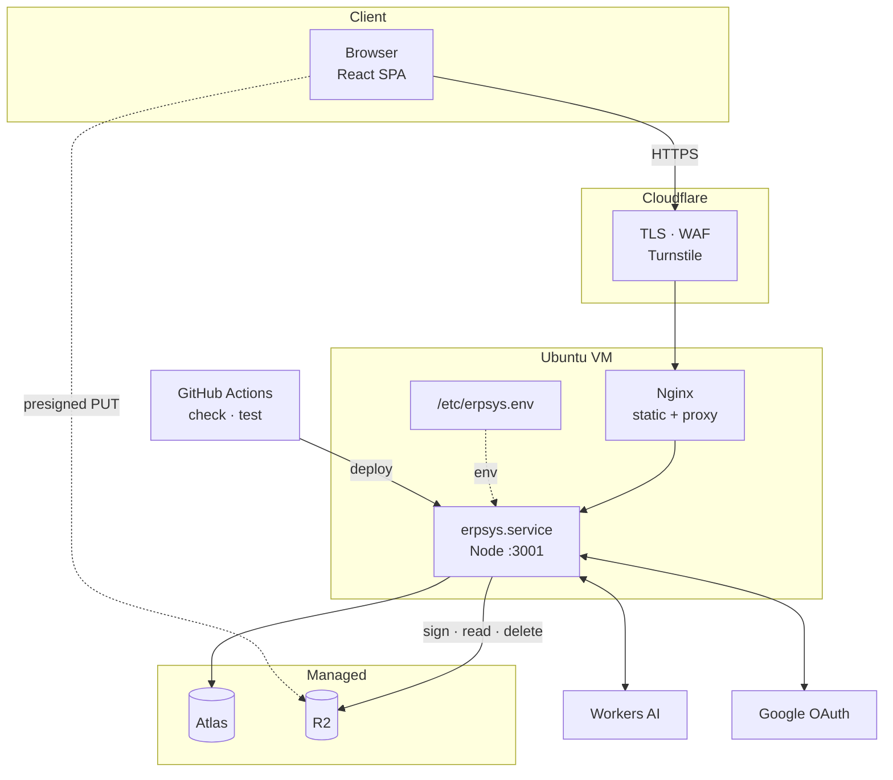

# ERPSYS — Enrollment Records and Processing System

**BUKIDNON STATE UNIVERSITY**
**COLLEGE OF TECHNOLOGIES**
**INFORMATION TECHNOLOGY DEPARTMENT**

A Project Presented to

> **TODO (author):** panel members and adviser, in the form the department requires.

of the Information Technology Department

In Partial Fulfillment of the Requirements for the Courses

- IT133 — Systems Integration and Architecture (SIA) 1
- IT137 — Elective 3: Integrative Programming and Technologies 2
- IT132 — Advanced Database Systems
- IT135 — Information Assurance and Security 1

**By:**

Ybanez, Alistair
Digal, John Paul
Cantiver, Miershan
Palmares, Melvis Alfonse

**1st Semester, AY 2026–2027**

---

## How this draft is written

This paper follows the section structure of
[`Collab Final Project Documentation.REFERENCE.pdf`](Collab%20Final%20Project%20Documentation.REFERENCE.pdf)
(see [`REFERENCE_OUTLINE.md`](REFERENCE_OUTLINE.md)). Numbering is kept identical so sections can be
cross-checked against the reference and against the course rubrics.

- Text in a normal voice is **drafted from the system as it exists in this repository** — it can be
  used as-is after a proofread.
- `> **TODO (author):**` blocks mark content only the project team can supply (names, dates,
  screenshots, interview findings, measured scan results).
- `> **TODO (figure):**` blocks mark an exhibit that must be captured or drawn. Every one of them is
  also tracked as a checkbox in [`todo.md`](todo.md).

Evidence links point at the code or design doc that backs a statement, so nothing in this paper is
unsourced.

---

## Table of Contents

> **TODO (author):** generate after the final layout. Suggested order: Chapters 1–5 → References →
> Appendices → API Documentation → External API Documentation → Sample Code Snippets → Coding
> Standards and Guidelines → Project Management Artifacts → Screenshots of System → Stakeholder
> Validation Documents.

**List of Figures** and **List of Tables** — also generated at layout time. Section headings below
carry the figure/table numbers that will be used.

---

# Chapter 1 — INTRODUCTION

## 1.1. Background of the Organization

The client for this project is the **College of Technology Student Body Organization (Bukidnon State
University)** — the SBO. The SBO is the college-level student organization that, among its other
functions, runs the student-facing side of enrollment: it checks that a student has completed each
pre-enrollment requirement, stamps the requirement as verified, and coordinates with the enrollment
advisers of each department when the student finally lines up for enrollment.

> **TODO (author):** the SBO office location (building/room) inside the College of Technology, and the
> interview date and interviewee.

### 1.1.1. History

Before ERPSYS, the entire verification cycle was physical. A student printed the requirement sheets —
several bond-paper pages, one sheet per stamp — and carried them to the college. The SBO officer
assigned to verification had to be physically present in the college to do the stamping, so a
student's progress depended on when that officer was on campus. Each of the five pre-enrollment steps
(assessment, social-media follow, profiling, mugshot, and consent/medical) was checked and stamped by
hand on the printed card, and the enrollment step itself was handled face to face with the
department's adviser. Nothing was recorded centrally: the printed sheets were the only evidence that a
step had been completed, and they were only as reliable as the paper they were printed on.

The result was a process that worked but did not scale — repeated trips to the office, stamps that
could not be proven after the fact, and no way for a student to know in advance which requirement was
still missing. ERPSYS keeps the same six steps and the same authority of the officer's stamp, but
records both digitally: the student submits evidence once, the officer verifies it in a review queue
with a saved digital stamp, and every decision is kept with who made it and when.

> **TODO (author):** the organization's founding year, its mandate under the college, and the year the
> printed-card process above was in use. Interview material — not inferable from the code.

### 1.1.2. Nature of Operations

The SBO's operations relevant to this system are:

- **Requirement verification.** Every student must pass six steps: Assessment, Social Media,
  Profiling, Mugshot, Consent / Medical, and Enrollment. The first five are pre-enrollment steps; the
  SBO officer reviews the evidence a student submits for each and either verifies it, returns it with
  a note, or (after verifying) revokes the stamp when something turns out to be wrong. The structure
  mirrors the printed card the office used before: the same six checks, the same single officer
  authority, but the stamp is now recorded rather than inked.
- **Record keeping.** The office keeps the verified evidence — assessment receipts, social-media
  screenshots, profiling-form submissions, mugshots, and signed consent/medical scans — and the
  history of who stamped what and when.
- **Coordination with departments.** Each department has one or more enrollment advisers. The adviser
  opens the department for a session, serves students in first-come-first-served order, and marks
  each student's enrollment complete.
- **Reporting.** The office produces per-step registers, department rosters, and a per-student
  enrollment record used as proof of enrollment.

### 1.1.3. Demographics

The college counts roughly **1,400–1,500 students**, who all pass through the six-step enrollment
process each academic year. The system serves four populations:

| Population          | Role in the system  | Who they are                                                            |
| ------------------- | ------------------- | ----------------------------------------------------------------------- |
| Students            | `STUDENT`           | Enrolled and incoming students of the College of Technologies           |
| SBO officers        | `SBO_OFFICER`       | Student officers who verify step submissions                            |
| Enrollment advisers | `ENROLLMENT_ADVISER`| Faculty/advisers assigned to a department, serving that department's queue |
| Administrators      | `ADMIN`             | SBO/college staff who manage users, departments, academic years and data |

> **TODO (author):** the number of departments and the number of enrollment advisers per department
> (from the interview or the live database). The student count above is the office's approximation.

### 1.1.4. Organizational Chart

> **TODO (figure):** Figure 1.1 — SBO organizational chart (adviser → president → vice presidents →
> officers, including the officers who will use the verification console).

The chart establishes who may act as an `SBO_OFFICER` and who supervises the accounts created by the
administrator. Access in the system follows that hierarchy: only `ADMIN` may promote an account to
`SBO_OFFICER`, and only `ADMIN` may reset a student's password
(`apps/server/src/services/users/UserAdminService.ts`).

### 1.1.5. Functional Chart

> **TODO (figure):** Figure 1.2 — functional chart mapping each SBO function to the person/office that
> performs it and the console that now performs it.

| Function                       | Performed by        | Console                          |
| ------------------------------ | ------------------- | -------------------------------- |
| Review and stamp submissions   | SBO officer         | Officer console                  |
| Return / revoke a stamp        | SBO officer         | Officer console                  |
| Capture a mugshot at the office| SBO officer         | Officer console                  |
| Manage social-media links      | SBO officer         | Officer console                  |
| Serve the department queue     | Enrollment adviser  | Enrollment officer console       |
| Complete / revert enrollment   | Enrollment adviser  | Enrollment officer console       |
| Manage users, roles, passwords | Administrator       | Admin console                    |
| Manage departments, years      | Administrator       | Admin console                    |

## 1.2. Business Processes

### 1.2.1. Information Asset Identification

The system's information assets were identified from the data it actually stores
(`apps/server/src/lib/db/db.ts`, `COLLECTIONS`):

- **Identity and account data** — user, session, account, verification documents (Better Auth).
- **Student data** — student profile (student number, year level, department, contact details),
  enrollment records, enrollment queue entries.
- **Evidence** — uploaded files and external links attached to a step: assessment proof, social-media
  screenshots, profiling submissions, mugshots, consent/medical scans.
- **Verification data** — per-step status, the officer's stamp, replies and return notes, revocation
  history.
- **Configuration data** — academic years, departments, adviser assignments and availability,
  requirement items, profiling-form URL, social-media links, integration toggles.
- **Operational data** — notifications, admin action log, chat knowledge and usage counters, storage
  usage counters.

### 1.2.2. List of Information Assets

Table 1.1 List of Information Assets for ERPSYS

| Asset Type                | Owner                          | Sensitivity | Purpose                                                              |
| ------------------------- | ------------------------------ | ----------- | -------------------------------------------------------------------- |
| Student identity records  | SBO Admin                      | High        | Identify the student, their department and year level                 |
| Enrollment evidence       | SBO Officer / student          | High        | Prove each step was completed; basis of the verification stamp        |
| Mugshot and consent scans  | SBO Officer                    | High        | Identity and medical/consent proof held by the office                 |
| Verification stamps       | SBO Officer                    | High        | Attest that a named officer checked a named submission                |
| Queue state               | Enrollment adviser             | Medium      | Decide whose turn it is; keep the line fair                           |
| Enrollment completion     | Enrollment adviser             | High        | Official record that the student is enrolled for the academic year    |
| Reports                   | SBO / department               | Medium      | Per-step registers, department rosters, per-student enrollment record |
| Audit log                 | Administrator                  | Medium      | Trace who changed roles, years, departments and settings              |
| Configuration             | Administrator                  | Medium      | Gate the active academic year, departments, forms and integrations    |

Only the student who owns a submission, the officer reviewing it, and the administrator can reach the
evidence; files are served through an authorized endpoint rather than a public link
(`apps/server/src/routes/storage/index.ts`).

### 1.2.3. Weighted Factor Analysis

Weights follow criticality, sensitivity, and impact:

- **Student identity records — high.** Losing or leaking them exposes minors/young adults' personal
  data and can invalidate an enrollment.
- **Evidence and mugshots — high.** Images of identity documents and faces are the most sensitive
  content the system holds.
- **Verification stamps — high.** A forged or missing stamp breaks the integrity of the enrollment
  record itself.
- **Enrollment completion — high.** This is the record the college relies on; an error means a student
  is enrolled who should not be, or the reverse.
- **Queue state — medium.** Short-lived, but unfair ordering is a visible operational failure.
- **Configuration and audit — medium.** No personal data, but a wrong active year blocks every
  student.

### 1.2.4. Threat Identification

- **Human error** — an officer stamps the wrong student, a student uploads the wrong file, an
  administrator activates the wrong academic year.
- **Technical risks** — an expired certificate, an exhausted Workers AI daily budget, an Atlas
  connection limit during the enrollment rush, a failed deploy.
- **Internal risks** — an account acting outside its role, or an officer using another officer's stamp.
- **External risks** — credential stuffing on the login form, automated sign-ups, scraping of student
  data, bots hammering the queue endpoints.
- **Operational risks** — the single server going down mid-session while a department is serving, or a
  long-running migration during enrollment week.

### 1.2.5. Vulnerability Database

Table 1.2 Vulnerability Database for ERPSYS

| Vulnerability                                  | Asset                    | Sensitivity | Control applied                                                        |
| ---------------------------------------------- | ------------------------ | ----------- | ---------------------------------------------------------------------- |
| Weak or reused passwords                       | Identity records         | High        | Password policy, Google OAuth, Turnstile on sign-in, admin reset flow   |
| Leaked evidence links                          | Evidence / mugshots      | High        | Private object storage, authorized read endpoint, short-lived access    |
| Unauthorized stamping or queue manipulation    | Verification / queue     | High        | Role-and-surface guards on every route, server-side business rules      |
| Stale or wrong configuration                   | Enrollment records       | Medium      | Single active year, activation preview, admin action log                |
| Unbounded requests during the rush             | All                      | Medium      | Rate limiting, request caps, single aggregate launch read, SSE limits   |
| Denial through expensive queries               | All                      | Medium      | Indexed queue queries, pagination limits, query timeouts                |

### 1.2..6. Vulnerability Assessment

**High priority**

- **Strong authentication.** Email/password plus Google OAuth through Better Auth, with Cloudflare
  Turnstile on the public sign-in/sign-up path and role checks again on the server. *(Reference:
  `apps/server/src/config/auth.ts`, `apps/server/src/middleware/auth.ts`.)*
- **Data protection.** Evidence is stored in a private Cloudflare R2 bucket and streamed only through
  an authorized endpoint; the database connection uses TLS to MongoDB Atlas. *(Reference:
  `apps/server/src/lib/storage/`, `apps/server/src/lib/db/db.ts`.)*
- **Auditability.** Every privileged action — role change, password reset, academic-year activation,
  integration toggle — is written to the admin action log. *(Reference:
  `apps/server/src/models/AdminActionLogModel.ts`.)*

**Medium priority**

- **Queue concurrency.** Serving state is enforced by the server, not the browser: only one student
  can be `IN_PROGRESS` per adviser/department, and queue mutations are re-validated against current
  state. *(Reference: `apps/server/src/services/queues/`.)*
- **Load behaviour.** A single aggregate `GET /api/v1/me/launch` read, a persisted query cache, and
  rate limits keep the app usable when hundreds of students open it at once. *(Reference:
  `docs/specs/app-launch-performance-spec.md`, `docs/specs/load-resilience-design.md`.)*

## 1.3. Background of the System

Before ERPSYS, enrollment verification at the SBO was a physical process: students lined up at the
office with printed receipts, screenshots and forms; officers stamped paper; the queue for the
enrollment adviser was a line in the corridor; and the only record of who had been served was the
adviser's own list. The consequences were predictable — long queues, lost or illegible evidence, a
student walking to the office only to be told a requirement was still missing, and no reliable way to
answer "how many students from this department are already enrolled?"

ERPSYS (**E**nrollment **R**ecords and **P**rocessing **S**ystem) moves that workflow online:

- Each student sees the six steps, their status, and exactly what is still missing.
- Evidence is uploaded once and reviewed asynchronously, so the student does not need to be at the
  office to be told to come back.
- The department queue is explicit and first-come-first-served, and the student can watch their
  position from anywhere.
- Officers get a review queue with the student's data, evidence and history in one screen, plus a
  reusable digital stamp.
- Administrators get the configuration surface (academic year, departments, advisers, requirements,
  integrations) and the audit trail.
- Reports — the per-step register, the department roster, and the per-student enrollment record — are
  generated as PDFs on demand.

The system is a two-application monorepo that deploys as **one origin**: an Express + MongoDB API
(`apps/server`) and a React single-page app (`apps/web`), served behind Nginx on a single Ubuntu VM.
It is a practical application of the four courses listed on the title page:

- **IT132 — Advanced Database Systems:** MongoDB document modelling, indexes that make queue
  correctness enforceable, and creation/update timestamps on every collection.
- **IT133 — Systems Integration and Architecture:** the layered architecture, the REST contract, and
  the integration of external services (Google OAuth, Cloudflare R2, Cloudflare Workers AI,
  Cloudflare Turnstile, MongoDB Atlas).
- **IT135 — Information Assurance and Security 1:** role-based access control, session security,
  evidence confidentiality, audit logging, and the security policy in Chapter 4.
- **IT137 — Integrative Programming and Technologies 2:** the client/server split, API consumption
  with typed routes, real-time updates, and background/async processing.

## 1.4. Objectives

### 1.4.1. General Objectives

To design, build, and evaluate a web-based enrollment records and processing system for the College of
Technologies SBO that replaces paper-based step verification and the physical enrollment queue with a
single auditable online workflow — one that the student can follow from their phone, that the officer
can act on in a few clicks, and that the college can rely on as its record of enrollment.

### 1.4.2. Specific Objectives

1. Determine the functional and non-functional requirements of the SBO's enrollment workflow,
   including the six steps, the review decision points, and the queue rules.
2. Design a system architecture — layered API, SPA client, private object storage — that can be
   deployed as one origin on a single server.
3. Develop the system with the following implemented features:
   - a. student step progression across Assessment, Social Media, Profiling, Mugshot, Consent /
     Medical, and Enrollment;
   - b. evidence submission (file upload and external link) with officer review, return, and revoke;
   - c. a per-department FIFO enrollment queue with adviser availability, serving, requeueing, and
     enrollment completion/reversion;
   - d. role-based access control across four roles and four consoles;
   - e. PDF report generation for officers, advisers, and administrators;
   - f. integration of external services: Google OAuth, Cloudflare R2, Cloudflare Workers AI, and
     Cloudflare Turnstile;
   - g. an administrative console for users, departments, academic years, requirements, adviser
     mapping, and integration toggles.
4. Test the system — unit, route, and load — to confirm the steps, the queue, and the role boundaries
   behave as specified.
5. Produce the documentation set: this paper, the API documentation, the deployment runbook
   (`docs/ops/deployment.md`), and the design specs under `docs/specs/`.

## 1.5. Scope and Limitations

**In scope**

- Student sign-up (institutional email / student number rule), sign-in (email + password or Google
  OAuth), and password reset by the administrator.
- The six enrollment steps and their statuses (`PENDING`, `APPLIED`, `SUBMITTED`, `VERIFIED`,
  `RETURNED`), including evidence upload, external links, officer verification with a digital stamp,
  return with feedback, and revocation.
- The enrollment queue: joining, queue position, leaving, adviser availability with heartbeat,
  serve-next, end-serving, move-to-end, removal/restoration, queue share links, and department
  transfers.
- Enrollment completion and reversion by the enrollment adviser.
- The administrator's configuration and audit surfaces.
- PDF reports: per-step register, department roster, user directory, and the per-student enrollment
  record.
- The student enrollment assistant (chat) with a versioned knowledge document and a daily usage
  ceiling.

**Out of scope / limitations**

- **No tuition or payment processing.** The assessment step only records that the student's SIMS
  balance was checked; payments happen in the university's existing systems.
- **No class scheduling, grading, or curriculum records.** ERPSYS records enrollment, not academic
  performance.
- **No SMS.** Notifications are in-app only.
- **Evidence is not independently authenticated.** The officer's check is the control; the system
  records who checked what, but cannot prove a screenshot is genuine.
- **Single-server deployment.** The design assumes one application process; real-time updates and the
  integration-toggle cache are in-process (see `docs/specs/load-resilience-design.md` for the limits
  this implies).
- **The chat assistant answers only from its knowledge document**; it is not a general-purpose model
  and falls back to "ask an SBO officer" when the answer is not in the document.

## 1.6. Definition of Terms

| Term                        | Definition                                                                                             |
| --------------------------- | ------------------------------------------------------------------------------------------------------ |
| **Academic year**           | The enrollment period (e.g. 2026–2027). Exactly one year is active; sign-up and step work are scoped to it. |
| **Step**                    | One of the six requirements: Assessment, Social Media, Profiling, Mugshot, Consent / Medical, Enrollment. |
| **Pre-enrollment step**     | Steps 1–5. All five must be `VERIFIED` before the student may join the enrollment queue.                |
| **Evidence**                | A file or an external link a student submits to prove a step.                                           |
| **Submission**              | The act of sending evidence for officer review, which moves the step from `PENDING`/`RETURNED` to `SUBMITTED` (or `APPLIED` for Assessment). |
| **Stamp**                   | The officer's saved digital signature block — name, graphic, signature image — applied when verifying.  |
| **Verification**            | The officer's decision on a submission: verify (stamp), return with feedback, or revoke a previous stamp. |
| **Revocation**              | Withdrawing a previously issued verification, which sends the step back to the student.                 |
| **SBO officer**             | The `SBO_OFFICER` role; reviews and stamps submissions.                                                 |
| **Enrollment adviser**      | The `ENROLLMENT_ADVISER` role; owns a department and serves its queue.                                  |
| **Department**              | The academic department whose queue the adviser serves, with a code and applicable year levels.         |
| **Availability**            | The adviser's open/closed state for accepting students, kept alive by a heartbeat.                      |
| **Queue entry**             | A student's place in a department's FIFO line, with a status such as `WAITING`, `IN_PROGRESS`.          |
| **Serving**                 | The state where the adviser is handling one student; only one entry per adviser may be `IN_PROGRESS`.    |
| **Queue share link**        | A signed, expiring link that lets a student open a department's queue directly.                         |
| **Enrollment completion**   | The adviser's final act that marks the student `ENROLLED` for the academic year.                        |
| **Revert**                  | Undoing a completion, returning a single student or a batch to the waiting state.                       |
| **Requirement item**        | A configurable line in the Assessment requirement list shown to students.                               |
| **Integration toggle**      | An administrator switch that disables an external service (Google, R2, Workers AI, Turnstile) in the UI and on the server. |
| **Audit log**               | The append-only record of privileged administrative actions.                                            |

---

# Chapter 2 — RISK & SYSTEM ANALYSIS

## 2.1. Risk Analysis

### 2.1.1. TVA Worksheet

Table 2.1 ERPSYS Threat–Vulnerability–Asset Worksheet

| Asset                  | Threat                          | Vulnerability                                         | Impact                                        | Risk   |
| ---------------------- | ------------------------------- | ----------------------------------------------------- | --------------------------------------------- | ------ |
| Student account        | Credential stuffing             | Reused passwords, public login form                   | Account takeover, exposure of evidence         | High   |
| Student evidence       | Unauthorized access             | Guessable or leaked file URLs                         | Privacy breach of identity documents           | High   |
| Verification record    | Fraudulent stamp                | Officer acting outside assigned steps                 | Invalid enrollment, loss of trust in records   | High   |
| Queue state            | Manipulation / race             | Two actions accepted for one entry                    | Unfair order, duplicate serving                | Medium |
| Enrollment record      | Wrong completion / revert      | No confirmation, no audit of the change               | Student wrongly marked enrolled or not         | High   |
| Configuration          | Accidental misconfiguration     | One-click activation of the wrong year or integration | Every student blocked or mis-scoped            | Medium |
| Server (availability)  | Traffic spike during enrollment | Single process, connection pool ceiling               | `5xx` for every student, session lost mid-queue | High   |
| Server (integrity)     | Compromise or takeover         | One internet-facing VM; shared OS and SSH access      | All data, sessions and evidence exposed        | High   |
| External integrations  | Outage or leaked credential     | Third-party dependency; key stored on the server      | Uploads, sign-in or chat stop working          | Medium |
| Chat assistant         | Budget exhaustion              | Shared daily Neuron ceiling                           | Assistant unavailable for the rest of the day  | Low    |

> **TODO (author):** run the ratings past the adviser before the defense; the scores that back them
> are in Table 2.4.

### 2.1.2. Likelihood Scale

Table 2.2 ERPSYS Likelihood Scale

| Rating | Label          | Description                                                              |
| ------ | -------------- | ------------------------------------------------------------------------ |
| 1      | Rare           | No known path; would require an unusual combination of events             |
| 2      | Unlikely       | Possible, but not expected during a normal semester                       |
| 3      | Possible       | Could happen during a semester under normal use                           |
| 4      | Likely         | Expected at least once during an enrollment period                        |
| 5      | Almost Certain | Happens routinely — every enrollment period, or every day of one          |

### 2.1.3. Risk Impact Scale

Table 2.3 ERPSYS Risk Impact Scale

| Rating | Label      | Description                                                                        |
| ------ | ---------- | ---------------------------------------------------------------------------------- |
| 1      | Negligible | Cosmetic; recoverable in minutes with no data loss                                  |
| 2      | Minor      | One student or one step affected; recoverable the same day                          |
| 3      | Moderate   | A department or a whole step affected for hours; manual work to recover             |
| 4      | Significant| Several departments or a lost working day; records need repair                      |
| 5      | Severe     | Data exposure or corrupted enrollment records; irreversible without outside help    |

Risk score = likelihood × impact (1–25). **High** is 15–25, **Medium** 6–14, and **Low** 5 or below.
Every High and Medium risk carries a control from Table 2.4.

### 2.1.4. Risk Control Strategy

Table 2.4 ERPSYS Security Control Mitigation Table

| Risk                                  | Likelihood × Impact | Score | Control                                                                                     | Where it lives                                        |
| ------------------------------------- | ------------------- | ----- | ------------------------------------------------------------------------------------------- | ----------------------------------------------------- |
| Credential stuffing                   | 4 × 4               | 16    | Turnstile on sign-in, rate limits, Google OAuth, per-account throttle after repeated failures  | `config/auth.ts`, `lib/platform/rate-limit.ts`        |
| Evidence exposure                     | 3 × 5               | 15    | Private bucket, authorized read endpoint, no public URLs                                     | `lib/storage/`, `routes/storage/`                     |
| Officer acting outside their duties   | 3 × 5               | 15    | Role + surface middleware, server-side status rules, audit log                                | `middleware/auth.ts`, `services/submissions/`         |
| Duplicate/racing queue actions        | 3 × 3               | 9     | Server-enforced single serving state, idempotent transitions, queue indexes                   | `services/queues/`, `lib/db/indexes.ts`               |
| Wrong enrollment state                | 3 × 5               | 15    | Explicit confirm dialogs, revert path, audit entries                                          | `services/enrollments/`                               |
| Misconfigured academic year           | 3 × 4               | 12    | Single active year, activation preview, admin-only route, audit entry                          | `services/academic-years/`, `models/AdminActionLogModel.ts` |
| Traffic spike                         | 4 × 5               | 20    | Request caps, aggregate launch read, persisted cache, graceful shutdown, metrics               | `lib/platform/`, `docs/specs/load-resilience-design.md`|
| Server compromise                     | 3 × 5               | 15    | Compiled-only runtime, key-only SSH, least-privilege systemd unit, patching                     | `deploy/erpsys.service`, `docs/ops/deployment.md`      |
| Integration outage / leaked key       | 3 × 4               | 12    | Per-integration toggle, secrets in the environment file only, graceful degradation             | `lib/platform/integration-settings.ts`                 |
| Chat budget exhaustion                | 3 × 1               | 3     | Daily guard with a friendly "resting" state                                                   | `lib/chat/budget.ts`                                  |

## 2.2. Requirements

### 2.2.1 Functional Requirements

The requirements below are reproduced from
[`docs/ops/functional_requirements.md`](../ops/functional_requirements.md), split by user type —
58 requirements in total. They are the source of the traceability matrix (Figure 2.1) and of the
endpoint entries in the API Documentation part.

Table 2.5 Functional Requirements — Student

| Component | Requirement | Description |
| --- | --- | --- |
| Authentication | Student Registration | STUDENT should be able to register a student account using a student number and personal email address. |
| Authentication | Student Login | STUDENT should be able to sign in using email and password or Google OAuth. |
| Step Progression | View Enrollment Progress | STUDENT should be able to view their enrollment step progress and current statuses for the active academic year. |
| Step Progression | Apply for Assessment | STUDENT should be able to apply for the assessment step to initiate the verification process. |
| Evidence Management | Upload Enrollment Evidence | STUDENT should be able to upload evidence files such as screenshots and scans for enrollment steps. |
| Evidence Management | Submit and Delete Evidence | STUDENT should be able to submit evidence for officer review and delete previously uploaded files. |
| Enrollment Queue | Join Enrollment Queue | STUDENT should be able to join the enrollment queue for a department with an open adviser. |
| Enrollment Queue | View and Leave Queue | STUDENT should be able to view their queue position and leave the queue before being served. |
| Notifications | View Notifications | STUDENT should be able to view notifications for step verification updates and queue status changes. |
| Notifications | Mark Notifications as Read | STUDENT should be able to mark all unread notifications as read. |

Table 2.6 Functional Requirements — SBO Officer

| Component | Requirement | Description |
| --- | --- | --- |
| Authentication | SBO Officer Login | SBO_OFFICER should be able to sign in using email and password or Google OAuth. |
| Authentication | SBO Officer Logout | SBO_OFFICER should be able to sign out from the system. |
| Submission Review | Filter Student Submissions | SBO_OFFICER should be able to list student submissions filtered by step, status, and date range. |
| Submission Review | View Submission Details | SBO_OFFICER should be able to view detailed submission information including student data, evidence, and verification history. |
| Verification Actions | Verify Submission with Digital Stamp | SBO_OFFICER should be able to verify a student's step submission with a digital stamp. |
| Verification Actions | Return or Revoke Verification | SBO_OFFICER should be able to return a submission with feedback chips and notes or revoke a verified stamp. |
| Social Media Management | Add and Edit Social Media Links | SBO_OFFICER should be able to add and edit social media links for students to follow. |
| Social Media Management | Reorder and Delete Social Media Links | SBO_OFFICER should be able to reorder and delete social media links. |
| Profiling Form | View Profiling Form URL | SBO_OFFICER should be able to view the current profiling form URL for the active academic year. |
| Profiling Form | Manage Profiling Form URL | SBO_OFFICER should be able to set or update the profiling form URL. |
| Verification Stamp | View Verification Stamp | SBO_OFFICER should be able to view their current verification stamp name, graphic, and signature. |
| Verification Stamp | Update Verification Stamp | SBO_OFFICER should be able to update their stamp name and upload stamp graphic and signature images. |
| Mugshot Review | Review Student Mugshot | SBO_OFFICER should be able to review and verify student mugshot photos. |
| Consent Review | Review Student Consent | SBO_OFFICER should be able to review and verify student consent form scans. |
| Reports | Generate Officer Reports | SBO_OFFICER should be able to generate PDF reports for their assigned verification steps. |

Table 2.7 Functional Requirements — Enrollment Adviser

| Component | Requirement | Description |
| --- | --- | --- |
| Authentication | Enrollment Adviser Login | ENROLLMENT_ADVISER should be able to sign in using email and password or Google OAuth. |
| Authentication | Enrollment Adviser Logout | ENROLLMENT_ADVISER should be able to sign out, automatically closing any open department availability. |
| Availability Management | Manage Department Availability | ENROLLMENT_ADVISER should be able to toggle their department availability open or closed to accept students. |
| Availability Management | Maintain Adviser Availability | ENROLLMENT_ADVISER should be able to send a heartbeat to keep their availability alive and prevent auto-close. |
| Queue Monitoring | Monitor Department Queues | ENROLLMENT_ADVISER should be able to view their mapped department queues with waiting counts and serving status. |
| Queue Monitoring | View Enrolled Students | ENROLLMENT_ADVISER should be able to view a list of enrolled students by department. |
| Queue Actions | Serve Next Student | ENROLLMENT_ADVISER should be able to begin serving the next student in the FIFO queue. |
| Queue Actions | End or Requeue Student | ENROLLMENT_ADVISER should be able to end serving a student or move the first student to the end of the queue. |
| Enrollment Processing | Complete Student Enrollment | ENROLLMENT_ADVISER should be able to complete a student's enrollment after all prerequisite steps are verified. |
| Enrollment Processing | Revert Completed Enrollment | ENROLLMENT_ADVISER should be able to revert a single or multiple completed enrollments back to the waiting queue. |
| Department Management | Manage Department Details | ENROLLMENT_ADVISER should be able to create and update department details. |
| Department Management | Assign Adviser to Department | ENROLLMENT_ADVISER should be able to assign themselves to a department or delete an empty department. |
| Students Tab | View Student Roster | ENROLLMENT_ADVISER should be able to view a roster of students across their assigned departments. |
| Reports | Generate Instructor Reports | ENROLLMENT_ADVISER should be able to generate PDF reports for their departments. |

Table 2.8 Functional Requirements — Administrator

| Component | Requirement | Description |
| --- | --- | --- |
| Authentication | Admin Login | ADMIN should be able to sign in using email and password or Google OAuth. |
| Authentication | Admin Logout | ADMIN should be able to sign out from the system. |
| Dashboard Overview | View Dashboard Statistics | ADMIN should be able to view system statistics including user role counts, step verification totals, and department queue tallies. |
| Dashboard Overview | View Administrative Audit Log | ADMIN should be able to view recent administrative activity in the audit log. |
| User Management | Manage and Search Users | ADMIN should be able to list and search users with filters for role, organization status, and sort order. |
| User Management | Change User Roles | ADMIN should be able to change individual user roles between student and SBO officer or bulk change roles for multiple users. |
| Password Management | Search Student Users | ADMIN should be able to search for student users by name, email, or student number. |
| Password Management | Reset Student Password | ADMIN should be able to reset a student's password by generating a new one. |
| Department Management | Manage Department Names and Codes | ADMIN should be able to create and update department names and codes. |
| Department Management | Activate or Deactivate Departments | ADMIN should be able to activate or deactivate departments. |
| Academic Year Management | Manage Academic Years | ADMIN should be able to create, edit, and delete academic years. |
| Academic Year Management | Activate Academic Year | ADMIN should be able to activate an academic year and preview its impact before activation. |
| Adviser Mapping | View Adviser Department Assignments | ADMIN should be able to list all advisers with their current department assignments. |
| Adviser Mapping | Assign Advisers to Departments | ADMIN should be able to assign advisers to departments. |
| Requirement Management | Manage Assessment Requirements | ADMIN should be able to create, edit, and delete requirement items for the assessment step. |
| Requirement Management | Reorder Assessment Requirements | ADMIN should be able to reorder requirement items by moving them up or down. |
| Chatbot Knowledge | View Chatbot Knowledge | ADMIN should be able to view the current chatbot knowledge document and its version. |
| Chatbot Knowledge | Update Chatbot Knowledge | ADMIN should be able to update the chatbot knowledge document used by the enrollment assistant. |
| Reports | Generate Admin Reports | ADMIN should be able to generate PDF reports for administrative purposes. |

Critical requirement rules (enforced on the server, not in the browser):

1. A student may only submit a step that is `PENDING` or `RETURNED`.
2. An officer may only verify a submission that is awaiting review, and only for a step they are
   assigned.
3. A student may only join a queue when all five pre-enrollment steps are `VERIFIED` and the
   department has an available adviser.
4. Only one entry per adviser may be `IN_PROGRESS`.
5. Completion is refused while any pre-enrollment step is not `VERIFIED`.
6. Every privileged mutation writes an audit entry.

> **TODO (figure):** Figure 2.1 — requirements traceability matrix (requirement → endpoint → screen →
> test).

### 2.2.2 Non-Functional Requirements

| Attribute      | Requirement                                                                                                    | Verification |
| -------------- | -------------------------------------------------------------------------------------------------------------- | ------------ |
| Performance    | Warm launch renders from a persisted cache; one aggregate read (`/me/launch`) instead of a fan-out of requests  | `docs/specs/app-launch-performance-spec.md`, bundle budget script |
| Scalability    | 300 concurrent students under normal load; survive a 1,000-student peak without losing queue state or enrollment records | `docs/specs/load-resilience-design.md`, load gates in CI |
| Availability   | 99% during the enrollment week (≈1.7 hours of downtime across the week); graceful shutdown on deploy; no dropped queue state | `deploy/erpsys.service`, load-resilience design |
| Recovery       | RTO 1 hour and RPO 24 hours — Atlas snapshots restore the data, the repository rebuilds the server | `docs/ops/deployment.md`, Atlas backup settings |
| Security       | Role-based authorization on every route; server-side validation of every payload; private evidence storage       | route tests, zod schemas |
| Integrity      | Queue and enrollment transitions are validated against current database state                                    | service tests |
| Auditability   | Privileged actions recorded with actor, target, and timestamp                                                     | admin action log tests |
| Usability      | A student can tell what to do next from a single screen; no dead ends; mobile-first layout                        | UI review, screenshots |
| Maintainability| Layered server (`routes → controllers → services → models`), no barrel files, one use case per service class      | `AGENTS.md`, typecheck |
| Portability    | Runs on one Ubuntu VM behind Nginx; configuration via environment file                                            | `docs/ops/deployment.md` |
| Observability  | Health, readiness, metrics, and structured logs for the queue and AI paths                                        | `lib/platform/metrics.ts`, `/api/metrics` |

### 2.2.3. Database Schema

ERPSYS uses MongoDB (Atlas in production). It is a document database, so the schema is the set of
collections and their document shapes rather than SQL tables; related data is referenced by id, and
the few shapes that are read as a unit are embedded.

Table 2.9 Collections

| Collection                    | Purpose                                                        |
| ----------------------------- | -------------------------------------------------------------- |
| `user`                        | Account, role, name, email, verification state                  |
| `session`, `account`, `verification` | Better Auth session, OAuth account link, verification tokens |
| `academic_year`               | Enrollment periods; exactly one active                            |
| `student_profile`             | Student number, year level, department, contact details          |
| `student_enrollment`          | The enrollment record per student per year                       |
| `step`                        | The six step definitions and their order                         |
| `step_verification`           | Per-student, per-step status, evidence reference, officer reply  |
| `upload`                      | Object-storage metadata for one evidence file                    |
| `requirement_item`            | Configurable assessment requirements                             |
| `profiling_form`              | Profiling-form URL for the active year                           |
| `social_media_link`           | Ordered social-media links shown to students                     |
| `notification`                | In-app notifications per user                                    |
| `department`                  | Department code, name, year levels, active flag                  |
| `adviser_department`          | Adviser ↔ department assignment                                  |
| `enrollment_queue`            | Queue entries: student, department, position, status, timestamps |
| `adviser_availability`        | Open/closed state, heartbeat timestamp                           |
| `department_transfer_request` | Adviser-initiated transfer/handover of a department              |
| `admin_action_log`            | Audit entries for privileged actions                             |
| `chatbot_knowledge`           | Versioned knowledge document for the assistant                   |
| `chat_usage`, `storage_usage` | Daily usage counters                                             |
| `integration_setting`         | Per-integration on/off switch                                    |

Schema rules:

- Every collection carries `createdAt` and `updatedAt`; updates set `updatedAt` server-side.
- Ids are generated strings, not raw ObjectIds, and lookups accept both forms for compatibility
  (`idForms` / `idIn` in `lib/db/db.ts`).
- Indexes are created at boot (`lib/db/indexes.ts`), and the queue indexes are what make "one serving
  student per adviser" enforceable at the database level.
- Evidence files live in object storage; the database stores only the key, size, type and owner.

> **TODO (figure):** Figures 2.2–2.6 — collection diagrams for identity, steps/evidence, queue,
> enrollment, and configuration. Draw from the models in `apps/server/src/models/`.

### 2.2.4 System Interface and Execution

**Client**

- A modern browser (Chrome, Edge, Firefox, Safari). The app is a single-page React application; no
  installation is required.
- Responsive layout: the student surface is designed for a phone, the officer and admin consoles for a
  desktop.
- Minimum practical viewport 360 px wide; JavaScript must be enabled.

**Server**

- One Ubuntu VM with Nginx in front (`docs/ops/deployment.md`).
- Node.js runtime running the compiled Express API as a `systemd` service.
- MongoDB Atlas for data; Cloudflare R2 for files; Cloudflare Workers AI and Google for their
  respective integrations.
- Environment configuration via `/etc/erpsys.env`; secrets never in the repository.

**Development environment**

```bash
pnpm install
pnpm dev      # API + web in parallel
pnpm check    # typecheck both apps
pnpm test     # unit and route tests
pnpm build    # production build of both apps
```

---

# Chapter 3 — SYSTEM DESIGN & DEVELOPMENT

## 3.1. Solution Design

ERPSYS is a **two-application monorepo deployed as one origin**:

| Layer            | Technology                                                                 | Responsibility |
| ---------------- | -------------------------------------------------------------------------- | -------------- |
| Presentation     | React 19, React Router 7, Tailwind CSS v4, TanStack Query/Form             | Four consoles (student, officer, enrollment officer, admin) |
| Transport        | REST over HTTPS, JSON envelope `{ data }` / `{ error }`; SSE for the chat   | One contract for every screen |
| Application      | Express (TypeScript, ESM), `routes → controllers → services → models`      | Business rules, authorization, validation |
| Persistence      | MongoDB Atlas via the driver; Cloudflare R2 for files                       | Data and evidence |
| Platform         | Nginx + systemd on one Ubuntu VM; GitHub Actions for CI                    | Serving, deployment, checks |

Design decisions worth defending:

- **One origin.** The SPA and the API are served from the same host, which avoids CORS entirely and
  lets session cookies be `HttpOnly`, `SameSite=Lax` and first-party.
- **Layered server with no shortcuts.** Routes wire HTTP, controllers parse and shape, services hold
  rules, models wrap the database. No controller touches Mongo; no route contains logic.
- **Business rules on the server.** Every "can this happen now?" question — submission, verify,
  queue-join, serve, complete — is answered from current database state, never from what the client
  says.
- **Evidence behind an endpoint.** Files are never public; the client asks the server for content, and
  the server decides whether the caller may see it.
- **Explicit configuration surface.** The academic year, departments, requirements, forms, social
  links, and integration toggles are all data an administrator can change without a deploy.

## 3.2. Architectural Views

Figures 3.1–3.9 are authored as **Mermaid** so they stay versioned with the text, and rendered to PNG
in [`diagrams/`](diagrams/) — `3-1-activity-submit.png` … `3-9-deployment.png`. Re-render from the
blocks below whenever a flow changes; the exported images are what the layout uses. Each diagram
matches the transitions actually enforced in the services — step statuses in
`apps/server/src/config/steps.ts`, queue transitions in `apps/server/src/services/queues/`, and
completion rules in `apps/server/src/services/enrollments/`.

### 3.2.1. Logical View (Activity Diagram)

**Figure 3.1** Activity diagram — a student submits evidence for a step.



*Step 1 (Assessment) is the same shape with one difference: the student applies instead of uploading —
`POST /me/assessment` moves the step to `APPLIED` and the officer then verifies or returns it.*

**Figure 3.2** Activity diagram — the SBO officer reviews a submission.



**Figure 3.3** Activity diagram — a student joins the department queue.



**Figure 3.4** Activity diagram — the enrollment adviser serves and completes a student.



**Figure 3.5** Activity diagram — an administrator activates an academic year.



### 3.2.2. Process View (User Flow Diagram)

**Figure 3.6** User flow — sign-in to landing surface, and the four console paths.



The route table is hand-written (`apps/web/src/app/router.tsx`), with guards deciding the landing
surface from the role:

| Role                 | Landing surface         | Can also enter        |
| -------------------- | ----------------------- | --------------------- |
| `STUDENT`            | Student console         | —                     |
| `SBO_OFFICER`        | Officer console         | Student console       |
| `ENROLLMENT_ADVISER` | Enrollment officer console | —                  |
| `ADMIN`              | Admin console           | Officer, enrollment officer, student |

Cross-surface links are visible only to roles that may use them; the server re-checks on every
request, so a hand-typed URL fails with `403` rather than rendering an empty screen.

### 3.2.3. Scenario View (Use-Case Diagram)

**Figure 3.7** Use-case diagram — actors, the system boundary, and the external services.



Principal use cases:

- *Student:* sign up, sign in, view steps, apply for assessment, upload evidence / add link, submit for
  review, cancel submission, join queue, view position, leave queue, view notifications, download
  enrollment record, ask the assistant.
- *SBO officer:* review queue, open submission, verify with stamp, return with feedback, revoke a
  stamp, capture a mugshot, manage social links, edit the stamp, set the profiling-form URL, generate
  the step register.
- *Enrollment adviser:* open/close availability, heartbeat, view department queues, serve next, end
  serving, move to end, remove/restore an entry, mint a queue share link, complete enrollment, revert
  one or many, manage departments, request a transfer, view the student roster, generate reports.
- *Administrator:* view dashboard, search/manage users, change roles in bulk, reset passwords, manage
  departments and year levels, manage academic years and activation, assign advisers, manage
  requirements, edit chatbot knowledge, toggle integrations, generate the user directory report.

## 3.3. *(reserved — unused in the reference template)*

The reference document has no 3.3. If the panel expects a continuous sequence, use 3.3 for a data
design section (the schema narrative in §2.2.3 moved here) and renumber the rest.

## 3.4. Project Schedule

**Figure 3.8** Gantt chart — plan for 1st Semester, AY 2026–2027.



Table 3.1 Project Phases

| Phase            | Activities                                                             | Dates                   |
| ---------------- | ---------------------------------------------------------------------- | ----------------------- |
| Planning         | Interview, requirements, scope, architecture decisions                 | Jun 15 – Jul 10, 2026   |
| Design           | Wireframes, schema, role matrix, queue design, API contract            | Jul 13 – Aug 7, 2026    |
| Development      | Server layers, SPA consoles, integrations, reports, chatbot            | Aug 10 – Sep 25, 2026   |
| Testing          | Unit/route tests, manual E2E checklists, load tests, UAT with the SBO    | Sep 14 – Oct 16, 2026   |
| Documentation    | This paper, API docs, runbooks, specs                                  | Oct 5 – Oct 30, 2026    |
| Deployment       | Server provisioning, Nginx/systemd, Atlas, R2, CI                      | Oct 19 – Nov 6, 2026    |

*The dates are the working plan; confirm them against the sprint board before submission.*

## 3.5. Integration Strategies

### 3.5.1. API Integrations and Interactions

Four external integrations are switchable at runtime by the administrator; MongoDB Atlas and the
deployment platform are infrastructure rather than toggles.

Table 3.2 Integrations

| # | Integration              | Purpose in ERPSYS                                                        | Credential / config                        |
| - | ------------------------ | ------------------------------------------------------------------------ | ------------------------------------------ |
| 1 | Google OAuth (via Better Auth) | One-tap sign-in for students and staff; links an existing account   | `GOOGLE_CLIENT_ID`, `GOOGLE_CLIENT_SECRET` |
| 2 | Cloudflare Turnstile     | Bot protection on the public sign-in/sign-up path                        | `TURNSTILE_SECRET_KEY`, site key           |
| 3 | Cloudflare R2            | Private storage for evidence, mugshots and stamp images                  | `R2_*` account, bucket, keys               |
| 4 | Cloudflare Workers AI    | Student enrollment assistant (model routing + streaming)                 | `CLOUDFLARE_ACCOUNT_ID`, `CLOUDFLARE_API_TOKEN` |
| 5 | MongoDB Atlas            | Primary data store                                                       | `MONGODB_URI`                              |
| 6 | Google Drive *(not used)*| Considered for evidence storage; R2 was chosen instead                   | —                                          |

Each toggle has both a UI consequence and a server consequence: turning one off hides the surface
**and** rejects the requests (e.g. R2 off → new uploads refused, existing reads still work; Workers AI
off → the chat tab disappears and the stream endpoint returns `503`). The full matrix is in
`docs/specs/integration-toggles-spec.md`.

> **TODO (author):** add a short code walkthrough per integration (client call, server service, error
> mapping) and reference the code figures listed in *Sample Code Snippets*.

### 3.5.2. Integration of Subject Components

Table 3.3 Course-to-System Mapping

| Course                                        | Where it shows up in ERPSYS                                                                 |
| --------------------------------------------- | ------------------------------------------------------------------------------------------- |
| IT132 — Advanced Database Systems             | Document schema, embedded vs referenced data, queue indexes, timestamps, counters, Atlas     |
| IT133 — Systems Integration and Architecture  | Layered architecture, REST contract, single-origin deployment, external service integration  |
| IT135 — Information Assurance and Security 1  | RBAC, session security, evidence confidentiality, audit logging, security policy (Chapter 4)  |
| IT137 — Integrative Programming and Technologies 2 | SPA client consuming typed routes, SSE streaming, async uploads, background sweeps      |

The system is therefore not four separate exercises: the same request path exercises all four — a
student uploads evidence (IT137 client + R2 integration), the server validates and stores it (IT132
schema + IT135 authorization), and the officer reviews it through the layered API (IT133).

### 3.5.3. Data Flow and Communication

```
Browser (React SPA)
   │  fetch (JSON, credentials: include)
   ▼
Nginx  ── static assets ─────────────►  /srv/erpsys/apps/web/dist
   │  /api/*, /api/auth/*
   ▼
Express API (systemd: erpsys.service)
   ├─ middleware: session, surface guard, rate limit, zod validation
   ├─ controllers → services → models
   ├─ MongoDB Atlas (data)
   ├─ Cloudflare R2 (evidence bytes, signed upload/download)
   ├─ Cloudflare Workers AI (chat stream, SSE)
   └─ Google (OAuth, via Better Auth)
```

- **Reads** go through TanStack Query with a persisted cache; the student landing surface is a single
  aggregate read (`GET /api/v1/me/launch`).
- **Writes** are `POST`/`PATCH`/`PUT`/`DELETE` on resource paths and answer with the updated resource.
- **Live updates** for queue state use a lightweight SSE endpoint (`/api/events`) plus polling
  fallbacks; the chat stream is a separate SSE endpoint (`POST /api/chat/stream`).
- **Errors** are a stable shape: `{ error: { code, message } }` with an HTTP status, produced by
  `ApiError` (`apps/server/src/config/errors.ts`).

**Figure 3.9** Deployment and data-flow diagram.



Uploads take a different path from everything else: the server mints a presigned URL and the browser
sends the bytes straight to R2, so file size never passes through Node. Reads are the opposite — the
browser asks the server, and the server checks ownership before streaming the object back.

---

# Chapter 4 — SECURITY POLICY

## 4.1. IS Policy Document

The following policies describe the controls ERPSYS actually enforces, rather than aspirations.

### 4.1.1. Hardware Security Policy

- The application runs on one university-controlled Ubuntu VM; no student data is stored on developer
  machines after testing.
- Access to the VM is by named SSH accounts with key authentication; password login is disabled.
- The server is patched on a schedule and restarted through the documented deploy procedure, not
  ad-hoc.

### 4.1.2. Software Security Policy

- Dependencies are pinned in `pnpm-lock.yaml`; upgrades are deliberate and go through CI.
- Production runs only compiled output (`tsc`) and a production build of the SPA (`vite build`); no
  dev server is exposed.
- Every payload is validated with `zod` before a service sees it; unknown fields are rejected.
- Errors return a stable shape and never leak stack traces to the client.

### 4.1.3. Network Communications Policy

- All traffic is HTTPS; Nginx terminates TLS and redirects HTTP to HTTPS.
- The API trusts first-party cookies only; session cookies are `HttpOnly` and `SameSite=Lax`.
- MongoDB Atlas accepts connections only over TLS from the server's address.
- R2 bucket access is private; the browser never receives a public object URL.
- `/api/metrics` and operational endpoints are not public and are restricted at the proxy layer.

### 4.1.4. Data Policy

- **Collect the minimum:** name, institutional email, student number, year level, department, contact
  details, and the evidence required by the six steps.
- **Retention:** records follow the academic year; completed evidence remains accessible to the office
  for as long as the enrollment record must be provable.
- **Access:** students see only their own data; officers see the submissions they review; advisers see
  the students of their departments; administrators see the administrative surface.
- **Confidentiality:** evidence is streamed through an authorized endpoint; filenames are opaque keys
  under `erpsys/<year>/…`, not user-supplied names.

### 4.1.5. Process Policy

- **Change control:** every change is committed, typechecked, tested, and reviewed before deploy.
- **Deployment:** built on CI, released through the documented procedure; the previous build stays on
  disk for rollback.
- **Incident handling:** the runbook in §4.5.1.
- **Administrative actions:** role changes, password resets, year activation, department changes, and
  integration toggles are recorded in the audit log with actor, target, and time.

### 4.1.6. People Policy

- Accounts are personal: no shared officer logins; the stamp identifies the officer who verified.
- Administrators are limited to the staff the SBO designates; their actions are auditable.
- Students are informed, at sign-up and in the interface, what evidence is collected and who sees it.
- Suspected misuse is reported to the SBO adviser and handled under the university's data-privacy
  process.

## 4.2. IT Security Management Framework

### 4.2.1. Legal Compliance

- **Data Privacy Act of 2012 (RA 10173)** — lawful basis is the student's enrollment relationship with
  the university; collection is limited to what enrollment requires; students are informed of the
  purpose; access is role-limited; a breach would be reported through the university's Data Privacy
  Officer.
- **Bukidnon State University IT and data-privacy policies** — the system follows the university's
  acceptable-use and records-retention rules.
- **Copyright and licensing** — only open-source dependencies with permissive licenses are used; their
  licenses are retained in the lockfile and package metadata.

> **TODO (author):** confirm the exact university issuance numbers (data-privacy and IT acceptable-use
> policies) with the adviser and cite them here.

### 4.2.2. Security Governance Standard

ERPSYS follows **OWASP ASVS-style** practices at the level appropriate to a capstone system:

| Control area      | Standard applied                                                                 |
| ----------------- | -------------------------------------------------------------------------------- |
| Authentication    | Centralized auth library (Better Auth), no custom token format, OAuth where available |
| Authorization     | Default deny; every route names its required session and surface                   |
| Input validation  | Schema validation on every endpoint; ids and enums checked before use              |
| Output encoding   | React escapes by default; markdown rendered through DOMPurify                       |
| Session management| Server-side sessions, HttpOnly cookies, sign-out invalidates the session            |
| Logging           | Structured request logs, audit log for privileged actions, no secrets logged        |
| Dependencies      | Lockfile, CI install, review before upgrade                                         |
| Error handling    | Centralized handler, generic client messages, detailed server logs                  |

## 4.3. Network Security Testing

### 4.3.1. Network and Server Profiling

> **TODO (author):** run and paste the profiling output — open ports (`ss -tulpn`), TLS grade
> (e.g. SSL Labs / `testssl.sh`), headers (`curl -I`), Atlas network access list, and the result of a
> basic port scan against the VM.

Expected posture, from the deployment: only 80/443 exposed; SSH restricted; no database port public;
application listens on loopback behind Nginx.

### 4.3.2. CVSS

Vulnerabilities are scored with CVSS v4.0 (or v3.1 where a v4 vector is unavailable), using the base
metrics only (attack vector, complexity, privileges, user interaction, and the CIA impacts).

Table 4.1 Vulnerability Assessment Table

| # | Finding                                       | Vector (base)             | Score | Severity | Remediation                                   |
| - | --------------------------------------------- | ------------------------- | ----- | -------- | --------------------------------------------- |
| 1 | TODO — from the actual scan                   |                           |       |          |                                               |
| 2 | Missing security headers on static assets     | `CVSS:4.0/AV:N/…`         | TODO  | Low      | Add HSTS, `X-Content-Type-Options`, CSP        |
| 3 | Verbose error on a failed upload              | `CVSS:4.0/AV:N/…`         | TODO  | Low      | Generic message + server-side log              |
| 4 | No rate limit on a read endpoint              | `CVSS:4.0/AV:N/…`         | TODO  | Medium   | Per-session read cap                           |

> **TODO (author):** replace the placeholder rows with the findings from the actual assessment and
> keep the vectors consistent with the selected CVSS version.

## 4.4. Solution Design

### 4.4.1. Policy Design

Policies are enforced in code at three points: the **route** (who may call this), the **service** (may
this transition happen now), and the **model** (what data may be returned). A policy that is not
enforced at the service layer is considered unimplemented, because the client is not trusted.

### 4.4.2. Logical Design

| Zone             | Components                                                              |
| ---------------- | ----------------------------------------------------------------------- |
| Public zone      | Login/sign-up screens, Turnstile widget, static assets                   |
| Student zone     | Steps, evidence, queue position, notifications, assistant                |
| Officer zone     | Review queue, submission detail, stamp, social links, step register      |
| Adviser zone     | Availability, department queues, serving, completion/revert, roster      |
| Admin zone       | Users, departments, academic years, requirements, integrations, audit    |
| Data zone        | MongoDB Atlas, R2 bucket, counters, audit log                            |

Crossing a zone boundary requires both a role and a surface; the server returns `403` for a valid
session in the wrong zone and `401` for no session at all.

### 4.4.3. Physical Design

> **TODO (figure):** Figure 4.1 — physical deployment diagram (client device → Cloudflare → Nginx →
> Express → Atlas / R2 / Workers AI).

One VM hosts Nginx and the Node process; Atlas and R2 are managed services; Cloudflare sits in front
of the domain for TLS, WAF and the AI/storage calls.

### 4.4.4. IS implementation Design (if applicable)

Implemented controls, mapped to code:

| Control                         | Implementation                                                                 |
| ------------------------------- | ------------------------------------------------------------------------------ |
| Session authentication          | Better Auth (`config/auth.ts`), session middleware (`middleware/auth.ts`)      |
| Role and surface authorization  | `config/roles.ts` role matrix + `requireSurface` middleware                    |
| Password policy and reset       | Auth config + `POST /api/v1/users/:userId/password-reset`                      |
| Payload validation              | `zod` schemas per endpoint                                                     |
| Upload authorization            | Storage session minting + owner checks in `services/storage/`                   |
| Rate limiting                   | `lib/platform/rate-limit.ts` on public and expensive endpoints                  |
| Audit trail                     | `AdminActionLogModel` written by privileged services                            |
| Secret handling                 | Environment file on the server; never committed                                 |
| Graceful degradation            | Integration toggles + chat daily budget                                         |

### 4.4.5. Intrusion and Detection Systems

ERPSYS does not deploy a host-based IDS. Detection comes from three layers:

1. **Cloudflare** — WAF rules, bot management, and Turnstile on the public forms.
2. **Nginx** — access/error logs, request caps, and blocked paths for operational endpoints.
3. **Application** — rate-limit rejections, `401`/`403` spikes, chat budget exhaustion, and the admin
   audit log, all visible through `/api/metrics` and structured logs.

> **TODO (author):** describe the alerting you will actually rely on during enrollment week (who
> watches which metric, and how they are told).

### 4.4.6. Secure Process Model

The development process is the first control:

- **Plan → spec → implement → test → review → deploy**, with the spec saved under `docs/specs/` before
  non-trivial work.
- **Server and client are checked separately** (`pnpm check`), and route behavior is covered by tests
  in `apps/server/tests/routes/`.
- **Conventions are enforced by structure**: no controller imports Mongo, no route contains logic, no
  barrel files, no cross-app imports.
- **Secrets never enter the repository**; a secret found in a diff blocks the change.

## 4.5. Business Continuity Plan

### 4.5.1 Incident Response Plan

| Severity | Example                                            | First response                                              |
| -------- | -------------------------------------------------- | ----------------------------------------------------------- |
| S1       | Site down during enrollment; data loss              | Page the admin; restore service; freeze deploys; post notice |
| S2       | Queue or verification broken for a department       | Pause that department; fix forward; notify affected adviser |
| S3       | Single feature degraded (chat, reports)             | Toggle the integration off; continue enrollment             |
| S4       | Cosmetic or single-user issue                       | Log and fix in the next release                             |

Standard sequence: **detect → contain (toggle or pause) → communicate → fix → verify → record** in the
incident log, then add a regression test and a spec note.

### 4.5.2. Disaster Recovery Plan

- **Database:** Atlas continuous backups; recovery point objective is the Atlas snapshot interval, and
  recovery time is the restore plus redeploy time. Restore drills are performed before each enrollment
  period.
- **Evidence files:** R2 object durability; the database stores keys, so a restore reconnects files to
  records without re-upload.
- **Application:** the repository plus the deploy runbook rebuilds the server from scratch; the
  environment file is backed up separately from the code.
- **Configuration:** academic years, departments, requirements, and toggles live in the database and
  are restored with it.

Committed targets: **RTO 1 hour** and **RPO 24 hours** — the Atlas snapshot interval is the
recovery point, and the redeploy from the repository plus the snapshot restore is the recovery time.

> **TODO (author):** record the date of the last restore drill with the SBO.

---

# Chapter 5 — CONCLUSION

## 5.1. Reflection on Architecture Decisions

The decisions that paid off most were the boring ones:

- **Layering the server before adding features.** Because routes only wire HTTP and services own the
  rules, every new rule (one serving student, "all five steps verified before queueing", "cannot
  verify a returned submission") landed in one place and was testable without HTTP.
- **Enforcing rules on the server.** The client is optimistic and friendly, but the server re-derives
  truth from the database. That is what makes a queue that two people are clicking on simultaneously
  behave predictably.
- **One origin.** Sessions, cookies, SSE and static assets all "just work" with no CORS exceptions,
  which removed a whole class of problems for a single-server deployment.
- **Private evidence behind an endpoint.** It cost a little performance and bought a simple security
  story: no public URL exists to leak.

The trade-offs are equally clear: in-process caches and SSE fan-out assume a single instance, and the
system deliberately does not attempt horizontal scaling.

## 5.2. Difficulties Encountered

- **Queue correctness.** Early versions decided whose turn it was in the browser. Two advisers on two
  devices produced two "current" students. The fix was to make the serving state a server-side
  invariant and to lean on indexes instead of application checks alone.
- **Evidence lifecycle.** "Uploaded", "submitted", "verified", "returned", "revoked" sound similar but
  are different states with different allowed actions; the first model collapsed them and produced
  unreachable states. Separating the upload from the submission fixed it.
- **Academic-year scoping.** Every query has to be scoped to the active year, or a new year inherits
  last year's data. Making the active year explicit in the data model, with an activation preview,
  removed the ambiguity.
- **Deploy-time disruption.** Restarting the server mid-session dropped queue state for students who
  were waiting. Graceful shutdown, a drain window, and a "reconnect" affordance in the UI reduced it.
- **Load during enrollment week.** Hundreds of students opening the app at the same hour produced a
  request storm. The aggregate launch endpoint plus a persisted cache was the fix, and the load
  design documents the remaining limits.

## 5.3. Improvements and Extensions

- **Multi-instance deployment** with a shared real-time channel, if enrollment ever outgrows one
  server.
- **Email/SMS notifications** (a provider such as Resend is the obvious next integration) so a
  returned step reaches the student without them opening the app.
- **Officer-side bulk review** for the start-of-semester rush.
- **Stronger evidence provenance** — signed uploads with a capture timestamp, or checksum matching
  against the source system.
- **Analytics for the office** — time-per-step, bottleneck detection, and per-department throughput.
- **Accessibility audit** and a formal usability test with students using screen readers.

## 5.4. Conclusion

ERPSYS replaces a paper-and-line process with an auditable online one. The six enrollment steps, the
evidence trail, the department queue, and the enrollment record now live in one system that the
student can follow from a phone, that the officer can act on in a few clicks, and that the
administrator can configure without a deploy. The security controls — role-based access, private
evidence, audit logging, and server-side validation — are not add-ons; they are what make the record
trustworthy enough to replace a stamp on paper.

The system meets its specific objectives: it implements the six steps and the review lifecycle, the
per-department queue with its serving and completion rules, role-based access across four consoles,
PDF reporting, and the four external integrations. What remains is the work this paper itself
documents — the final evidence, the measured results, and the validation by the office that will use
it.

---

# References

> **TODO (author):** complete in APA 7th, alphabetical, and verify every URL before submission.

1. Cloudflare. (2026). *Cloudflare R2 documentation.* https://developers.cloudflare.com/r2/
2. Cloudflare. (2026). *Workers AI documentation.* https://developers.cloudflare.com/workers-ai/
3. Cloudflare. (2026). *Turnstile documentation.* https://developers.cloudflare.com/turnstile/
4. Better Auth. (2026). *Better Auth documentation.* https://www.better-auth.com/docs
5. Express. (2026). *Express documentation.* https://expressjs.com/
6. MongoDB. (2026). *MongoDB manual.* https://www.mongodb.com/docs/manual/
7. OWASP Foundation. (2025). *OWASP Application Security Verification Standard.*
   https://owasp.org/www-project-application-security-verification-standard/
8. React. (2026). *React documentation.* https://react.dev/
9. Republic Act No. 10173. (2012). *Data Privacy Act of 2012.*
   https://www.officialgazette.gov.ph/2012/08/15/republic-act-no-10173/
10. FIRST. (2025). *CVSS v4.0 specification document.* https://www.first.org/cvss/v4-0/

---

# Appendices

Table 5. Summary of Achievements

| Objective                                   | Achievement                                                             | Date |
| ------------------------------------------- | ----------------------------------------------------------------------- | ---- |
| Requirements gathering                      | Interview with the SBO conducted; requirements documented                | TODO |
| System design                               | Architecture, schema, role matrix, queue and step designs documented     | TODO |
| Development                                 | Server and SPA implemented; integrations and reports working             | TODO |
| Testing                                     | Unit/route tests, manual E2E, load checks                                | TODO |
| Documentation                               | Paper, API documentation, runbooks, specs                                | TODO |
| Deployment                                  | Live on the university VM behind Nginx                                   | TODO |

Table 6. Member's Contributions and Roles

| Team Member | Roles | Contributions |
| ----------- | ----- | ------------- |
| TODO        | TODO  | TODO          |
| TODO        | TODO  | TODO          |
| TODO        | TODO  | TODO          |
| TODO        | TODO  | TODO          |

---

# API Documentation

Base URL: `https://<host>/api/v1` (authentication: `/api/auth`, chat stream: `/api/chat/stream`).
The client's path table is `apps/web/src/lib/api-routes.ts`; the server mounts the matching routers in
`apps/server/src/routes/index.ts`.

**Every endpoint gets its own entry**: the labeled fields below, then one figure for each request and
response. Nothing in this part is tabulated, because each entry carries its own captures.

- **Version:** 1.0
- **Date:** `<date of capture>`
- **Description:** `<one sentence: what the call is for>`
- **Endpoint:** `<METHOD> <path>`
- **Access:** `<session | session + student|officer|instructor|admin surface>`
- **Parameters:** `<path/query/body fields and their rules>`
- **Returns:** `<status + payload shape>`

Figures are numbered continuously through this part — one for the valid request, one for an invalid
or unauthorized request, and one for each response code the call can return — and every caption names
the request that was sent and says what its response code means.

> **TODO (author):** fill every `<date of capture>` with the date the request was run, and capture
> the figures every caption describes. The per-module checklist is [`todo.md`](todo.md) §6.

## 1.1 STUDENT MODULE API

**1.1.1 Module Description** — everything a student can do for themselves: read their steps, submit
evidence, queue, and read notifications.

### 1.1.2 Retrieve my step progression

- **Version:** 1.0
- **Date:** `<date of capture>`
- **Description:** The six steps of the active academic year with my status on each.
- **Endpoint:** `GET /api/v1/me/student`
- **Access:** session + student surface
- **Parameters:** none
- **Returns:** `200` with `{ data: steps }`.

**Figure 1. Valid GET Request for Retrieving My Step Progression.** This figure displays a valid GET
request to `/api/v1/me/student` carrying an authenticated student session and no parameters. The
system answers with a response code of 200 and returns the six steps of the active academic year.

**Figure 2. Invalid GET Request for Retrieving My Step Progression.** This figure displays an
invalid GET request with a response code of 401. This indicates that the request was denied because
no session token was detected by the system.

**Figure 3. Forbidden GET Request for Retrieving My Step Progression.** This figure displays a GET
request from an account outside the student surface with a response code of 403. This indicates that
the role check refused the call.

**Figure 4. Failed GET Request for Retrieving My Step Progression.** This figure displays a valid
request that failed with a response code of 500. This indicates that the server could not complete
the call.

### 1.1.3 Claim my student number

- **Version:** 1.0
- **Date:** `<date of capture>`
- **Description:** Saves the student number that identifies me in the college register.
- **Endpoint:** `PATCH /api/v1/me/student`
- **Access:** session + student surface
- **Parameters:** body `{ studentNumber }` — digits only.
- **Returns:** `200` with `{ data: profile }`.

**Figure 5. Valid PATCH Request for Claiming My Student Number.** This figure displays a valid PATCH
request to `/api/v1/me/student` carrying an authenticated student session and a body with a
nine-digit student number. The system answers with a response code of 200 and returns the updated
profile.

**Figure 6. Invalid PATCH Request for Claiming My Student Number.** This figure displays an invalid
PATCH request with a response code of 401. This indicates that the request was denied because no
session token was detected by the system.

**Figure 7. Invalid PATCH Request for Claiming My Student Number.** This figure displays a PATCH
request with letters in the student number and a response code of 400. This indicates that the
validation rule rejects anything but digits.

**Figure 8. Conflict PATCH Request for Claiming My Student Number.** This figure displays a PATCH
request for a student number another account already claimed and a response code of 409. This
indicates that the student number can belong to one account only.

### 1.1.4 Apply for assessment

- **Version:** 1.0
- **Date:** `<date of capture>`
- **Description:** Opens the assessment step for me, moving it to `APPLIED`.
- **Endpoint:** `POST /api/v1/me/assessment`
- **Access:** session + student surface
- **Parameters:** none
- **Returns:** `200` with `{ data: assessment }`.

**Figure 9. Valid POST Request for Applying for Assessment.** This figure displays a valid POST
request to `/api/v1/me/assessment` carrying an authenticated student session and no body. The system
answers with a response code of 200 and returns the assessment step in the `APPLIED` state.

**Figure 10. Invalid POST Request for Applying for Assessment.** This figure displays an invalid
POST request with a response code of 401. This indicates that the request was denied because no
session token was detected by the system.

**Figure 11. Precondition POST Request for Applying for Assessment.** This figure displays a POST
request from a student with no active academic year, with a response code of 412. This indicates
that assessment cannot be applied for until an administrator activates a year.

### 1.1.5 Attach an uploaded file to a step

- **Version:** 1.0
- **Date:** `<date of capture>`
- **Description:** Records an already-uploaded file as evidence for one step.
- **Endpoint:** `POST /api/v1/evidence`
- **Access:** session + student surface
- **Parameters:** body `{ stepCode, fileKey, fileUrl }`.
- **Returns:** `201` with `{ data: upload }`.

**Figure 12. Valid POST Request for Attaching an Uploaded File to a Step.** This figure displays a
valid POST request to `/api/v1/evidence` carrying an authenticated student session and the step
code, file key and file URL. The system answers with a response code of 201 and returns the stored
upload.

**Figure 13. Invalid POST Request for Attaching an Uploaded File to a Step.** This figure displays
an invalid POST request with a response code of 401. This indicates that the request was denied
because no session token was detected by the system.

**Figure 14. Invalid POST Request for Attaching an Uploaded File to a Step.** This figure displays a
POST request for an unknown step code with no file key and a response code of 400. This indicates
that the body must name a real step and an uploaded file.

### 1.1.6 Delete an upload I own

- **Version:** 1.0
- **Date:** `<date of capture>`
- **Description:** Removes one of my evidence uploads from the step it was attached to.
- **Endpoint:** `DELETE /api/v1/evidence/:id`
- **Access:** session + student surface
- **Parameters:** path `id` — the upload id.
- **Returns:** `200` with `{ data: upload }`.

**Figure 15. Valid DELETE Request for Deleting an Upload I Own.** This figure displays a valid
DELETE request to `/api/v1/evidence/{id}` carrying an authenticated student session and the id of my
own upload. The system answers with a response code of 200 and returns the removed upload.

**Figure 16. Invalid DELETE Request for Deleting an Upload I Own.** This figure displays an invalid
DELETE request with a response code of 401. This indicates that the request was denied because no
session token was detected by the system.

**Figure 17. Not Found DELETE Request for Deleting an Upload I Own.** This figure displays a DELETE
request for an upload that belongs to another student and a response code of 404. This indicates
that another student's upload is not visible from my record at all.

**Figure 18. Not Found DELETE Request for Deleting an Upload I Own.** This figure displays a DELETE
request for an id that no upload carries and a response code of 404. This indicates that there is
nothing to remove.

### 1.1.7 Save an external evidence link

- **Version:** 1.0
- **Date:** `<date of capture>`
- **Description:** Uses a link (a post, a form response) instead of a file as a step's evidence.
- **Endpoint:** `PUT /api/v1/me/evidence-link`
- **Access:** session + student surface
- **Parameters:** body `{ stepCode, url }`.
- **Returns:** `200` with `{ data: verification }`.

**Figure 19. Valid PUT Request for Saving an External Evidence Link.** This figure displays a valid
PUT request to `/api/v1/me/evidence-link` carrying an authenticated student session, the step code
and the link. The system answers with a response code of 200 and returns the step verification with
the link attached.

**Figure 20. Invalid PUT Request for Saving an External Evidence Link.** This figure displays an
invalid PUT request with a response code of 401. This indicates that the request was denied because
no session token was detected by the system.

**Figure 21. Invalid PUT Request for Saving an External Evidence Link.** This figure displays a PUT
request with a malformed URL and an unknown step code and a response code of 400. This indicates
that the link must be a usable URL for a real step.

### 1.1.8 Remove the evidence link

- **Version:** 1.0
- **Date:** `<date of capture>`
- **Description:** Clears the external link attached to a step.
- **Endpoint:** `DELETE /api/v1/me/evidence-link`
- **Access:** session + student surface
- **Parameters:** body `{ stepCode }`.
- **Returns:** `200` with `{ data: verification }`.

**Figure 22. Valid DELETE Request for Removing the Evidence Link.** This figure displays a valid
DELETE request to `/api/v1/me/evidence-link` carrying an authenticated student session and the step
code. The system answers with a response code of 200 and returns the step verification with the link
cleared.

**Figure 23. Invalid DELETE Request for Removing the Evidence Link.** This figure displays an
invalid DELETE request with a response code of 401. This indicates that the request was denied
because no session token was detected by the system.

**Figure 24. Conflict DELETE Request for Removing the Evidence Link.** This figure displays a DELETE
request for a step the officer already verified, with a response code of 409. This indicates that a
verified step is locked against changes, including clearing its link.

### 1.1.9 Submit a step for review

- **Version:** 1.0
- **Date:** `<date of capture>`
- **Description:** Sends the evidence attached to a step to the SBO officer queue.
- **Endpoint:** `POST /api/v1/me/steps/:code/submission`
- **Access:** session + student surface
- **Parameters:** path `code` — one of SOCIAL_MEDIA, PROFILING, MUGSHOT, CONSENT; body `{ note? }` — optional note shown to the officer.
- **Returns:** `201` with `{ data: verification }`.

**Figure 25. Valid POST Request for Submitting a Step for Review.** This figure displays a valid
POST request to `/api/v1/me/steps/{code}/submission` carrying an authenticated student session, the
step code and an optional note. The system answers with a response code of 201 and returns the
verification moved to `SUBMITTED`.

**Figure 26. Invalid POST Request for Submitting a Step for Review.** This figure displays an
invalid POST request with a response code of 401. This indicates that the request was denied because
no session token was detected by the system.

**Figure 27. Invalid POST Request for Submitting a Step for Review.** This figure displays a POST
request with a step code outside the submittable set, with a response code of 400. This indicates
that validation rejected the code before the step was read.

**Figure 28. Conflict POST Request for Submitting a Step for Review.** This figure displays a POST
request for a step the officer already verified, with a response code of 409. This indicates that a
stamped step cannot be submitted again.

**Figure 29. Precondition POST Request for Submitting a Step for Review.** This figure displays a
POST request for a step with no evidence attached, with a response code of 412. This indicates that
the submission needs uploads that are still inside their 24-hour window.

### 1.1.10 Cancel a submission before review

- **Version:** 1.0
- **Date:** `<date of capture>`
- **Description:** Pulls a submitted step back to me while the officer has not acted on it.
- **Endpoint:** `DELETE /api/v1/me/steps/:code/submission`
- **Access:** session + student surface
- **Parameters:** path `code` — the step code.
- **Returns:** `200` with `{ data: verification }`.

**Figure 30. Valid DELETE Request for Cancelling a Submission Before Review.** This figure displays
a valid DELETE request to `/api/v1/me/steps/{code}/submission` carrying an authenticated student
session and the step code. The system answers with a response code of 200 and returns the
verification back at `PENDING`.

**Figure 31. Invalid DELETE Request for Cancelling a Submission Before Review.** This figure
displays an invalid DELETE request with a response code of 401. This indicates that the request was
denied because no session token was detected by the system.

**Figure 32. Conflict DELETE Request for Cancelling a Submission Before Review.** This figure
displays a DELETE request for a step that is not awaiting review, with a response code of 409. This
indicates that only a submitted step can be pulled back.

**Figure 33. Not Found DELETE Request for Cancelling a Submission Before Review.** This figure
displays a DELETE request for a step code outside the active academic year and a response code of
404. This indicates that there is no submission to cancel.

### 1.1.11 Retrieve my queue position

- **Version:** 1.0
- **Date:** `<date of capture>`
- **Description:** My place in line for a department, `null` when I am not queued.
- **Endpoint:** `GET /api/v1/me/queue`
- **Access:** session + student surface
- **Parameters:** none
- **Returns:** `200` with `{ data: queue state | null }`.

**Figure 34. Valid GET Request for Retrieving My Queue Position.** This figure displays a valid GET
request to `/api/v1/me/queue` carrying an authenticated student session and no parameters. The
system answers with a response code of 200 and returns my queue state with my position in line.

**Figure 35. Valid GET Request for Retrieving My Queue Position.** This figure displays a valid GET
request from a student who is not queued. The system answers with a response code of 200 and returns
`null` for the queue state.

**Figure 36. Invalid GET Request for Retrieving My Queue Position.** This figure displays an invalid
GET request with a response code of 401. This indicates that the request was denied because no
session token was detected by the system.

**Figure 37. Forbidden GET Request for Retrieving My Queue Position.** This figure displays a GET
request from an account outside the student surface with a response code of 403. This indicates that
the role check refused the call.

### 1.1.12 Join a department queue

- **Version:** 1.0
- **Date:** `<date of capture>`
- **Description:** Takes the next place at the end of a department's first-come-first-served line.
- **Endpoint:** `POST /api/v1/me/queue`
- **Access:** session + student surface
- **Parameters:** body `{ departmentId }` — the department whose adviser is open.
- **Returns:** `201` with `{ data: entry }`.

**Figure 38. Valid POST Request for Joining a Department Queue.** This figure displays a valid POST
request to `/api/v1/me/queue` carrying an authenticated student session and the id of a department
whose adviser is open. The system answers with a response code of 201 and returns the new queue
entry with its position.

**Figure 39. Invalid POST Request for Joining a Department Queue.** This figure displays an invalid
POST request with a response code of 401. This indicates that the request was denied because no
session token was detected by the system.

**Figure 40. Conflict POST Request for Joining a Department Queue.** This figure displays a POST
request from a student whose pre-enrollment steps are not all verified, with a response code of 409.
This indicates that the line cannot be joined until the five pre-enrollment steps are verified.

**Figure 41. Not Found POST Request for Joining a Department Queue.** This figure displays a POST
request naming a department that is inactive or unknown, with a response code of 404. This indicates
that there is no line to join.

### 1.1.13 Leave the queue

- **Version:** 1.0
- **Date:** `<date of capture>`
- **Description:** Removes me from the line, unless an adviser is already serving me.
- **Endpoint:** `DELETE /api/v1/me/queue`
- **Access:** session + student surface
- **Parameters:** none
- **Returns:** `200` with `{ data: queue state }`.

**Figure 42. Valid DELETE Request for Leaving the Queue.** This figure displays a valid DELETE
request to `/api/v1/me/queue` carrying an authenticated student session and the department entry I
hold. The system answers with a response code of 200 and returns the queue state after my departure.

**Figure 43. Invalid DELETE Request for Leaving the Queue.** This figure displays an invalid DELETE
request with a response code of 401. This indicates that the request was denied because no session
token was detected by the system.

**Figure 44. Conflict DELETE Request for Leaving the Queue.** This figure displays a DELETE request
from a student an adviser is already serving, with a response code of 409. This indicates that the
line cannot be left while the adviser is handling the student.

### 1.1.14 Read my department

- **Version:** 1.0
- **Date:** `<date of capture>`
- **Description:** The department I belong to for the active academic year, or `null`.
- **Endpoint:** `GET /api/v1/me/departments`
- **Access:** session + student surface
- **Parameters:** none
- **Returns:** `200` with `{ data: department | null }`.

**Figure 45. Valid GET Request for Reading My Department.** This figure displays a valid GET request
to `/api/v1/me/departments` carrying an authenticated student session and no parameters. The system
answers with a response code of 200 and returns the department I belong to for the active year.

**Figure 46. Invalid GET Request for Reading My Department.** This figure displays an
unauthenticated GET request with a response code of 401. This indicates that the request was denied
because no session token was detected by the system.

**Figure 47. Forbidden GET Request for Reading My Department.** This figure displays a GET request
from an account outside the student surface with a response code of 403. This indicates that the
role check refused the call.

### 1.1.15 Read my profile completeness

- **Version:** 1.0
- **Date:** `<date of capture>`
- **Description:** Reports whether I have claimed a student number yet.
- **Endpoint:** `GET /api/v1/me/student/profile`
- **Access:** session + student surface
- **Parameters:** none
- **Returns:** `200` with `{ data: profile status }`.

**Figure 48. Valid GET Request for Reading My Profile Completeness.** This figure displays a valid
GET request to `/api/v1/me/student/profile` carrying an authenticated student session and no
parameters. The system answers with a response code of 200 and reports whether a student number is
claimed.

**Figure 49. Invalid GET Request for Reading My Profile Completeness.** This figure displays an
unauthenticated GET request with a response code of 401. This indicates that the request was denied
because no session token was detected by the system.

**Figure 50. Forbidden GET Request for Reading My Profile Completeness.** This figure displays a GET
request from an account outside the student surface with a response code of 403. This indicates that
the role check refused the call.

### 1.1.16 Download my enrollment record

- **Version:** 1.0
- **Date:** `<date of capture>`
- **Description:** My record sheet: the six steps, their stamps and my enrollment for the year.
- **Endpoint:** `GET /api/v1/me/record`
- **Access:** session + student surface
- **Parameters:** none
- **Returns:** `200` with `{ data: record }`.

**Figure 51. Valid GET Request for Downloading My Enrollment Record.** This figure displays a valid
GET request to `/api/v1/me/record` carrying an authenticated student session and no parameters. The
system answers with a response code of 200 and returns the record sheet for the active year.

**Figure 52. Invalid GET Request for Downloading My Enrollment Record.** This figure displays an
unauthenticated GET request with a response code of 401. This indicates that the request was denied
because no session token was detected by the system.

**Figure 53. Forbidden GET Request for Downloading My Enrollment Record.** This figure displays a
GET request from an account outside the student surface with a response code of 403. This indicates
that the role check refused the call.

### 1.1.17 Record my enrollment details

- **Version:** 1.0
- **Date:** `<date of capture>`
- **Description:** Sets or corrects the course I am enrolled in for a year.
- **Endpoint:** `POST /api/v1/me/enrollments`
- **Access:** session + student surface
- **Parameters:** body `{ academicYearId, departmentId, yearLevel, studentNumber? }`.
- **Returns:** `200` with `{ data: enrollment }`.

**Figure 54. Valid POST Request for Recording My Enrollment Details.** This figure displays a valid
POST request to `/api/v1/me/enrollments` carrying an authenticated student session and the academic
year, department and year level. The system answers with a response code of 200 and returns the
saved enrollment.

**Figure 55. Invalid POST Request for Recording My Enrollment Details.** This figure displays an
invalid POST request with a response code of 401. This indicates that the request was denied because
no session token was detected by the system.

**Figure 56. Invalid POST Request for Recording My Enrollment Details.** This figure displays a POST
request naming an academic year or department that does not exist and a response code of 400. This
indicates that the enrollment must point at real records.

### 1.1.18 List my enrollments

- **Version:** 1.0
- **Date:** `<date of capture>`
- **Description:** Every academic year I am enrolled in, with its department and year level.
- **Endpoint:** `GET /api/v1/me/enrollments`
- **Access:** session + student surface
- **Parameters:** none
- **Returns:** `200` with `{ data, page: 1, pageSize, total }`.

**Figure 57. Valid GET Request for Listing My Enrollments.** This figure displays a valid GET
request to `/api/v1/me/enrollments` carrying an authenticated student session and no parameters. The
system answers with a response code of 200 and returns each year I am enrolled in with its
department and year level.

**Figure 58. Valid GET Request for Listing My Enrollments.** This figure displays a valid GET
request from a student with no enrollment yet. The system answers with a response code of 200 and an
empty data list with a total of zero.

**Figure 59. Invalid GET Request for Listing My Enrollments.** This figure displays an
unauthenticated GET request with a response code of 401. This indicates that the request was denied
because no session token was detected by the system.

### 1.1.19 List my notifications

- **Version:** 1.0
- **Date:** `<date of capture>`
- **Description:** My notifications, newest first, capped at `NOTIFICATION_PAGE_SIZE`.
- **Endpoint:** `GET /api/v1/me/notifications`
- **Access:** session
- **Parameters:** none
- **Returns:** `200` with `{ data, page, pageSize, total }`.

**Figure 60. Valid GET Request for Listing My Notifications.** This figure displays a valid GET
request to `/api/v1/me/notifications` carrying an authenticated session and no parameters. The
system answers with a response code of 200 and returns my notifications newest first within the page
cap.

**Figure 61. Valid GET Request for Listing My Notifications.** This figure displays a valid GET
request from a user with no notifications. The system answers with a response code of 200 and an
empty data list.

**Figure 62. Invalid GET Request for Listing My Notifications.** This figure displays an
unauthenticated GET request with a response code of 401. This indicates that the request was denied
because no session token was detected by the system.

### 1.1.20 Mark notifications as read

- **Version:** 1.0
- **Date:** `<date of capture>`
- **Description:** Marks every unread notification of mine as read.
- **Endpoint:** `POST /api/v1/me/notifications/read`
- **Access:** session
- **Parameters:** none
- **Returns:** `200` with `{ data: mark-all result }`.

**Figure 63. Valid POST Request for Marking Notifications as Read.** This figure displays a valid
POST request to `/api/v1/me/notifications/read` carrying an authenticated session and no body. The
system answers with a response code of 200 and returns the count of notifications it marked.

**Figure 64. Invalid POST Request for Marking Notifications as Read.** This figure displays an
unauthenticated POST request with a response code of 401. This indicates that the request was denied
because no session token was detected by the system.

**Figure 65. Valid POST Request for Marking Notifications as Read.** This figure displays a POST
request from an account with no unread notifications, with a response code of 200. This indicates
that the call is repeatable and reports a count of zero.

### 1.1.21 Boot the landing surface

- **Version:** 1.0
- **Date:** `<date of capture>`
- **Description:** One aggregate read that fills the landing screen, sent with `Cache-Control: private, no-store`.
- **Endpoint:** `GET /api/v1/me/launch`
- **Access:** session
- **Parameters:** none
- **Returns:** `200` with `{ data: launch bundle }`.

**Figure 66. Valid GET Request for Booting the Landing Surface.** This figure displays a valid GET
request to `/api/v1/me/launch` carrying an authenticated session and no parameters. The system
answers with a response code of 200, the launch bundle, and a `Cache-Control: private, no-store`
header.

**Figure 67. Invalid GET Request for Booting the Landing Surface.** This figure displays an
unauthenticated GET request with a response code of 401. This indicates that the request was denied
because no session token was detected by the system.

**Figure 68. Failed GET Request for Booting the Landing Surface.** This figure displays a valid
request that failed with a response code of 500. This indicates that the server could not assemble
the launch bundle.

### 1.1.22 Resolve a shared queue link

- **Version:** 1.0
- **Date:** `<date of capture>`
- **Description:** The landing payload behind a queue share link minted by an adviser.
- **Endpoint:** `GET /api/v1/queue-shares/:token`
- **Access:** session + student surface
- **Parameters:** path `token` — the signed token from the share link.
- **Returns:** `200` with `{ data: share }`.

**Figure 69. Valid GET Request for Resolving a Shared Queue Link.** This figure displays a valid GET
request to `/api/v1/queue-shares/{token}` carrying an authenticated student session and a token
minted by the adviser. The system answers with a response code of 200 and returns the share landing
payload.

**Figure 70. Invalid GET Request for Resolving a Shared Queue Link.** This figure displays an
unauthenticated GET request with a response code of 401. This indicates that the request was denied
because no session token was detected by the system.

**Figure 71. Forbidden GET Request for Resolving a Shared Queue Link.** This figure displays a GET
request from an account outside the student surface, with a response code of 403. This indicates
that the role check refused the call.

### 1.1.23 Read sign-up options

- **Version:** 1.0
- **Date:** `<date of capture>`
- **Description:** The departments and year levels the register page offers.
- **Endpoint:** `GET /api/v1/signup-options`
- **Access:** public
- **Parameters:** none
- **Returns:** `200` with `{ data: { departments, yearLevels } }`.

**Figure 72. Valid GET Request for Reading Sign-up Options.** This figure displays a valid
unauthenticated GET request to `/api/v1/signup-options` with no parameters. The system answers with
a response code of 200 and returns the active departments and the year levels the register page
offers.

**Figure 73. Failed GET Request for Reading Sign-up Options.** This figure displays a valid request
that failed with a response code of 500. This indicates that the server could not read the sign-up
options.

## 1.2 SBO OFFICER MODULE API

**1.2.1 Module Description** — the review queue and everything an officer needs to verify a step.

### 1.2.2 Read the officer overview

- **Version:** 1.0
- **Date:** `<date of capture>`
- **Description:** The counts the officer console opens on: submissions waiting, verified today, returns outstanding.
- **Endpoint:** `GET /api/v1/me/overview`
- **Access:** session
- **Parameters:** none
- **Returns:** `200` with `{ data: overview }`.

**Figure 74. Valid GET Request for Reading the Officer Overview.** This figure displays a valid GET
request to `/api/v1/me/overview` carrying an authenticated officer session and no parameters. The
system answers with a response code of 200 and returns the waiting, verified-today and
outstanding-return counts.

**Figure 75. Invalid GET Request for Reading the Officer Overview.** This figure displays an invalid
GET request with a response code of 401. This indicates that the request was denied because no
session token was detected by the system.

**Figure 76. Failed GET Request for Reading the Officer Overview.** This figure displays a valid
request that failed with a response code of 500. This indicates that the server could not complete
the call.

### 1.2.3 List student submissions

- **Version:** 1.0
- **Date:** `<date of capture>`
- **Description:** The review queue, filtered by step, status, evidence kind, free text and date range.
- **Endpoint:** `GET /api/v1/submissions`
- **Access:** session + officer surface
- **Parameters:** query `step`, `status`, `evidence`, `q`, `range`, `sort`, `dir`, `page`, `pageSize`.
- **Returns:** `200` with `{ data, page, pageSize, total }`.

**Figure 77. Valid GET Request for Listing Student Submissions.** This figure displays a valid GET
request to `/api/v1/submissions` from an officer session, filtered by step, status and page size.
The system answers with a response code of 200 and returns the page of submissions with its total.

**Figure 78. Invalid GET Request for Listing Student Submissions.** This figure displays an invalid
GET request with a response code of 401. This indicates that the request was denied because no
session token was detected by the system.

**Figure 79. Invalid GET Request for Listing Student Submissions with an Unknown Filter.** This
figure displays a request whose `step` or `status` value is not a known code, with a response code
of 400. This indicates that validation rejected the query before any submission was read.

### 1.2.4 Retrieve one submission

- **Version:** 1.0
- **Date:** `<date of capture>`
- **Description:** One submission in full: student data, evidence and verification history.
- **Endpoint:** `GET /api/v1/submissions/:verificationId`
- **Access:** session + officer surface
- **Parameters:** path `verificationId` — the step-verification id.
- **Returns:** `200` with `{ data: submission }`.

**Figure 80. Valid GET Request for Retrieving One Submission.** This figure displays a valid GET
request to `/api/v1/submissions/:verificationId` for a submission awaiting review. The system
answers with a response code of 200 and returns the student data, the evidence and the verification
history.

**Figure 81. Invalid GET Request for Retrieving One Submission.** This figure displays an invalid
GET request with a response code of 401. This indicates that the request was denied because no
session token was detected by the system.

**Figure 82. Not Found GET Request for Retrieving One Submission.** This figure displays a request
for a verification id that does not exist, with a response code of 404. This indicates that no
submission matched the id given in the path.

### 1.2.5 Verify a submission with the digital stamp

- **Version:** 1.0
- **Date:** `<date of capture>`
- **Description:** Applies my saved stamp to the submission and moves the step to `VERIFIED`.
- **Endpoint:** `POST /api/v1/submissions/:id/verification`
- **Access:** session + officer surface
- **Parameters:** path `id` — the step-verification id; no body.
- **Returns:** `200` with `{ data: verification }`.

**Figure 83. Valid POST Request for Verifying a Submission with the Digital Stamp.** This figure
displays a valid POST request to `/api/v1/submissions/:id/verification` carrying an officer session
and no body. The system answers with a response code of 200 and returns the verification, now
stamped and set to `VERIFIED`.

**Figure 84. Invalid POST Request for Verifying a Submission with the Digital Stamp.** This figure
displays an invalid POST request with a response code of 401. This indicates that the request was
denied because no session token was detected by the system.

**Figure 85. Conflict POST Request for Verifying a Submission with the Digital Stamp.** This figure
displays a request against a submission that belongs to an archived academic year, with a response
code of 409. This indicates that only records of the active year can be stamped.

**Figure 86. Not Found POST Request for Verifying a Submission with the Digital Stamp.** This figure
displays a request against a verification id that does not exist, with a response code of 404. This
indicates that no submission matched the id given in the path.

### 1.2.6 Return a submission to the student

- **Version:** 1.0
- **Date:** `<date of capture>`
- **Description:** Sends the submission back with feedback chips and an optional note, moving the step to `RETURNED`.
- **Endpoint:** `POST /api/v1/submissions/:id/replies`
- **Access:** session + officer surface
- **Parameters:** body `{ chips? }` — up to 10 short strings; `{ note? }` — up to 500 characters.
- **Returns:** `200` with `{ data: submission }`.

**Figure 87. Valid POST Request for Returning a Submission to the Student.** This figure displays a
valid POST request to `/api/v1/submissions/:id/replies` with two feedback chips and a short note.
The system answers with a response code of 200 and returns the submission with the step moved to
`RETURNED`.

**Figure 88. Invalid POST Request for Returning a Submission to the Student.** This figure displays
an invalid POST request with a response code of 401. This indicates that the request was denied
because no session token was detected by the system.

**Figure 89. Invalid POST Request for Returning a Submission with No Reply.** This figure displays a
request whose note runs past 500 characters, with a response code of 400. This indicates that
validation rejected the reply before the student was notified.

### 1.2.7 Revoke a stamp

- **Version:** 1.0
- **Date:** `<date of capture>`
- **Description:** Withdraws a stamp I previously issued, sending the step back to the student.
- **Endpoint:** `DELETE /api/v1/submissions/:id/verification`
- **Access:** session + officer surface
- **Parameters:** path `id` — the step-verification id.
- **Returns:** `200` with `{ data: verification }`.

**Figure 90. Valid DELETE Request for Revoking a Stamp.** This figure displays a valid DELETE
request to `/api/v1/submissions/:id/verification` for a step this officer stamped. The system
answers with a response code of 200 and returns the verification, now back with the student.

**Figure 91. Invalid DELETE Request for Revoking a Stamp.** This figure displays an invalid DELETE
request with a response code of 401. This indicates that the request was denied because no session
token was detected by the system.

**Figure 92. Conflict DELETE Request for Revoking a Stamp.** This figure displays a request against a
step that is not verified, with a response code of 409. This indicates that only a stamped step can
have its stamp withdrawn.

**Figure 93. Not Found DELETE Request for Revoking a Stamp.** This figure displays a request against
a verification id that does not exist, with a response code of 404. This indicates that no
verification matched the id given in the path.

### 1.2.8 Capture a student's mugshot

- **Version:** 1.0
- **Date:** `<date of capture>`
- **Description:** Stores the mugshot taken at the office and stamps the step in the same call.
- **Endpoint:** `PUT /api/v1/students/:id/mugshot`
- **Access:** session + officer surface
- **Parameters:** path `id` — the step-verification id of the mugshot; body `{ fileKey, fileUrl }`.
- **Returns:** `200` with `{ data: record }`.

**Figure 94. Valid PUT Request for Capturing a Student's Mugshot.** This figure displays a valid PUT
request to `/api/v1/students/:id/mugshot` with the file key and url of the capture. The system
answers with a response code of 200 and returns the student record with the mugshot step stamped.

**Figure 95. Invalid PUT Request for Capturing a Student's Mugshot.** This figure displays an
invalid PUT request with a response code of 401. This indicates that the request was denied because
no session token was detected by the system.

**Figure 96. Invalid PUT Request for Capturing a Student's Mugshot with No File.** This figure
displays a request whose body omits `fileKey` or `fileUrl`, with a response code of 400. This
indicates that validation rejected the call before the step was stamped.

**Figure 97. Not Found PUT Request for Capturing a Student's Mugshot.** This figure displays a
request carrying a step-verification id that does not exist, with a response code of 404. This
indicates that no mugshot submission matched the id given in the path.

### 1.2.9 Read my verification stamp

- **Version:** 1.0
- **Date:** `<date of capture>`
- **Description:** The name, graphic and signature my verifications render.
- **Endpoint:** `GET /api/v1/me/stamp`
- **Access:** session + officer surface
- **Parameters:** none
- **Returns:** `200` with `{ data: stamp }`.

**Figure 98. Valid GET Request for Reading My Verification Stamp.** This figure displays a valid GET
request to `/api/v1/me/stamp` carrying an authenticated SBO officer session and no parameters. The
system answers with a response code of 200 and returns the stamp rendered on every verification the
officer issues.

**Figure 99. Invalid GET Request for Reading My Verification Stamp.** This figure displays an
invalid GET request with a response code of 401. This indicates that the request was denied because
no session token was detected by the system.

**Figure 100. Forbidden GET Request for Reading My Verification Stamp.** This figure displays a GET
request from a student account with a response code of 403. This indicates that the officer surface
check refused the call.

### 1.2.10 Update my verification stamp

- **Version:** 1.0
- **Date:** `<date of capture>`
- **Description:** Saves the stamp shown on every verification I issue.
- **Endpoint:** `PATCH /api/v1/me/stamp`
- **Access:** session + officer surface
- **Parameters:** body `{ name?, graphicUrl?, signatureUrl? }`.
- **Returns:** `200` with `{ data: stamp }`.

**Figure 101. Valid PATCH Request for Updating My Verification Stamp.** This figure displays a valid
PATCH request to `/api/v1/me/stamp` with a new name and signature url. The system answers with a
response code of 200 and returns the saved stamp.

**Figure 102. Invalid PATCH Request for Updating My Verification Stamp.** This figure displays an
invalid PATCH request with a response code of 401. This indicates that the request was denied
because no session token was detected by the system.

**Figure 103. Invalid PATCH Request for Updating My Verification Stamp with a Bad Payload.** This
figure displays a request whose name is missing or whose url cannot be used, with a response code of
400. This indicates that validation rejected the stamp before it was saved.

### 1.2.11 Read the profiling form URL

- **Version:** 1.0
- **Date:** `<date of capture>`
- **Description:** The profiling form students are told to answer for the active year.
- **Endpoint:** `GET /api/v1/profiling-form`
- **Access:** session + officer surface
- **Parameters:** none
- **Returns:** `200` with `{ data: { formUrl } }`.

**Figure 104. Valid GET Request for Reading the Profiling Form URL.** This figure displays a valid
GET request to `/api/v1/profiling-form` from an officer session. The system answers with a response
code of 200 and returns the form url set for the active academic year.

**Figure 105. Invalid GET Request for Reading the Profiling Form URL.** This figure displays an
invalid GET request with a response code of 401. This indicates that the request was denied because
no session token was detected by the system.

**Figure 106. Forbidden GET Request for Reading the Profiling Form URL.** This figure displays a GET
request from an account without the officer surface, with a response code of 403. This indicates
that the surface check refused the call.

### 1.2.12 Set the profiling form URL

- **Version:** 1.0
- **Date:** `<date of capture>`
- **Description:** Points the profiling step at the current form, or clears it for the active year.
- **Endpoint:** `PUT /api/v1/profiling-form`
- **Access:** session + officer surface
- **Parameters:** body `{ formUrl? }` — omit it to clear the form.
- **Returns:** `200` with `{ data: { formUrl } }`.

**Figure 107. Valid PUT Request for Setting the Profiling Form URL.** This figure displays a valid
PUT request to `/api/v1/profiling-form` with the url of the current form. The system answers with a
response code of 200 and returns the url now shown to students.

**Figure 108. Invalid PUT Request for Setting the Profiling Form URL.** This figure displays an
invalid PUT request with a response code of 401. This indicates that the request was denied because
no session token was detected by the system.

**Figure 109. Invalid PUT Request for Setting the Profiling Form URL.** This figure displays a
request whose `formUrl` is not a usable address, with a response code of 400. This indicates that
validation rejected the value before the form was changed.

### 1.2.13 List social-media links

- **Version:** 1.0
- **Date:** `<date of capture>`
- **Description:** The links students must follow, in the order they are shown.
- **Endpoint:** `GET /api/v1/social-links`
- **Access:** session + officer surface
- **Parameters:** query `page`, `pageSize`.
- **Returns:** `200` with `{ data, page, pageSize, total }`.

**Figure 110. Valid GET Request for Listing Social-Media Links.** This figure displays a valid GET
request to `/api/v1/social-links` with a page and page size. The system answers with a response code
of 200 and returns the links in display order with the total.

**Figure 111. Invalid GET Request for Listing Social-Media Links.** This figure displays an invalid
GET request with a response code of 401. This indicates that the request was denied because no
session token was detected by the system.

**Figure 112. Forbidden GET Request for Listing Social-Media Links.** This figure displays a GET
request from an account outside the officer surface, with a response code of 403. This indicates
that the surface check refused the call.

### 1.2.14 Add a social-media link

- **Version:** 1.0
- **Date:** `<date of capture>`
- **Description:** Adds a link to the follow list, or saves the one whose id is sent.
- **Endpoint:** `POST /api/v1/social-links`
- **Access:** session + officer surface
- **Parameters:** body `{ id?, name, url }`.
- **Returns:** `201` when the link is new, `200` with `{ data: link }` when an existing one is saved.

**Figure 113. Valid POST Request for Adding a Social-Media Link.** This figure displays a valid POST
request to `/api/v1/social-links` with a new name and url and no id. The system answers with a
response code of 201 and returns the created link.

**Figure 114. Valid POST Request for Adding a Social-Media Link with an Existing Id.** This figure
displays a valid POST request that carries an existing link id alongside the new name and url. The
system answers with a response code of 200 and returns the saved link.

**Figure 115. Invalid POST Request for Adding a Social-Media Link.** This figure displays an invalid
POST request with a response code of 401. This indicates that the request was denied because no
session token was detected by the system.

**Figure 116. Invalid POST Request for Adding a Social-Media Link with No Name or URL.** This figure
displays a request whose body omits `name` or `url`, with a response code of 400. This indicates
that validation rejected the link before it was stored.

### 1.2.15 Edit a social-media link

- **Version:** 1.0
- **Date:** `<date of capture>`
- **Description:** Renames a link or changes its destination.
- **Endpoint:** `PATCH /api/v1/social-links/:id`
- **Access:** session + officer surface
- **Parameters:** path `id`; body `{ name, url }`.
- **Returns:** `200` with `{ data: link }`.

**Figure 117. Valid PATCH Request for Editing a Social-Media Link.** This figure displays a valid
PATCH request to `/api/v1/social-links/:id` with a new name and url. The system answers with a
response code of 200 and returns the updated link.

**Figure 118. Invalid PATCH Request for Editing a Social-Media Link.** This figure displays an
invalid PATCH request with a response code of 401. This indicates that the request was denied
because no session token was detected by the system.

**Figure 119. Invalid PATCH Request for Editing a Social-Media Link with Missing Fields.** This
figure displays a request whose body carries neither a name nor a url, with a response code of 400.
This indicates that validation rejected the edit.

**Figure 120. Not Found PATCH Request for Editing a Social-Media Link.** This figure displays a
request against a link id that does not exist, with a response code of 404. This indicates that no
link matched the id given in the path.

### 1.2.16 Delete a social-media link

- **Version:** 1.0
- **Date:** `<date of capture>`
- **Description:** Removes a link from the follow list.
- **Endpoint:** `DELETE /api/v1/social-links/:id`
- **Access:** session + officer surface
- **Parameters:** path `id`.
- **Returns:** `200` with `{ data: { ok: true } }`.

**Figure 121. Valid DELETE Request for Deleting a Social-Media Link.** This figure displays a valid
DELETE request to `/api/v1/social-links/:id` for a link on the follow list. The system answers with
a response code of 200 and returns `{ data: { ok: true } }`.

**Figure 122. Invalid DELETE Request for Deleting a Social-Media Link.** This figure displays an
invalid DELETE request with a response code of 401. This indicates that the request was denied
because no session token was detected by the system.

**Figure 123. Forbidden DELETE Request for Deleting a Social-Media Link.** This figure displays a
DELETE request from an account outside the officer surface, with a response code of 403. This
indicates that the surface check refused the removal.

### 1.2.17 Reorder social-media links

- **Version:** 1.0
- **Date:** `<date of capture>`
- **Description:** Applies a new display order to the whole follow list.
- **Endpoint:** `PUT /api/v1/social-links/order`
- **Access:** session + officer surface
- **Parameters:** body `{ orderedIds }` — every link id, in the new order.
- **Returns:** `200` with `{ data: { ok: true } }`.

**Figure 124. Valid PUT Request for Reordering Social-Media Links.** This figure displays a valid
PUT request to `/api/v1/social-links/order` with every link id in the new order. The system answers
with a response code of 200 and returns `{ data: { ok: true } }`.

**Figure 125. Invalid PUT Request for Reordering Social-Media Links.** This figure displays an
invalid PUT request with a response code of 401. This indicates that the request was denied because
no session token was detected by the system.

**Figure 126. Invalid PUT Request for Reordering Social-Media Links with No List.** This figure
displays a request whose body carries no `orderedIds` array, with a response code of 400. This
indicates that validation rejected the order before it was saved.

### 1.2.18 Generate the per-step register

- **Version:** 1.0
- **Date:** `<date of capture>`
- **Description:** The printable register of one step's submissions for the filters applied.
- **Endpoint:** `GET /api/v1/reports/step-register`
- **Access:** session + officer surface
- **Parameters:** query `step` (required), plus the submission filters `status`, `q`, `range`.
- **Returns:** `200` with `{ data: register rows }` for print.

**Figure 127. Valid GET Request for Generating the Per-Step Register.** This figure displays a valid
GET request to `/api/v1/reports/step-register` naming one step and a date range. The system answers
with a response code of 200 and returns the register rows for print.

**Figure 128. Invalid GET Request for Generating the Per-Step Register.** This figure displays an
invalid GET request with a response code of 401. This indicates that the request was denied because
no session token was detected by the system.

**Figure 129. Invalid GET Request for Generating the Per-Step Register with No Step.** This figure
displays a request that names no step, with a response code of 400. This indicates that validation
rejected the report request.

### 1.2.19 Search students

- **Version:** 1.0
- **Date:** `<date of capture>`
- **Description:** Student search behind the officer's student picker and roster.
- **Endpoint:** `GET /api/v1/students`
- **Access:** session
- **Parameters:** query `q`, `role`, `outside`, `academicYearId`, `departmentId`, `yearLevel`, `scope`, `enrolled`, `stepState`, `unassigned`, `page`, `pageSize`.
- **Returns:** `200` with `{ data, page, pageSize, total }`.

**Figure 130. Valid GET Request for Searching Students.** This figure displays a valid GET request
to `/api/v1/students` with a search term and a page size. The system answers with a response code of
200 and returns the matching students with the page total.

**Figure 131. Invalid GET Request for Searching Students.** This figure displays an invalid GET
request with a response code of 401. This indicates that the request was denied because no session
token was detected by the system.

**Figure 132. Invalid GET Request for Searching Students with a Bad Page Size.** This figure
displays a request whose page size is above the limit the endpoint allows, or whose direction is not
`asc` or `desc`, with a response code of 400. This indicates that validation rejected the query.

### 1.2.20 Read a student's enrollment record

- **Version:** 1.0
- **Date:** `<date of capture>`
- **Description:** Staff view of one student's six-step verification record and stamp history.
- **Endpoint:** `GET /api/v1/students/:id/record`
- **Access:** session
- **Parameters:** path `id` — the student profile id; query `academicYearId`, `scope`.
- **Returns:** `200` with `{ data: record }`.

**Figure 133. Valid GET Request for Reading a Student's Enrollment Record.** This figure displays a
valid GET request to `/api/v1/students/:id/record` for one student in the active year. The system
answers with a response code of 200 and returns the six steps, their stamps and the enrollment
record.

**Figure 134. Invalid GET Request for Reading a Student's Enrollment Record.** This figure displays
an invalid GET request with a response code of 401. This indicates that the request was denied
because no session token was detected by the system.

**Figure 135. Not Found GET Request for Reading a Student's Enrollment Record.** This figure
displays a request against a student profile id that does not exist, with a response code of 404.
This indicates that no student matched the id given in the path.

## 1.3 ENROLLMENT OFFICER MODULE API

**1.3.1 Module Description** — department ownership, availability, the queue, and completion.

### 1.3.2 Open or close my department

- **Version:** 1.0
- **Date:** `<date of capture>`
- **Description:** Opens my department for serving, or closes it so nobody can join.
- **Endpoint:** `PUT /api/v1/me/availability`
- **Access:** session + instructor surface
- **Parameters:** body `{ departmentId, isOpen }`.
- **Returns:** `200` with `{ data: availability }`.

**Figure 136. Valid PUT Request for Opening or Closing My Department.** This figure displays a valid
PUT request to `/api/v1/me/availability` carrying an authenticated adviser session and a body of `{
departmentId, isOpen }`. The system answers with a response code of 200 and returns the department's
availability record.

**Figure 137. Failed PUT Request for Opening or Closing My Department.** This figure displays a
valid request that failed with a response code of 500. This indicates that the server could not
complete the call.

**Figure 138. Invalid PUT Request for Opening or Closing My Department.** This figure displays an
invalid PUT request with a response code of 401. This indicates that the request was denied because
no session token was detected by the system.

**Figure 139. Forbidden PUT Request for Opening or Closing My Department.** This figure displays a
PUT request naming a department the adviser does not hold, with a response code of 403. This
indicates that the ownership check refused the change.

### 1.3.3 Keep my availability alive

- **Version:** 1.0
- **Date:** `<date of capture>`
- **Description:** The heartbeat that stops an open department from closing on its own.
- **Endpoint:** `POST /api/v1/me/availability/heartbeat`
- **Access:** session + instructor surface
- **Parameters:** none
- **Returns:** `200` with `{ data: availability }`.

**Figure 140. Valid POST Request for Keeping My Availability Alive.** This figure displays a valid
POST request to `/api/v1/me/availability/heartbeat` carrying an authenticated adviser session and no
body. The system answers with a response code of 200 and returns the refreshed availability record.

**Figure 141. Invalid POST Request for Keeping My Availability Alive.** This figure displays an
invalid POST request with a response code of 401. This indicates that the request was denied because
no session token was detected by the system.

**Figure 142. Forbidden POST Request for Keeping My Availability Alive.** This figure displays a
heartbeat for a user who is not an enrollment adviser, with a response code of 403. This indicates
that the surface check refused the call.

### 1.3.4 List departments

- **Version:** 1.0
- **Date:** `<date of capture>`
- **Description:** Every department and who holds it — all of them for an admin, my own for an instructor.
- **Endpoint:** `GET /api/v1/departments`
- **Access:** session + instructor surface
- **Parameters:** query `page`, `pageSize`.
- **Returns:** `200` with `{ data, page, pageSize, total }`.

**Figure 143. Valid GET Request for Listing Departments.** This figure displays a valid GET request
to `/api/v1/departments` with `page` and `pageSize` in the query string and an authenticated adviser
session. The system answers with a response code of 200 and returns the page of departments with its
total.

**Figure 144. Invalid GET Request for Listing Departments.** This figure displays an invalid GET
request with a response code of 401. This indicates that the request was denied because no session
token was detected by the system.

**Figure 145. Forbidden GET Request for Listing Departments.** This figure displays a request from a
student account, with a response code of 403. This indicates that the call sits outside the student
surface.

### 1.3.5 Create a department

- **Version:** 1.0
- **Date:** `<date of capture>`
- **Description:** Adds a department; an instructor holding none takes the new one.
- **Endpoint:** `POST /api/v1/departments`
- **Access:** session + instructor surface
- **Parameters:** body `{ name }`.
- **Returns:** `201` with `{ data: department }`.

**Figure 146. Valid POST Request for Creating a Department.** This figure displays a valid POST
request to `/api/v1/departments` with a body of `{ name }` and an authenticated adviser session. The
system answers with a response code of 201 and returns the new department.

**Figure 147. Invalid POST Request for Creating a Department.** This figure displays an invalid POST
request with a response code of 401. This indicates that the request was denied because no session
token was detected by the system.

**Figure 148. Conflict POST Request for Creating a Department.** This figure displays a request
whose department name or derived code is already on record, with a response code of 409. This
indicates that a department's name and code have to stay unique.

### 1.3.6 Update department details

- **Version:** 1.0
- **Date:** `<date of capture>`
- **Description:** Renames a department, and lets an admin activate or deactivate it.
- **Endpoint:** `PATCH /api/v1/departments/:id`
- **Access:** session + instructor surface
- **Parameters:** path `id`; body `{ name?, isActive? }` — the active flag is admin-only.
- **Returns:** `200` with `{ data: department }`.

**Figure 149. Valid PATCH Request for Updating Department Details.** This figure displays a valid
PATCH request to `/api/v1/departments/:id` with a new name in the body and an authenticated adviser
session. The system answers with a response code of 200 and returns the updated department.

**Figure 150. Invalid PATCH Request for Updating Department Details.** This figure displays an
invalid PATCH request with a response code of 401. This indicates that the request was denied
because no session token was detected by the system.

**Figure 151. Forbidden PATCH Request for Updating Department Details.** This figure displays a
request from an instructor that sets `isActive`, with a response code of 403. This indicates that
only the admin surface may change the active flag.

**Figure 152. Not Found PATCH Request for Updating Department Details.** This figure displays a
request whose department id is unknown, with a response code of 404. This indicates that no
department with that id exists.

### 1.3.7 Delete a department

- **Version:** 1.0
- **Date:** `<date of capture>`
- **Description:** Removes an empty department; a department with anyone queued cannot be deleted.
- **Endpoint:** `DELETE /api/v1/departments/:id`
- **Access:** session + instructor surface
- **Parameters:** path `id`.
- **Returns:** `200` with `{ data: department }`.

**Figure 153. Valid DELETE Request for Deleting a Department.** This figure displays a valid DELETE
request to `/api/v1/departments/:id` for an empty department, carrying an authenticated adviser
session. The system answers with a response code of 200 and returns the removed department.

**Figure 154. Invalid DELETE Request for Deleting a Department.** This figure displays an invalid
DELETE request with a response code of 401. This indicates that the request was denied because no
session token was detected by the system.

**Figure 155. Conflict DELETE Request for Deleting a Department.** This figure displays a DELETE
request for a department that still has students in its line, with a response code of 409. This
indicates that the queue must be empty before the department can go.

**Figure 156. Not Found DELETE Request for Deleting a Department.** This figure displays a request
whose department id is unknown, with a response code of 404. This indicates that no department with
that id exists.

### 1.3.8 Set applicable year levels

- **Version:** 1.0
- **Date:** `<date of capture>`
- **Description:** The year levels a department serves, which decides who may join its queue.
- **Endpoint:** `PUT /api/v1/departments/:id/year-levels`
- **Access:** session + instructor surface
- **Parameters:** path `id`; body `{ yearLevels }`.
- **Returns:** `200` with `{ data: department }`.

**Figure 157. Valid PUT Request for Setting Applicable Year Levels.** This figure displays a valid
PUT request to `/api/v1/departments/:id/year-levels` with a list of year levels in the body and an
authenticated adviser session. The system answers with a response code of 200 and returns the
department with its new year levels.

**Figure 158. Invalid PUT Request for Setting Applicable Year Levels.** This figure displays an
invalid PUT request with a response code of 401. This indicates that the request was denied because
no session token was detected by the system.

**Figure 159. Invalid PUT Request for Setting Applicable Year Levels.** This figure displays a
request naming a year level the college does not offer, with a response code of 400. This indicates
that the validation step rejected the unknown year level.

### 1.3.9 Take over an unassigned department

- **Version:** 1.0
- **Date:** `<date of capture>`
- **Description:** Claims a department nobody currently holds.
- **Endpoint:** `POST /api/v1/departments/:id/takeover`
- **Access:** session + instructor surface
- **Parameters:** path `id`; body `{ yearLevels? }`.
- **Returns:** `200` with `{ data: assignment }`.

**Figure 160. Valid POST Request for Taking Over an Unassigned Department.** This figure displays a
valid POST request to `/api/v1/departments/:id/takeover` with optional year levels in the body and
an authenticated adviser session. The system answers with a response code of 200 and returns the new
assignment.

**Figure 161. Invalid POST Request for Taking Over an Unassigned Department.** This figure displays
an invalid POST request with a response code of 401. This indicates that the request was denied
because no session token was detected by the system.

**Figure 162. Conflict POST Request for Taking Over an Unassigned Department.** This figure displays
a request for a department that has been deactivated, with a response code of 409. This indicates
that a deactivated department cannot be assigned to anyone.

### 1.3.10 List a department's enrolled students

- **Version:** 1.0
- **Date:** `<date of capture>`
- **Description:** The completed-enrollment register of one department.
- **Endpoint:** `GET /api/v1/departments/:id/enrollments`
- **Access:** session + instructor surface
- **Parameters:** path `id`; query `range`, `q`, `cursor`, `limit` — the next cursor comes back in the `X-Next-Cursor` response header.
- **Returns:** `200` with `{ data, page: 1, pageSize: limit, total }`.

**Figure 163. Valid GET Request for Listing a Department's Enrolled Students.** This figure displays
a valid GET request to `/api/v1/departments/:id/enrollments` with a limit and an authenticated
adviser session. The system answers with a response code of 200, returns the register rows and hands
the next cursor back in `X-Next-Cursor`.

**Figure 164. Valid GET Request for Listing a Department's Enrolled Students.** This figure displays
the same call repeated with the cursor from the previous response. The system answers with a
response code of 200 and returns the following page of the register.

**Figure 165. Invalid GET Request for Listing a Department's Enrolled Students.** This figure
displays an invalid GET request with a response code of 401. This indicates that the request was
denied because no session token was detected by the system.

**Figure 166. Forbidden GET Request for Listing a Department's Enrolled Students.** This figure
displays a request for a department the adviser does not hold, with a response code of 403. This
indicates that the ownership check refused the read.

### 1.3.11 Set my department assignment

- **Version:** 1.0
- **Date:** `<date of capture>`
- **Description:** Claims one department outright and records the year levels I serve there.
- **Endpoint:** `PUT /api/v1/me/departments`
- **Access:** session + instructor surface
- **Parameters:** body `{ departmentIds, yearLevels? }`.
- **Returns:** `200` with `{ data: assignment }`.

**Figure 167. Valid PUT Request for Setting My Department Assignment.** This figure displays a valid
PUT request to `/api/v1/me/departments` with a department id in the body and an authenticated
adviser session. The system answers with a response code of 200 and returns the assignment.

**Figure 168. Invalid PUT Request for Setting My Department Assignment.** This figure displays an
invalid PUT request with a response code of 401. This indicates that the request was denied because
no session token was detected by the system.

**Figure 169. Conflict PUT Request for Setting My Department Assignment.** This figure displays a
request for a department another adviser already holds, with a response code of 409. This indicates
that a held department has to go through a transfer instead.

### 1.3.12 Request a department transfer

- **Version:** 1.0
- **Date:** `<date of capture>`
- **Description:** Asks the current holder to hand a department over to me.
- **Endpoint:** `POST /api/v1/transfers`
- **Access:** session + instructor surface
- **Parameters:** body `{ departmentId, yearLevels? }`.
- **Returns:** `201` with `{ data: transfer }`.

**Figure 170. Valid POST Request for Requesting a Department Transfer.** This figure displays a
valid POST request to `/api/v1/transfers` naming a held department, with an authenticated adviser
session. The system answers with a response code of 201 and returns the pending transfer.

**Figure 171. Invalid POST Request for Requesting a Department Transfer.** This figure displays an
invalid POST request with a response code of 401. This indicates that the request was denied because
no session token was detected by the system.

**Figure 172. Conflict POST Request for Requesting a Department Transfer.** This figure displays a
request for a department that no other adviser holds, with a response code of 409. This indicates
that an unassigned department is claimed directly instead of through a transfer.

### 1.3.13 List my transfers

- **Version:** 1.0
- **Date:** `<date of capture>`
- **Description:** Incoming offers for my departments and the requests I have sent; expired ones are resolved first.
- **Endpoint:** `GET /api/v1/transfers`
- **Access:** session + instructor surface
- **Parameters:** none
- **Returns:** `200` with `{ data: transfer list }`.

**Figure 173. Valid GET Request for Listing My Transfers.** This figure displays a valid GET request
to `/api/v1/transfers` carrying an authenticated adviser session. The system answers with a response
code of 200 and returns the incoming offers and sent requests, with expired ones already resolved.

**Figure 174. Valid GET Request for Listing My Transfers.** This figure displays the same call for
an adviser with no transfers on record, answered with a response code of 200 and an empty list.

**Figure 175. Invalid GET Request for Listing My Transfers.** This figure displays an invalid GET
request with a response code of 401. This indicates that the request was denied because no session
token was detected by the system.

**Figure 176. Forbidden GET Request for Listing My Transfers.** This figure displays a request from
a student account, with a response code of 403. This indicates that transfers belong to the
instructor surface only.

### 1.3.14 Accept or decline a transfer

- **Version:** 1.0
- **Date:** `<date of capture>`
- **Description:** The holder answers a transfer request.
- **Endpoint:** `PATCH /api/v1/transfers/:id`
- **Access:** session + instructor surface
- **Parameters:** path `id`; body `{ accept }`.
- **Returns:** `200` with `{ data: transfer }`.

**Figure 177. Valid PATCH Request for Accepting or Declining a Transfer.** This figure displays a
valid PATCH request to `/api/v1/transfers/:id` with `{ accept: true }` and an authenticated holder
session. The system answers with a response code of 200 and returns the accepted transfer.

**Figure 178. Valid PATCH Request for Accepting or Declining a Transfer.** This figure displays the
same call with `{ accept: false }`, answered with a response code of 200 and the declined transfer.

**Figure 179. Invalid PATCH Request for Accepting or Declining a Transfer.** This figure displays an
invalid PATCH request with a response code of 401. This indicates that the request was denied
because no session token was detected by the system.

**Figure 180. Forbidden PATCH Request for Accepting or Declining a Transfer.** This figure displays
an answer sent by an adviser who does not hold the department, with a response code of 403. This
indicates that only the current holder may answer.

### 1.3.15 Cancel a transfer request

- **Version:** 1.0
- **Date:** `<date of capture>`
- **Description:** The requester withdraws a request before it is answered.
- **Endpoint:** `DELETE /api/v1/transfers/:id`
- **Access:** session + instructor surface
- **Parameters:** path `id`.
- **Returns:** `200` with `{ data: transfer }`.

**Figure 181. Valid DELETE Request for Cancelling a Transfer Request.** This figure displays a valid
DELETE request to `/api/v1/transfers/:id` sent by the requester with an authenticated session. The
system answers with a response code of 200 and returns the cancelled transfer.

**Figure 182. Invalid DELETE Request for Cancelling a Transfer Request.** This figure displays an
invalid DELETE request with a response code of 401. This indicates that the request was denied
because no session token was detected by the system.

**Figure 183. Not Found DELETE Request for Cancelling a Transfer Request.** This figure displays a
request whose transfer id is unknown, with a response code of 404. This indicates that no transfer
with that id exists.

### 1.3.16 Monitor my department queues

- **Version:** 1.0
- **Date:** `<date of capture>`
- **Description:** My departments with their lines, waiting counts and who is being served.
- **Endpoint:** `GET /api/v1/queues`
- **Access:** session + instructor surface
- **Parameters:** none
- **Returns:** `200` with `{ data: queues }`.

**Figure 184. Valid GET Request for Monitoring My Department Queues.** This figure displays a valid
GET request to `/api/v1/queues` carrying an authenticated adviser session. The system answers with a
response code of 200 and returns each held department with its line and serving state.

**Figure 185. Valid GET Request for Monitoring My Department Queues.** This figure displays the same
call for an adviser whose departments are all empty, answered with a response code of 200 and empty
lines.

**Figure 186. Invalid GET Request for Monitoring My Department Queues.** This figure displays an
invalid GET request with a response code of 401. This indicates that the request was denied because
no session token was detected by the system.

**Figure 187. Forbidden GET Request for Monitoring My Department Queues.** This figure displays a
request from a student account, with a response code of 403. This indicates that queue monitoring
belongs to the instructor surface only.

### 1.3.17 Serve the next student

- **Version:** 1.0
- **Date:** `<date of capture>`
- **Description:** Takes the head of a department's line into `IN_PROGRESS`.
- **Endpoint:** `POST /api/v1/queues/serving`
- **Access:** session + instructor surface
- **Parameters:** body `{ departmentId, entryId }`.
- **Returns:** `201` with `{ data: serving }`.

**Figure 188. Valid POST Request for Serving the Next Student.** This figure displays a valid POST
request to `/api/v1/queues/serving` naming the department and the entry at the head of its line,
with an authenticated adviser session. The system answers with a response code of 201 and returns
the serving entry.

**Figure 189. Invalid POST Request for Serving the Next Student.** This figure displays an invalid
POST request with a response code of 401. This indicates that the request was denied because no
session token was detected by the system.

**Figure 190. Conflict POST Request for Serving the Next Student.** This figure displays a second
serving request while a student is already being served, with a response code of 409. This indicates
that only one entry per adviser may be in progress.

**Figure 191. Conflict POST Request for Serving the Next Student.** This figure displays a request
for an entry that is not at the head of the line, with a response code of 409. This indicates that
the queue is served in strict first-come-first-served order.

### 1.3.18 End serving

- **Version:** 1.0
- **Date:** `<date of capture>`
- **Description:** Releases the student I am serving without completing the enrollment.
- **Endpoint:** `DELETE /api/v1/queues/serving`
- **Access:** session + instructor surface
- **Parameters:** body `{ departmentId, entryId }`.
- **Returns:** `200` with `{ data: queue }`.

**Figure 192. Valid DELETE Request for Ending Serving.** This figure displays a valid DELETE request
to `/api/v1/queues/serving` carrying an authenticated adviser session and a body of `{ departmentId,
entryId }`. The system answers with a response code of 200 and returns the department's queue with
the student released.

**Figure 193. Invalid DELETE Request for Ending Serving.** This figure displays an invalid DELETE
request with a response code of 401. This indicates that the request was denied because no session
token was detected by the system.

**Figure 194. Not Found DELETE Request for Ending Serving.** This figure displays a DELETE request
naming an entry that belongs to another department, with a response code of 404. This indicates that
no entry with that id sits in the department named in the body.

### 1.3.19 Move the served student to the end

- **Version:** 1.0
- **Date:** `<date of capture>`
- **Description:** Sends the student I am serving to the back of the line.
- **Endpoint:** `POST /api/v1/queues/serving/position`
- **Access:** session + instructor surface
- **Parameters:** body `{ departmentId, entryId }`.
- **Returns:** `200` with `{ data: queue }`.

**Figure 195. Valid POST Request for Moving the Served Student to the End.** This figure displays a
valid POST request to `/api/v1/queues/serving/position` carrying an authenticated adviser session
and a body of `{ departmentId, entryId }`. The system answers with a response code of 200 and
returns the queue with that student at the back.

**Figure 196. Invalid POST Request for Moving the Served Student to the End.** This figure displays
an invalid POST request with a response code of 401. This indicates that the request was denied
because no session token was detected by the system.

**Figure 197. Forbidden POST Request for Moving the Served Student to the End.** This figure
displays a POST request from an account that is not serving the entry, with a response code of 403.
This indicates that only the adviser holding the serving state may reposition that student.

### 1.3.20 Remove a waiting entry

- **Version:** 1.0
- **Date:** `<date of capture>`
- **Description:** Takes a waiting student out of line; the removal can be undone from the console.
- **Endpoint:** `POST /api/v1/queue-entries/:id/removal`
- **Access:** session + instructor surface
- **Parameters:** path `id` — the queue entry id.
- **Returns:** `200` with `{ data: entry }`.

**Figure 198. Valid POST Request for Removing a Waiting Entry.** This figure displays a valid POST
request to `/api/v1/queue-entries/:id/removal` carrying an authenticated adviser session and the
queue entry id in the path. The system answers with a response code of 200 and returns the removed
entry.

**Figure 199. Invalid POST Request for Removing a Waiting Entry.** This figure displays an invalid
POST request with a response code of 401. This indicates that the request was denied because no
session token was detected by the system.

**Figure 200. Conflict POST Request for Removing a Waiting Entry.** This figure displays a request to
remove an entry that is already being served, with a response code of 409. This indicates that only
a waiting entry can be taken out of line.

**Figure 201. Not Found POST Request for Removing a Waiting Entry.** This figure displays a request
for an entry id that does not exist, with a response code of 404. This indicates that no queue entry
matched the id in the path.

### 1.3.21 Undo a removal

- **Version:** 1.0
- **Date:** `<date of capture>`
- **Description:** Puts a removed student back in line at the position they held.
- **Endpoint:** `POST /api/v1/queue-entries/:id/restoration`
- **Access:** session + instructor surface
- **Parameters:** path `id`; body `{ departmentId, studentProfileId, academicYearId, joinedAt, studentName }` — the values the console kept from the removal.
- **Returns:** `200` with `{ data: entry }`.

**Figure 202. Valid POST Request for Undoing a Removal.** This figure displays a valid POST request
to `/api/v1/queue-entries/:id/restoration` carrying an authenticated adviser session and the fields
of the removed entry. The system answers with a response code of 200 and returns the restored entry
in its former place.

**Figure 203. Invalid POST Request for Undoing a Removal.** This figure displays an invalid POST
request with a response code of 401. This indicates that the request was denied because no session
token was detected by the system.

**Figure 204. Conflict POST Request for Undoing a Removal.** This figure displays a restoration for a
student who is already back in the line, with a response code of 409. This indicates that the queue
cannot hold two live entries for the same student.

### 1.3.22 Mint a queue share link

- **Version:** 1.0
- **Date:** `<date of capture>`
- **Description:** Creates a signed, expiring link that opens a department's queue directly.
- **Endpoint:** `POST /api/v1/queue-shares`
- **Access:** session + instructor surface
- **Parameters:** body `{ departmentId }`.
- **Returns:** `201` with `{ data: { token, url } }`.

**Figure 205. Valid POST Request for Minting a Queue Share Link.** This figure displays a valid POST
request to `/api/v1/queue-shares` carrying an authenticated adviser session and a body of `{
departmentId }`. The system answers with a response code of 201 and returns the signed token and its
share url.

**Figure 206. Invalid POST Request for Minting a Queue Share Link.** This figure displays an invalid
POST request with a response code of 401. This indicates that the request was denied because no
session token was detected by the system.

**Figure 207. Forbidden POST Request for Minting a Queue Share Link.** This figure displays a
request for a department the adviser does not hold, with a response code of 403. This indicates that
only the assigned adviser may share a department's queue.

### 1.3.23 Complete a student's enrollment

- **Version:** 1.0
- **Date:** `<date of capture>`
- **Description:** Marks the student I am serving as `ENROLLED` for the academic year.
- **Endpoint:** `POST /api/v1/enrollments/:id/completion`
- **Access:** session + instructor surface
- **Parameters:** path `id` — the enrollment id; body `{ departmentId }`.
- **Returns:** `200` with `{ data: enrollment }`.

**Figure 208. Valid POST Request for Completing a Student's Enrollment.** This figure displays a
valid POST request to `/api/v1/enrollments/:id/completion` carrying an authenticated adviser session
and a body of `{ departmentId }`. The system answers with a response code of 200 and returns the
enrollment marked `ENROLLED`.

**Figure 209. Invalid POST Request for Completing a Student's Enrollment.** This figure displays an
invalid POST request with a response code of 401. This indicates that the request was denied because
no session token was detected by the system.

**Figure 210. Conflict POST Request for Completing a Student's Enrollment.** This figure displays a
completion for a student whose pre-enrollment steps are not all verified, with a response code of
409. This indicates that enrollment may only be completed when all five pre-enrollment steps carry a
stamp.

**Figure 211. Not Found POST Request for Completing a Student's Enrollment.** This figure displays a
completion for an enrollment id that does not exist, with a response code of 404. This indicates
that no enrollment matched the id in the path.

### 1.3.24 Revert one completion

- **Version:** 1.0
- **Date:** `<date of capture>`
- **Description:** Undoes one enrollment and returns the student to the waiting state.
- **Endpoint:** `DELETE /api/v1/enrollments/:id/completion`
- **Access:** session + instructor surface
- **Parameters:** path `id`; body `{ departmentId, reason }`.
- **Returns:** `200` with `{ data: enrollment }`.

**Figure 212. Valid DELETE Request for Reverting One Completion.** This figure displays a valid
DELETE request to `/api/v1/enrollments/:id/completion` carrying an authenticated adviser session and
a body of `{ departmentId, reason }`. The system answers with a response code of 200 and returns the
enrollment reverted to the waiting state.

**Figure 213. Invalid DELETE Request for Reverting One Completion.** This figure displays an invalid
DELETE request with a response code of 401. This indicates that the request was denied because no
session token was detected by the system.

**Figure 214. Invalid DELETE Request for Reverting One Completion.** This figure displays a revert
sent without a reason, with a response code of 400. This indicates that every revert must record why
the completion was undone.

### 1.3.25 Revert a batch of completions

- **Version:** 1.0
- **Date:** `<date of capture>`
- **Description:** Undoes between 1 and 50 completions of one department in a single call.
- **Endpoint:** `DELETE /api/v1/enrollments/completions`
- **Access:** session + instructor surface
- **Parameters:** body `{ departmentId, reason, enrollmentIds | ids }` — at most 50 ids.
- **Returns:** `200` with `{ data: revert result }`.

**Figure 215. Valid DELETE Request for Reverting a Batch of Completions.** This figure displays a
valid DELETE request to `/api/v1/enrollments/completions` carrying an authenticated adviser session
and a body with the department, a reason and the enrollment ids. The system answers with a response
code of 200 and returns the revert result for every id.

**Figure 216. Invalid DELETE Request for Reverting a Batch of Completions.** This figure displays an
invalid DELETE request with a response code of 401. This indicates that the request was denied
because no session token was detected by the system.

**Figure 217. Invalid DELETE Request for Reverting a Batch of Completions.** This figure displays a
batch of more than 50 ids, with a response code of 400. This indicates that one call may undo at
most 50 completions.

### 1.3.26 Read the student roster

Same endpoint as [1.2.19](#1219-search-students); the enrollment console sends its department and scope filters so the roster reads as one department's students.

**Figure 218. Valid GET Request for Reading the Student Roster.** This figure displays a valid GET
request to `/api/v1/students` carrying an authenticated adviser session and the department and scope
filters of the roster. The system answers with a response code of 200 and returns the page of
students with its total.

**Figure 219. Invalid GET Request for Reading the Student Roster.** This figure displays an invalid
GET request with a response code of 401. This indicates that the request was denied because no
session token was detected by the system.

**Figure 220. Invalid GET Request for Reading the Student Roster.** This figure displays a roster
request with an unknown filter value, with a response code of 400. This indicates that the query was
rejected before the roster was read.

### 1.3.27 Retrieve one student

- **Version:** 1.0
- **Date:** `<date of capture>`
- **Description:** One student's steps, queue entry and enrollment, for the console's detail sheet.
- **Endpoint:** `GET /api/v1/students/:id`
- **Access:** session
- **Parameters:** path `id`; query `academicYearId`, `scope`.
- **Returns:** `200` with `{ data: student }`.

**Figure 221. Valid GET Request for Retrieving One Student.** This figure displays a valid GET
request to `/api/v1/students/:id` carrying a session and the query `academicYearId` and `scope`. The
system answers with a response code of 200 and returns the student with their steps, queue entry and
enrollment.

**Figure 222. Invalid GET Request for Retrieving One Student.** This figure displays an invalid GET
request with a response code of 401. This indicates that the request was denied because no session
token was detected by the system.

**Figure 223. Not Found GET Request for Retrieving One Student.** This figure displays a request for
a student id that does not exist, with a response code of 404. This indicates that no student
matched the id in the path.

### 1.3.28 Send reminders

- **Version:** 1.0
- **Date:** `<date of capture>`
- **Description:** Nudges up to 200 students with an in-app notification.
- **Endpoint:** `POST /api/v1/students/reminders`
- **Access:** session + instructor surface
- **Parameters:** body `{ studentProfileIds, academicYearId? }` — at most 200 students.
- **Returns:** `200` with `{ data: send result }`.

**Figure 224. Valid POST Request for Sending Reminders.** This figure displays a valid POST request
to `/api/v1/students/reminders` carrying an authenticated adviser session and the student profile
ids to nudge. The system answers with a response code of 200 and returns the send result with the
number of notifications written.

**Figure 225. Invalid POST Request for Sending Reminders.** This figure displays an invalid POST
request with a response code of 401. This indicates that the request was denied because no session
token was detected by the system.

**Figure 226. Invalid POST Request for Sending Reminders.** This figure displays a reminder sent to
more than 200 students, with a response code of 400. This indicates that one call may address at
most 200 students.

### 1.3.29 Generate the department roster

- **Version:** 1.0
- **Date:** `<date of capture>`
- **Description:** The printable roster of my departments, filtered by step state and enrollment.
- **Endpoint:** `GET /api/v1/reports/roster`
- **Access:** session + instructor surface
- **Parameters:** query `academicYearId`, `scope`, `sort`, `dir`, `q`, `steps`, `buckets`, `departmentIds`, `yearLevels`, `stepState`, `enrolled`, `unassigned`.
- **Returns:** `200` with `{ data: capped rows + bucket stats }`.

**Figure 227. Valid GET Request for Generating the Department Roster.** This figure displays a valid
GET request to `/api/v1/reports/roster` carrying an authenticated adviser session and the report
filters. The system answers with a response code of 200 and returns the capped roster rows with
their bucket statistics.

**Figure 228. Invalid GET Request for Generating the Department Roster.** This figure displays an
invalid GET request with a response code of 401. This indicates that the request was denied because
no session token was detected by the system.

**Figure 229. Invalid GET Request for Generating the Department Roster.** This figure displays a
roster request with an unknown filter value, with a response code of 400. This indicates that the
report filters were rejected before the roster was built.

### 1.3.30 Read roster counts

- **Version:** 1.0
- **Date:** `<date of capture>`
- **Description:** The same filters as the roster, aggregated and uncapped — the counts under the table.
- **Endpoint:** `GET /api/v1/reports/roster-stats`
- **Access:** session + instructor surface
- **Parameters:** the same query as `/reports/roster`.
- **Returns:** `200` with `{ data: bucket totals }`.

**Figure 230. Valid GET Request for Reading Roster Counts.** This figure displays a valid GET
request to `/api/v1/reports/roster-stats` carrying an authenticated adviser session and the roster
filters. The system answers with a response code of 200 and returns the bucket totals for those
filters.

**Figure 231. Invalid GET Request for Reading Roster Counts.** This figure displays an invalid GET
request with a response code of 401. This indicates that the request was denied because no session
token was detected by the system.

**Figure 232. Forbidden GET Request for Reading Roster Counts.** This figure displays a request from
an account outside the instructor surface, with a response code of 403. This indicates that the role
check refused the report.

### 1.3.31 Read a student's enrollment record

Same endpoint as [1.2.20](#1220-read-a-students-enrollment-record), called from the enrollment console after a completion or a revert.

**Figure 233. Valid GET Request for Reading a Student's Enrollment Record.** This figure displays a
valid GET request to `/api/v1/students/:id/record` carrying a session and the academic-year and
scope query. The system answers with a response code of 200 and returns the student's record with
its stamp history.

**Figure 234. Invalid GET Request for Reading a Student's Enrollment Record.** This figure displays
an invalid GET request with a response code of 401. This indicates that the request was denied
because no session token was detected by the system.

**Figure 235. Not Found GET Request for Reading a Student's Enrollment Record.** This figure
displays a request for a student id that does not exist, with a response code of 404. This indicates
that no record matched the id in the path.

## 1.4 ADMIN MODULE API

**1.4.1 Module Description** — accounts, roles, configuration, integrations, and the audit trail.

### 1.4.2 Read the admin overview

Same endpoint as [1.2.2](#122-read-the-officer-overview); the admin shape adds system statistics
(role counts, verification totals, queue tallies) and the recent audit entries.

**Figure 236. Valid GET Request for Reading the Admin Overview.** This figure displays a valid GET
request to `/api/v1/me/overview` carrying an authenticated admin session and no parameters. The
system answers with a response code of 200 and returns the dashboard statistics together with the
recent audit entries.

**Figure 237. Invalid GET Request for Reading the Admin Overview.** This figure displays an invalid
GET request with a response code of 401. This indicates that the request was denied because no
session token was detected by the system.

**Figure 238. Forbidden GET Request for Reading the Admin Overview.** This figure displays a request
sent from a student account with a response code of 403. This indicates that the role check refused
the admin console's first screen.

**Figure 239. Failed GET Request for Reading the Admin Overview.** This figure displays a valid
request that failed with a response code of 500. This indicates that the server could not complete
the call.

### 1.4.3 Search and list users

- **Version:** 1.0
- **Date:** `<date of capture>`
- **Description:** The user table, filtered by role, organization status and free text.
- **Endpoint:** `GET /api/v1/users`
- **Access:** session + admin surface
- **Parameters:** query `q`, `role`, `outside`, `sort`, `dir`, `page`, `pageSize`.
- **Returns:** `200` with `{ data, page, pageSize, total }`.

**Figure 240. Valid GET Request for Searching and Listing Users.** This figure displays a valid GET
request to `/api/v1/users` carrying an authenticated admin session and a query limited to the
officer role and the first page. The system answers with a response code of 200 and returns the page
of accounts with its page and total counts.

**Figure 241. Invalid GET Request for Searching and Listing Users.** This figure displays an invalid
GET request with a response code of 401. This indicates that the request was denied because no
session token was detected by the system.

**Figure 242. Invalid GET Request for Searching and Listing Users.** This figure displays a request
whose role filter names a role the system does not know, with a response code of 400. This indicates
that query validation rejected the request before the table was read.

### 1.4.4 Change one user's role

- **Version:** 1.0
- **Date:** `<date of capture>`
- **Description:** Sets the role of a single account and writes the audit entry.
- **Endpoint:** `PATCH /api/v1/users/:userId`
- **Access:** session + admin surface
- **Parameters:** path `userId`; body `{ role }`.
- **Returns:** `200` with `{ data: user }`.

**Figure 243. Valid PATCH Request for Changing One User's Role.** This figure displays a valid PATCH
request to `/api/v1/users/:userId` carrying an authenticated admin session and a body that promotes
one student account to the officer role. The system answers with a response code of 200 and returns
the updated user.

**Figure 244. Invalid PATCH Request for Changing One User's Role.** This figure displays an invalid
PATCH request with a response code of 401. This indicates that the request was denied because no
session token was detected by the system.

**Figure 245. Invalid PATCH Request for Changing One User's Role.** This figure displays a request
whose body carries a misspelled role, with a response code of 400. This indicates that body
validation rejected the change.

**Figure 246. Not Found PATCH Request for Changing One User's Role.** This figure displays a request
aimed at a user id that does not exist, with a response code of 404. This indicates that no account
matched the id, so no audit entry was written.

### 1.4.5 Change roles in bulk

- **Version:** 1.0
- **Date:** `<date of capture>`
- **Description:** Sets the same role on several accounts in one call.
- **Endpoint:** `PATCH /api/v1/users`
- **Access:** session + admin surface
- **Parameters:** body `{ userIds, role }`.
- **Returns:** `200` with `{ data: update result }`.

**Figure 247. Valid PATCH Request for Changing Roles in Bulk.** This figure displays a valid PATCH
request to `/api/v1/users` carrying an authenticated admin session and a body with four account ids
and the officer role. The system answers with a response code of 200 and returns the update result
for those accounts.

**Figure 248. Invalid PATCH Request for Changing Roles in Bulk.** This figure displays an invalid
PATCH request with a response code of 401. This indicates that the request was denied because no
session token was detected by the system.

**Figure 249. Invalid PATCH Request for Changing Roles in Bulk.** This figure displays a request
carrying a role the user table does not offer, with a response code of 400. This indicates that body
validation refused the role before any account was touched.

### 1.4.6 Delete accounts in bulk

- **Version:** 1.0
- **Date:** `<date of capture>`
- **Description:** Removes up to 500 accounts in one call.
- **Endpoint:** `DELETE /api/v1/users`
- **Access:** session + admin surface
- **Parameters:** body `{ userIds }` — at most 500 ids.
- **Returns:** `200` with `{ data: delete result }`.

**Figure 250. Valid DELETE Request for Deleting Accounts in Bulk.** This figure displays a valid
DELETE request to `/api/v1/users` carrying an authenticated admin session and a body with three
account ids. The system answers with a response code of 200 and returns the delete result for those
accounts.

**Figure 251. Invalid DELETE Request for Deleting Accounts in Bulk.** This figure displays an
invalid DELETE request with a response code of 401. This indicates that the request was denied
because no session token was detected by the system.

**Figure 252. Invalid DELETE Request for Deleting Accounts in Bulk.** This figure displays a request
whose selection carries more than five hundred ids, with a response code of 400. This indicates that
body validation refused the request at the cap.

### 1.4.7 Purge one account

- **Version:** 1.0
- **Date:** `<date of capture>`
- **Description:** Deletes one account together with its records.
- **Endpoint:** `DELETE /api/v1/users/:userId`
- **Access:** session + admin surface
- **Parameters:** path `userId`.
- **Returns:** `200` with `{ data: purge result }`.

**Figure 253. Valid DELETE Request for Purging One Account.** This figure displays a valid DELETE
request to `/api/v1/users/:userId` carrying an authenticated admin session and the id of an account
being removed. The system answers with a response code of 200 and returns the purge result.

**Figure 254. Invalid DELETE Request for Purging One Account.** This figure displays an invalid
DELETE request with a response code of 401. This indicates that the request was denied because no
session token was detected by the system.

**Figure 255. Forbidden DELETE Request for Purging One Account.** This figure displays a request
aimed at another administrator's account, with a response code of 403. This indicates that an
account holding the administrator role cannot be purged.

**Figure 256. Not Found DELETE Request for Purging One Account.** This figure displays a request
aimed at an account id that does not exist, with a response code of 404. This indicates that nothing
was purged.

### 1.4.8 Reset a password

- **Version:** 1.0
- **Date:** `<date of capture>`
- **Description:** Sets a new password for one account; there is no self-service reset.
- **Endpoint:** `POST /api/v1/users/:userId/password-reset`
- **Access:** session + admin surface
- **Parameters:** path `userId`; body `{ newPassword }` — 8 to 128 characters.
- **Returns:** `200` with `{ data: reset result }`.

**Figure 257. Valid POST Request for Resetting a Password.** This figure displays a valid POST
request to `/api/v1/users/:userId/password-reset` carrying an authenticated admin session and a body
with a new password of twelve characters. The system answers with a response code of 200 and returns
the reset result.

**Figure 258. Invalid POST Request for Resetting a Password.** This figure displays an invalid POST
request with a response code of 401. This indicates that the request was denied because no session
token was detected by the system.

**Figure 259. Invalid POST Request for Resetting a Password.** This figure displays a request whose
new password is seven characters long, with a response code of 400. This indicates that the password
policy rejected the body.

**Figure 260. Not Found POST Request for Resetting a Password.** This figure displays a request
aimed at a user id that does not exist, with a response code of 404. This indicates that no account
received a new password.

### 1.4.9 List departments

Same endpoint as [1.3.4](#134-list-departments); the admin sees every department, not one.

**Figure 261. Valid GET Request for Listing Departments.** This figure displays a valid GET request
to `/api/v1/departments` carrying an authenticated admin session. The system answers with a response
code of 200 and returns every department with the adviser who holds it.

**Figure 262. Invalid GET Request for Listing Departments.** This figure displays an invalid GET
request with a response code of 401. This indicates that the request was denied because no session
token was detected by the system.

**Figure 263. Forbidden GET Request for Listing Departments.** This figure displays a request sent
from a student account, with a response code of 403. This indicates that the role check refused the
departmental console.

### 1.4.10 Create a department

Same endpoint as [1.3.5](#135-create-a-department).

**Figure 264. Valid POST Request for Creating a Department.** This figure displays a valid POST
request to `/api/v1/departments` carrying an authenticated admin session and a body with the name of
a new department. The system answers with a response code of 201 and returns the created department.

**Figure 265. Invalid POST Request for Creating a Department.** This figure displays an invalid POST
request with a response code of 401. This indicates that the request was denied because no session
token was detected by the system.

**Figure 266. Conflict POST Request for Creating a Department.** This figure displays a request
whose department name already exists, with a response code of 409. This indicates that the system
refused a second department with the same name.

### 1.4.11 Rename, activate or deactivate a department

Same endpoint as [1.3.6](#136-update-department-details); only the admin surface may change the active
flag.

**Figure 267. Valid PATCH Request for Renaming, Activating or Deactivating a Department.** This
figure displays a valid PATCH request to `/api/v1/departments/:id` carrying an authenticated admin
session and a body with a corrected department name. The system answers with a response code of 200
and returns the updated department.

**Figure 268. Valid PATCH Request for Renaming, Activating or Deactivating a Department.** This
figure displays a second valid PATCH request whose body carries `isActive: false` for one
department. The system answers with a response code of 200 and returns the department marked
inactive.

**Figure 269. Invalid PATCH Request for Renaming, Activating or Deactivating a Department.** This
figure displays an invalid PATCH request with a response code of 401. This indicates that the
request was denied because no session token was detected by the system.

**Figure 270. Forbidden PATCH Request for Renaming, Activating or Deactivating a Department.** This
figure displays a request that changes the active flag from an instructor account, with a response
code of 403. This indicates that only the admin surface may deactivate a department.

### 1.4.12 Set a department's year levels

Same endpoint as [1.3.8](#138-set-applicable-year-levels).

**Figure 271. Valid PUT Request for Setting a Department's Year Levels.** This figure displays a
valid PUT request to `/api/v1/departments/:id/year-levels` carrying an authenticated admin session
and a body listing the year levels the department serves. The system answers with a response code of
200 and returns the updated department.

**Figure 272. Invalid PUT Request for Setting a Department's Year Levels.** This figure displays an
invalid PUT request with a response code of 401. This indicates that the request was denied because
no session token was detected by the system.

**Figure 273. Invalid PUT Request for Setting a Department's Year Levels.** This figure displays a
request whose body names a year level the college does not use, with a response code of 400. This
indicates that body validation rejected the year-level list.

### 1.4.13 List adviser assignments

- **Version:** 1.0
- **Date:** `<date of capture>`
- **Description:** Every instructor with the departments it holds.
- **Endpoint:** `GET /api/v1/advisers`
- **Access:** session + admin surface
- **Parameters:** query `page`, `pageSize`.
- **Returns:** `200` with `{ data, page, pageSize, total }`.

**Figure 274. Valid GET Request for Listing Adviser Assignments.** This figure displays a valid GET
request to `/api/v1/advisers` carrying an authenticated admin session and the first page of
assignments. The system answers with a response code of 200 and returns each instructor with the
departments it holds.

**Figure 275. Invalid GET Request for Listing Adviser Assignments.** This figure displays an invalid
GET request with a response code of 401. This indicates that the request was denied because no
session token was detected by the system.

**Figure 276. Forbidden GET Request for Listing Adviser Assignments.** This figure displays a
request sent from an instructor account, with a response code of 403. This indicates that only the
admin surface may read every assignment.

### 1.4.14 Assign an adviser to departments

- **Version:** 1.0
- **Date:** `<date of capture>`
- **Description:** Replaces the whole mapping of one instructor in a single call.
- **Endpoint:** `PATCH /api/v1/advisers/:adviserId`
- **Access:** session + admin surface
- **Parameters:** path `adviserId`; body `{ assignments: [{ departmentId, yearLevels }] }`.
- **Returns:** `200` with `{ data: adviser }`.

**Figure 277. Valid PATCH Request for Assigning an Adviser to Departments.** This figure displays a
valid PATCH request to `/api/v1/advisers/:adviserId` carrying an authenticated admin session and a
body that gives one instructor two departments with their year levels. The system answers with a
response code of 200 and returns the adviser with the new mapping.

**Figure 278. Invalid PATCH Request for Assigning an Adviser to Departments.** This figure displays
an invalid PATCH request with a response code of 401. This indicates that the request was denied
because no session token was detected by the system.

**Figure 279. Conflict PATCH Request for Assigning an Adviser to Departments.** This figure displays
a request that assigns a department already held by another adviser, with a response code of 409.
This indicates that the system refused a second holder for the same department.

**Figure 280. Not Found PATCH Request for Assigning an Adviser to Departments.** This figure
displays a request aimed at an instructor id that does not exist, with a response code of 404. This
indicates that no mapping was changed.

### 1.4.15 List academic years

- **Version:** 1.0
- **Date:** `<date of capture>`
- **Description:** Every year on record, with the active one marked.
- **Endpoint:** `GET /api/v1/academic-years`
- **Access:** session + admin surface
- **Parameters:** query `page`, `pageSize`.
- **Returns:** `200` with `{ data, page, pageSize, total }`.

**Figure 281. Valid GET Request for Listing Academic Years.** This figure displays a valid GET
request to `/api/v1/academic-years` carrying an authenticated admin session and the first page of
years. The system answers with a response code of 200 and returns every year on record with the
active one marked.

**Figure 282. Invalid GET Request for Listing Academic Years.** This figure displays an invalid GET
request with a response code of 401. This indicates that the request was denied because no session
token was detected by the system.

**Figure 283. Forbidden GET Request for Listing Academic Years.** This figure displays a request
sent from an officer account, with a response code of 403. This indicates that the year table is
reserved for the admin surface.

### 1.4.16 Create an academic year

- **Version:** 1.0
- **Date:** `<date of capture>`
- **Description:** Adds a year, optionally making it the active one immediately.
- **Endpoint:** `POST /api/v1/academic-years`
- **Access:** session + admin surface
- **Parameters:** body `{ label, semesterLabel, activate? }`.
- **Returns:** `201` with `{ data: year }`.

**Figure 284. Valid POST Request for Creating an Academic Year.** This figure displays a valid POST
request to `/api/v1/academic-years` carrying an authenticated admin session and a body with a new
year label, its semester label and the activation flag. The system answers with a response code of
201 and returns the created year.

**Figure 285. Invalid POST Request for Creating an Academic Year.** This figure displays an invalid
POST request with a response code of 401. This indicates that the request was denied because no
session token was detected by the system.

**Figure 286. Conflict POST Request for Creating an Academic Year.** This figure displays a request
that creates the year with `activate: true` while the running year still has students in line, with
a response code of 409. This indicates that activation waits until that year's line is empty.

### 1.4.17 Update an academic year

- **Version:** 1.0
- **Date:** `<date of capture>`
- **Description:** Renames a year and its semester label.
- **Endpoint:** `PATCH /api/v1/academic-years/:id`
- **Access:** session + admin surface
- **Parameters:** path `id`; body `{ label, semesterLabel }`.
- **Returns:** `200` with `{ data: year }`.

**Figure 287. Valid PATCH Request for Updating an Academic Year.** This figure displays a valid
PATCH request to `/api/v1/academic-years/:id` carrying an authenticated admin session, the year id
and a new `label` with its `semesterLabel`. The system answers with a response code of 200 and
returns the updated year.

**Figure 288. Invalid PATCH Request for Updating an Academic Year.** This figure displays an invalid
PATCH request with a response code of 401. This indicates that the request was denied because no
session token was detected by the system.

**Figure 289. Invalid PATCH Request for Updating an Academic Year.** This figure displays a PATCH
request whose body omits `label`, with a response code of 400. This indicates that validation
rejected the body before the year was changed.

**Figure 290. Not Found PATCH Request for Updating an Academic Year.** This figure displays a PATCH
request carrying an id that matches no academic year, with a response code of 404. This indicates
that there was no record to update.

### 1.4.18 Delete an academic year

- **Version:** 1.0
- **Date:** `<date of capture>`
- **Description:** Removes a year; the active year cannot be deleted.
- **Endpoint:** `DELETE /api/v1/academic-years/:id`
- **Access:** session + admin surface
- **Parameters:** path `id`.
- **Returns:** `200` with `{ data: year }`.

**Figure 291. Valid DELETE Request for Deleting an Academic Year.** This figure displays a valid
DELETE request to `/api/v1/academic-years/:id` carrying an authenticated admin session and the id of
an inactive year. The system answers with a response code of 200 and returns the deleted year.

**Figure 292. Invalid DELETE Request for Deleting an Academic Year.** This figure displays an
invalid DELETE request with a response code of 401. This indicates that the request was denied
because no session token was detected by the system.

**Figure 293. Conflict DELETE Request for Deleting an Academic Year.** This figure displays a DELETE
request for a year that still holds step verifications, queue rows or a profiling form, with a
response code of 409. This indicates that only a year with no records can be removed.

**Figure 294. Not Found DELETE Request for Deleting an Academic Year.** This figure displays a
DELETE request carrying an id that matches no academic year, with a response code of 404. This
indicates that there was no record to remove.

### 1.4.19 Preview an activation

- **Version:** 1.0
- **Date:** `<date of capture>`
- **Description:** What activating this year would carry over, shown before the admin commits.
- **Endpoint:** `GET /api/v1/academic-years/:id/activation`
- **Access:** session + admin surface
- **Parameters:** path `id`.
- **Returns:** `200` with `{ data: stats }`.

**Figure 295. Valid GET Request for Previewing an Activation.** This figure displays a valid GET
request to `/api/v1/academic-years/:id/activation` carrying an authenticated admin session and the
id of an inactive year. The system answers with a response code of 200 and returns the carry-over
statistics.

**Figure 296. Invalid GET Request for Previewing an Activation.** This figure displays an invalid
GET request with a response code of 401. This indicates that the request was denied because no
session token was detected by the system.

**Figure 297. Not Found GET Request for Previewing an Activation.** This figure displays a GET
request carrying an id that matches no academic year, with a response code of 404. This indicates
that the preview could not be produced.

### 1.4.20 Activate an academic year

- **Version:** 1.0
- **Date:** `<date of capture>`
- **Description:** Makes this the single active year and writes the audit entry.
- **Endpoint:** `POST /api/v1/academic-years/:id/activation`
- **Access:** session + admin surface
- **Parameters:** path `id`.
- **Returns:** `200` with `{ data: year }`.

**Figure 298. Valid POST Request for Activating an Academic Year.** This figure displays a valid
POST request to `/api/v1/academic-years/:id/activation` carrying an authenticated admin session and
the id of an inactive year. The system answers with a response code of 200 and returns the year now
marked active.

**Figure 299. Invalid POST Request for Activating an Academic Year.** This figure displays an
invalid POST request with a response code of 401. This indicates that the request was denied because
no session token was detected by the system.

**Figure 300. Conflict POST Request for Activating an Academic Year.** This figure displays a POST
request for a new year while the running year still has students waiting or being served, with a
response code of 409. This indicates that activation waits until that line is empty.

### 1.4.21 List assessment requirements

- **Version:** 1.0
- **Date:** `<date of capture>`
- **Description:** The configurable requirement list shown on the assessment step.
- **Endpoint:** `GET /api/v1/requirements`
- **Access:** session + admin surface
- **Parameters:** query `page`, `pageSize`.
- **Returns:** `200` with `{ data, page, pageSize, total }`.

**Figure 301. Valid GET Request for Listing Assessment Requirements.** This figure displays a valid
GET request to `/api/v1/requirements` carrying an authenticated admin session and the default page
of results. The system answers with a response code of 200 and returns the requirement rows with
their paging counts.

**Figure 302. Invalid GET Request for Listing Assessment Requirements.** This figure displays an
invalid GET request with a response code of 401. This indicates that the request was denied because
no session token was detected by the system.

**Figure 303. Forbidden GET Request for Listing Assessment Requirements.** This figure displays a
GET request from an account that is not an administrator, with a response code of 403. This
indicates that the role check refused the call before any requirement was read.

### 1.4.22 Create a requirement

- **Version:** 1.0
- **Date:** `<date of capture>`
- **Description:** Adds one line to the assessment requirement list.
- **Endpoint:** `POST /api/v1/requirements`
- **Access:** session + admin surface
- **Parameters:** body `{ label }`.
- **Returns:** `201` with `{ data: row }`.

**Figure 304. Valid POST Request for Creating a Requirement.** This figure displays a valid POST
request to `/api/v1/requirements` carrying an authenticated admin session, a `label` and no id. The
system answers with a response code of 201 and returns the new requirement row.

**Figure 305. Invalid POST Request for Creating a Requirement.** This figure displays an invalid
POST request with a response code of 401. This indicates that the request was denied because no
session token was detected by the system.

**Figure 306. Invalid POST Request for Creating a Requirement.** This figure displays a POST request
whose body carries an empty `label`, with a response code of 400. This indicates that validation
rejected the row before it was created.

### 1.4.23 Edit a requirement

- **Version:** 1.0
- **Date:** `<date of capture>`
- **Description:** Renames a requirement or takes it out of the list.
- **Endpoint:** `PATCH /api/v1/requirements/:id`
- **Access:** session + admin surface
- **Parameters:** path `id`; body `{ label?, isActive? }`.
- **Returns:** `200` with `{ data: row }`.

**Figure 307. Valid PATCH Request for Editing a Requirement.** This figure displays a valid PATCH
request to `/api/v1/requirements/:id` carrying an authenticated admin session, the row id and a new
`label`. The system answers with a response code of 200 and returns the updated requirement row.

**Figure 308. Invalid PATCH Request for Editing a Requirement.** This figure displays an invalid
PATCH request with a response code of 401. This indicates that the request was denied because no
session token was detected by the system.

**Figure 309. Invalid PATCH Request for Editing a Requirement.** This figure displays a PATCH
request whose body carries an empty `label`, with a response code of 400. This indicates that
validation rejected the change before the row was touched.

**Figure 310. Not Found PATCH Request for Editing a Requirement.** This figure displays a PATCH
request carrying an id that matches no requirement, with a response code of 404. This indicates that
there was no row to edit.

### 1.4.24 Delete a requirement

- **Version:** 1.0
- **Date:** `<date of capture>`
- **Description:** Removes one line from the assessment requirement list.
- **Endpoint:** `DELETE /api/v1/requirements/:id`
- **Access:** session + admin surface
- **Parameters:** path `id`.
- **Returns:** `200` with `{ data: row }`.

**Figure 311. Valid DELETE Request for Deleting a Requirement.** This figure displays a valid DELETE
request to `/api/v1/requirements/:id` carrying an authenticated admin session and the row id. The
system answers with a response code of 200 and returns the removed requirement row.

**Figure 312. Invalid DELETE Request for Deleting a Requirement.** This figure displays an invalid
DELETE request with a response code of 401. This indicates that the request was denied because no
session token was detected by the system.

**Figure 313. Not Found DELETE Request for Deleting a Requirement.** This figure displays a DELETE
request carrying an id that matches no requirement, with a response code of 404. This indicates that
there was no row to remove.

### 1.4.25 Reorder assessment requirements

- **Version:** 1.0
- **Date:** `<date of capture>`
- **Description:** Applies a new order to the whole requirement list.
- **Endpoint:** `PUT /api/v1/requirements/order`
- **Access:** session + admin surface
- **Parameters:** body `{ orderedIds }` — every requirement id, in the new order.
- **Returns:** `200` with `{ data: rows }` in the new order.

**Figure 314. Valid PUT Request for Reordering Assessment Requirements.** This figure displays a
valid PUT request to `/api/v1/requirements/order` carrying an authenticated admin session and every
requirement id in its new order. The system answers with a response code of 200 and returns the rows
in that order.

**Figure 315. Invalid PUT Request for Reordering Assessment Requirements.** This figure displays an
invalid PUT request with a response code of 401. This indicates that the request was denied because
no session token was detected by the system.

**Figure 316. Not Found PUT Request for Reordering Assessment Requirements.** This figure displays a
PUT request whose `orderedIds` names an id that is not a requirement, with a response code of 404.
This indicates that the order was refused because one id matches no requirement row.

### 1.4.26 Read the chatbot knowledge

- **Version:** 1.0
- **Date:** `<date of capture>`
- **Description:** The knowledge document the enrollment assistant answers from.
- **Endpoint:** `GET /api/v1/chatbot-knowledge`
- **Access:** session + admin surface
- **Parameters:** none.
- **Returns:** `200` with `{ data: { content } }`.

**Figure 317. Valid GET Request for Reading the Chatbot Knowledge.** This figure displays a valid
GET request to `/api/v1/chatbot-knowledge` carrying an authenticated admin session and no
parameters. The system answers with a response code of 200 and returns the knowledge text the
assistant answers from.

**Figure 318. Invalid GET Request for Reading the Chatbot Knowledge.** This figure displays an
invalid GET request with a response code of 401. This indicates that the request was denied because
no session token was detected by the system.

**Figure 319. Forbidden GET Request for Reading the Chatbot Knowledge.** This figure displays a GET
request from an account that is not an administrator, with a response code of 403. This indicates
that the role check refused the call before the document was read.

### 1.4.27 Update the chatbot knowledge

- **Version:** 1.0
- **Date:** `<date of capture>`
- **Description:** Replaces the knowledge document the assistant answers from.
- **Endpoint:** `PUT /api/v1/chatbot-knowledge`
- **Access:** session + admin surface
- **Parameters:** body `{ content }` — up to 200,000 characters.
- **Returns:** `200` with `{ data: { content } }`.

**Figure 320. Valid PUT Request for Updating the Chatbot Knowledge.** This figure displays a valid
PUT request to `/api/v1/chatbot-knowledge` carrying an authenticated admin session and a replacement
`content` document. The system answers with a response code of 200 and returns the stored knowledge
text.

**Figure 321. Invalid PUT Request for Updating the Chatbot Knowledge.** This figure displays an
invalid PUT request with a response code of 401. This indicates that the request was denied because
no session token was detected by the system.

**Figure 322. Invalid PUT Request for Updating the Chatbot Knowledge.** This figure displays a PUT
request whose `content` runs past the 200,000 character cap, with a response code of 400. This
indicates that validation rejected the document before it replaced the stored one.

### 1.4.28 Read integration states

- **Version:** 1.0
- **Date:** `<date of capture>`
- **Description:** Booleans for the sign-in page without a session, the full row list for an admin.
- **Endpoint:** `GET /api/v1/integrations`
- **Access:** public (the admin shape needs a session)
- **Parameters:** none.
- **Returns:** `200` with `{ data: flags | rows }`.

**Figure 323. Valid GET Request for Reading Integration States.** This figure displays a valid GET
request to `/api/v1/integrations` without a session, as the sign-in page sends it. The system
answers with a response code of 200 and returns only the booleans the public page needs.

**Figure 324. Valid GET Request for Reading Integration States.** This figure displays a GET request
carrying an authenticated admin session. The system answers with a response code of 200 and returns
the full integration rows, including each switch and its state.

**Figure 325. Valid GET Request for Reading Integration States.** This figure displays a GET request
from a signed-in student account. The system answers with a response code of 200 and returns the
public booleans, because the row list is reserved for administrators.

### 1.4.29 Toggle one integration

- **Version:** 1.0
- **Date:** `<date of capture>`
- **Description:** Turns one external service off or on for the UI and the server.
- **Endpoint:** `PATCH /api/v1/integrations/:key`
- **Access:** session + admin surface
- **Parameters:** path `key` — the integration key; body `{ enabled }`.
- **Returns:** `200` with `{ data: row }`.

**Figure 326. Valid PATCH Request for Toggling One Integration.** This figure displays a valid PATCH
request to `/api/v1/integrations/:key` carrying an authenticated admin session, a known integration
key and `{ enabled: false }`. The system answers with a response code of 200 and returns the updated
row.

**Figure 327. Invalid PATCH Request for Toggling One Integration.** This figure displays an invalid
PATCH request with a response code of 401. This indicates that the request was denied because no
session token was detected by the system.

**Figure 328. Invalid PATCH Request for Toggling One Integration.** This figure displays a PATCH
request whose body omits `enabled`, with a response code of 400. This indicates that validation
rejected the change before the switch moved.

**Figure 329. Not Found PATCH Request for Toggling One Integration.** This figure displays a PATCH
request carrying an integration key the system does not know, with a response code of 404. This
indicates that there was no switch to toggle.

### 1.4.30 Generate the user directory

- **Version:** 1.0
- **Date:** `<date of capture>`
- **Description:** The printable user directory for the filters applied.
- **Endpoint:** `GET /api/v1/reports/user-directory`
- **Access:** session + admin surface
- **Parameters:** query `q`, `role`, `outside`, `academicYearId`, `departmentId`, `yearLevel`, `sort`, `dir`.
- **Returns:** `200` with `{ data: rows }` for print.

**Figure 330. Valid GET Request for Generating the User Directory.** This figure displays a valid
GET request to `/api/v1/reports/user-directory` carrying an authenticated admin session, a role
filter and a sort direction. The system answers with a response code of 200 and returns the rows the
print view lays out.

**Figure 331. Invalid GET Request for Generating the User Directory.** This figure displays an
invalid GET request with a response code of 401. This indicates that the request was denied because
no session token was detected by the system.

**Figure 332. Invalid GET Request for Generating the User Directory.** This figure displays a GET
request carrying a role value the system does not recognise, with a response code of 400. This
indicates that the filter was rejected before the directory was built.

## 1.5 AUTHENTICATION MODULE API

**1.5.1 Module Description** — Better Auth handles sign-in, sign-up, OAuth, sessions and sign-out.
Sign-up additionally validates the institutional email and claims the student number.

### 1.5.2 Sign in with email and password

- **Version:** 1.0
- **Date:** `<date of capture>`
- **Description:** Authenticates an account with email and password and opens a session.
- **Endpoint:** `POST /api/auth/sign-in/email`
- **Access:** public (Turnstile-guarded, rate limited)
- **Parameters:** body `{ email, password }`, plus the Turnstile token.
- **Returns:** Better Auth's own session payload and `Set-Cookie`.

**Figure 333. Valid POST Request for Signing In with Email and Password.** This figure displays a
valid POST request to `/api/auth/sign-in/email` carrying an institutional email, its password and a
solved Turnstile token. The system answers with a response code of 200, the session payload and the
session cookie.

**Figure 334. Invalid POST Request for Signing In with Email and Password.** This figure displays an
invalid POST request with a response code of 401. This indicates that the credentials did not match
any account, so no session was opened.

**Figure 335. Invalid POST Request for Signing In with Email and Password.** This figure displays a
POST request whose password field is missing, with a response code of 400. This indicates that the
request was rejected before any credential was checked.

**Figure 336. Throttled POST Request for Signing In with Email and Password.** This figure displays
a POST request sent after the sign-in limit for one address was reached, with a response code of
429. This indicates that the rate limit held the attempt back.

### 1.5.3 Sign up as a student

- **Version:** 1.0
- **Date:** `<date of capture>`
- **Description:** Creates a student account with a personal email, claiming the student number and placing the student in a department and year.
- **Endpoint:** `POST /api/auth/sign-up/student`
- **Access:** public (Turnstile-guarded, rate limited)
- **Parameters:** body `{ name, email, password, studentNumber, academicYearId, departmentId, yearLevel }`, plus the Turnstile token.
- **Returns:** `200` with `{ token, user }` and the session cookie.

**Figure 337. Valid POST Request for Signing Up as a Student.** This figure displays a valid POST
request to `/api/auth/sign-up/student` carrying a personal email, a password, an unclaimed student
number, an academic year, a department and a year level. The system answers with a response code of
200, the session token and user, and the session cookie.

**Figure 338. Invalid POST Request for Signing Up as a Student.** This figure displays a POST
request carrying an `@student.buksu.edu.ph` address, with a response code of 400. This indicates
that institutional accounts are refused here and sign in with Google instead.

**Figure 339. Invalid POST Request for Signing Up as a Student.** This figure displays a POST
request carrying a student number that another account already holds, with a response code of 400.
This indicates that the claim was refused, because one student number belongs to one account.

**Figure 340. Throttled POST Request for Signing Up as a Student.** This figure displays a POST
request sent after the sign-up limit for one address was reached, with a response code of 429. This
indicates that the rate limit held the attempt back.

### 1.5.4 Start Google sign-in

- **Version:** 1.0
- **Date:** `<date of capture>`
- **Description:** Hands the browser to Google; answers `412` while the Google integration is off.
- **Endpoint:** `GET /api/auth/sign-in/social`
- **Access:** public
- **Parameters:** query `provider=google`, `callbackURL`.
- **Returns:** a redirect to Google's consent screen.

**Figure 341. Valid GET Request for Starting Google Sign-In.** This figure displays a valid GET
request to `/api/auth/sign-in/social` with `provider=google` and the callback address of the app.
The system answers with a response code of 302 and a redirect to Google's consent screen.

**Figure 342. Invalid GET Request for Starting Google Sign-In.** This figure displays the same
request while the Google integration is switched off, with a response code of 412. This indicates
that the sign-in path is closed until an administrator turns the integration back on.

**Figure 343. Invalid GET Request for Starting Google Sign-In.** This figure displays a request
naming a provider the system does not offer, with a response code of 400. This indicates that only
the Google provider is configured.

### 1.5.5 Google OAuth callback

- **Version:** 1.0
- **Date:** `<date of capture>`
- **Description:** Completes the Google flow and links the Google account to the ERPSYS user.
- **Endpoint:** `GET /api/auth/callback/google`
- **Access:** public
- **Parameters:** query `code`, `state`.
- **Returns:** a redirect back into the app with the session cookie set.

**Figure 344. Valid GET Request for the Google OAuth Callback.** This figure displays the callback
Google sends back with a valid code and the state the app issued. The system answers with a response
code of 302, a redirect into the app and the session cookie already set.

**Figure 345. Invalid GET Request for the Google OAuth Callback.** This figure displays a callback
whose state no longer matches the one the app issued, with a response code of 400. This indicates
that the flow was refused and no account was linked.

**Figure 346. Invalid GET Request for the Google OAuth Callback.** This figure displays a callback
Google returned after the user declined consent, with a response code of 302 and a redirect back to
the sign-in page. This indicates that the flow ended without a session.

### 1.5.6 Read the current session

- **Version:** 1.0
- **Date:** `<date of capture>`
- **Description:** The session of the caller: user, role and expiry.
- **Endpoint:** `GET /api/auth/get-session`
- **Access:** session (public shape when absent)
- **Parameters:** none
- **Returns:** `{ session, user }`, or `null` without a session.

**Figure 347. Valid GET Request for Reading the Current Session.** This figure displays a valid GET
request to `/api/auth/get-session` carrying the session cookie of a signed-in student. The system
answers with a response code of 200 and the session together with its user and role.

**Figure 348. Valid GET Request for Reading the Current Session.** This figure displays the same
request without a session cookie. The system answers with a response code of 200 and a null session,
which the app reads as signed out.

### 1.5.7 Sign out

- **Version:** 1.0
- **Date:** `<date of capture>`
- **Description:** Ends the session; an adviser's sign-out also closes any department availability they had open.
- **Endpoint:** `POST /api/auth/sign-out`
- **Access:** session
- **Parameters:** none
- **Returns:** an empty success payload and the cleared session cookie.

**Figure 349. Valid POST Request for Signing Out.** This figure displays a valid POST request to
`/api/auth/sign-out` carrying the session cookie of a signed-in adviser. The system answers with a
response code of 200, an empty payload and the cleared cookie.

**Figure 350. Valid POST Request for Signing Out.** This figure displays a sign-out sent by an
adviser whose department was open for serving. The system answers with a response code of 200 and
closes that adviser's availability as part of the call.

There is no self-service password reset: the administrator generates a new password with
[1.4.8](#148-reset-a-password).

## 1.6 STORAGE & FILES MODULE API

**1.6.1 Module Description** — signed upload sessions and authorized evidence reads.

### 1.6.2 Start an upload session

- **Version:** 1.0
- **Date:** `<date of capture>`
- **Description:** Mints a presigned PUT so the browser can upload the file straight to R2.
- **Endpoint:** `POST /api/v1/storage/session`
- **Access:** session
- **Parameters:** body `{ route, stepCode?, studentProfileId?, mime, size }`.
- **Returns:** `201` with `{ data: session }`; `429` with `Retry-After` when throttled, `503` when storage is switched off.

**Figure 351. Valid POST Request for Starting an Upload Session.** This figure displays a valid POST
request to `/api/v1/storage/session` carrying a signed-in student's session, a step code, an image
mime type and the file size. The system answers with a response code of 201 and the presigned upload
session.

**Figure 352. Invalid POST Request for Starting an Upload Session.** This figure displays an invalid
POST request with a response code of 401. This indicates that the request was denied because no
session token was detected by the system.

**Figure 353. Unsupported POST Request for Starting an Upload Session.** This figure displays a
POST request carrying a mime type outside the accepted list, with a response code of 415. This
indicates that only JPEG, PNG, WebP and PDF files are accepted.

**Figure 354. Throttled POST Request for Starting an Upload Session.** This figure displays a POST
request sent after twenty session requests in one minute, with a response code of 429. This
indicates that the caller must wait for the window named in the `Retry-After` header.

**Figure 355. Failed POST Request for Starting an Upload Session.** This figure displays a valid
request while the storage integration is switched off, with a response code of 503. This indicates
that uploads are unavailable until an administrator turns the integration back on.

### 1.6.3 Complete an upload

- **Version:** 1.0
- **Date:** `<date of capture>`
- **Description:** Confirms the bytes landed in R2, checks them and finalizes the upload.
- **Endpoint:** `POST /api/v1/storage/complete`
- **Access:** session
- **Parameters:** body `{ uploadId, stepCode? }`.
- **Returns:** `200` with `{ data: upload }`.

**Figure 356. Valid POST Request for Completing an Upload.** This figure displays a valid POST
request to `/api/v1/storage/complete` carrying the upload id of a file the browser has just written
to R2. The system answers with a response code of 200 and the finalized upload record.

**Figure 357. Invalid POST Request for Completing an Upload.** This figure displays an invalid POST
request with a response code of 401. This indicates that the request was denied because no session
token was detected by the system.

**Figure 358. Not Found POST Request for Completing an Upload.** This figure displays a POST request
whose upload id names no object at the expected key, with a response code of 404. This indicates
that the finalize step will not record an upload that never landed.

### 1.6.4 Poll an upload session

- **Version:** 1.0
- **Date:** `<date of capture>`
- **Description:** The state of an upload still in flight.
- **Endpoint:** `GET /api/v1/storage/session-status`
- **Access:** session
- **Parameters:** query `uploadId`.
- **Returns:** `200` with `{ data: status }`.

**Figure 359. Valid GET Request for Polling an Upload Session.** This figure displays a valid GET
request to `/api/v1/storage/session-status` carrying the id of an upload the browser is still
sending. The system answers with a response code of 200 and the session's current state.

**Figure 360. Invalid GET Request for Polling an Upload Session.** This figure displays an invalid
GET request with a response code of 401. This indicates that the request was denied because no
session token was detected by the system.

**Figure 361. Not Found GET Request for Polling an Upload Session.** This figure displays a request
carrying an upload id the session never opened, with a response code of 404. This indicates that
nothing is known about that upload.

### 1.6.5 Stream a file I may see

- **Version:** 1.0
- **Date:** `<date of capture>`
- **Description:** Authorized read of one evidence file, `Range`-aware and cached per upload id.
- **Endpoint:** `GET /api/v1/uploads/:id/content`
- **Access:** session
- **Parameters:** path `id` — the upload id; optional `Range` header.
- **Returns:** binary `200` or `206` stream; falls through when the row is not an R2 upload.

**Figure 362. Valid GET Request for Streaming a File I May See.** This figure displays a valid GET
request to `/api/v1/uploads/:id/content` carrying the session of the student who owns the upload.
The system answers with a response code of 200 and the file bytes.

**Figure 363. Valid GET Request for Streaming a File I May See.** This figure displays the same
request with a `Range` header asking for the first part of the file. The system answers with a
response code of 206 and only the requested bytes.

**Figure 364. Invalid GET Request for Streaming a File I May See.** This figure displays an invalid
GET request with a response code of 401. This indicates that the request was denied because no
session token was detected by the system.

**Figure 365. Forbidden GET Request for Streaming a File I May See.** This figure displays a GET
request for the upload of another student, with a response code of 403. This indicates that the
access rule allows the owner, the reviewing officer and the administrator only.

**Figure 366. Not Found GET Request for Streaming a File I May See.** This figure displays a GET
request carrying an upload id that does not exist, with a response code of 404. This indicates that
no bytes can be served for that id.

## 1.7 SYSTEM & OPERATIONS MODULE API

**1.7.1 Module Description** — health, metrics, live updates, and the chat stream. These paths sit at
the root, not under `/api/v1`.

### 1.7.2 Liveness probe

- **Version:** 1.0
- **Date:** `<date of capture>`
- **Description:** Reports that the process is up; never touches MongoDB.
- **Endpoint:** `GET /api/health`
- **Access:** public
- **Parameters:** none
- **Returns:** `200` with `{ ok: true }`.

**Figure 367. Valid GET Request for the Liveness Probe.** This figure displays a valid
unauthenticated GET request to `/api/health`. The system answers with a response code of 200 and `{
ok: true }`.

**Figure 368. Valid GET Request for the Liveness Probe.** This figure displays the same request
while the database is unreachable. The system still answers with a response code of 200, because the
probe checks the process and not the data store.

### 1.7.3 Readiness probe

- **Version:** 1.0
- **Date:** `<date of capture>`
- **Description:** Reports readiness behind a MongoDB ping, for the load balancer and the deploy.
- **Endpoint:** `GET /api/ready`
- **Access:** public
- **Parameters:** none
- **Returns:** `200` with `{ ok: true }`, `503` when the database is unreachable.

**Figure 369. Valid GET Request for the Readiness Probe.** This figure displays a valid
unauthenticated GET request to `/api/ready` while the MongoDB ping succeeds. The system answers with
a response code of 200 and `{ ok: true }`.

**Figure 370. Failed GET Request for the Readiness Probe.** This figure displays the same request
while the database ping fails, with a response code of 503. This indicates that the instance must
stay out of rotation until the connection returns.

### 1.7.4 Scrape metrics

- **Version:** 1.0
- **Date:** `<date of capture>`
- **Description:** Prometheus scrape endpoint with the operational counters.
- **Endpoint:** `GET /api/metrics`
- **Access:** public
- **Parameters:** none
- **Returns:** `200` with the text exposition of the counters.

**Figure 371. Valid GET Request for Scraping Metrics.** This figure displays a valid unauthenticated
GET request to `/api/metrics`. The system answers with a response code of 200 and the counters in
the text exposition format, including the queue and assistant totals for the day.

### 1.7.5 Subscribe to live events

- **Version:** 1.0
- **Date:** `<date of capture>`
- **Description:** Server-sent events for this user — queue position and notification changes, with a 25-second heartbeat keeping the stream open.
- **Endpoint:** `GET /api/events`
- **Access:** session
- **Parameters:** none
- **Returns:** the SSE stream itself; `401` without a session.

**Figure 372. Valid GET Request for Subscribing to Live Events.** This figure displays a valid GET
request to `/api/events` carrying the session of a waiting student. The system answers with a
response code of 200 and the event stream, held open by the heartbeat.

**Figure 373. Valid GET Request for Subscribing to Live Events.** This figure displays the same
stream after the adviser serves the next student. The system answers with a response code of 200 and
the queue event frame that moves the student's position.

**Figure 374. Invalid GET Request for Subscribing to Live Events.** This figure displays an invalid
GET request with a response code of 401. This indicates that the request was denied because no
session token was detected by the system.

### 1.7.6 Send a chat turn

- **Version:** 1.0
- **Date:** `<date of capture>`
- **Description:** One turn of the student enrollment assistant, streamed back as SSE.
- **Endpoint:** `POST /api/chat/stream`
- **Access:** session + student surface
- **Parameters:** JSON body under the 100 kb cap.
- **Returns:** the SSE stream itself; no `{ data }` envelope.

**Figure 375. Valid POST Request for Sending a Chat Turn.** This figure displays a valid POST
request to `/api/chat/stream` carrying a signed-in student's session and a question about the
profiling step. The system answers with a response code of 200 and the answer streamed back as SSE.

**Figure 376. Invalid POST Request for Sending a Chat Turn.** This figure displays a POST request
whose JSON body is larger than the 100 kb parser cap, with a response code of 413. This indicates
that the body parser refused the turn before the assistant was called.

**Figure 377. Invalid POST Request for Sending a Chat Turn.** This figure displays an invalid POST
request with a response code of 401. This indicates that the request was denied because no session
token was detected by the system.

**Figure 378. Throttled POST Request for Sending a Chat Turn.** This figure displays a POST request
sent more than ten times in one minute, with a response code of 429. This indicates that the chat
limit for one student held the turn back.

### 1.7.7 Read the OpenAPI document

- **Version:** 1.0
- **Date:** `<date of capture>`
- **Description:** Machine-readable description of every route in this part.
- **Endpoint:** `GET /openapi.json`
- **Access:** public
- **Parameters:** none
- **Returns:** `200` with the OpenAPI document.

**Figure 379. Valid GET Request for Reading the OpenAPI Document.** This figure displays a valid
unauthenticated GET request to `/openapi.json`. The system answers with a response code of 200 and
the document listing every mounted route, its method and its security requirement.

### 1.7.8 Open the API explorer

- **Version:** 1.0
- **Date:** `<date of capture>`
- **Description:** Swagger UI over `/openapi.json`, also served at `/docs/`.
- **Endpoint:** `GET /docs`
- **Access:** public
- **Parameters:** none
- **Returns:** `200` with the explorer page.

**Figure 380. Valid GET Request for Opening the API Explorer.** This figure displays a valid
unauthenticated GET request to `/docs`. The system answers with a response code of 200 and the
explorer page with the route groups collapsed.

---

# External API Documentation

| # | API                       | Description                                                              | Version / config                          | Documentation |
| - | ------------------------- | ------------------------------------------------------------------------ | ----------------------------------------- | ------------- |
| 1 | Google OAuth 2.0          | Federated sign-in; links a Google account to an ERPSYS user              | Web application client; Better Auth 1.6   | https://developers.google.com/identity/protocols/oauth2 |
| 2 | Cloudflare Turnstile      | Bot protection on the public authentication forms                        | Managed widget; site + secret key         | https://developers.cloudflare.com/turnstile/ |
| 3 | Cloudflare R2 (S3 API)    | Private object storage for evidence, mugshots, and stamp images          | S3-compatible, AWS SDK v3                 | https://developers.cloudflare.com/r2/api/s3/ |
| 4 | Cloudflare Workers AI     | Streaming enrollment assistant with a daily Neuron budget                | Model routed per request (`lib/chat/model-router.ts`) | https://developers.cloudflare.com/workers-ai/ |
| 5 | MongoDB Atlas             | Managed MongoDB cluster for all application data                         | Driver 7.x, `maxPoolSize` configured      | https://www.mongodb.com/docs/atlas/ |

**Not integrated (decisions recorded):** Google Drive (considered for evidence storage; R2 chosen),
Gmail/Sheets/Calendar/Forms (not required by the enrollment workflow), reCAPTCHA (Turnstile chosen).

---

# Sample Code Snippets

The reference lists ~70 code figures. ERPSYS keeps the same grouping but points at the files, so the
figures can be captured from the current code rather than pasted out of date.

| Group                  | Client                                                     | Route                            | Service                                | Model                       |
| ---------------------- | ---------------------------------------------------------- | -------------------------------- | -------------------------------------- | --------------------------- |
| Authentication & shell | `app/auth-pages.tsx`, `app/guards.tsx`, `lib/auth/`          | `routes/auth`                    | `services/auth/`                       | `UserModel`                 |
| Student steps          | `components/student/`                                       | `routes/me`, `routes/evidence`   | `services/me/`, `services/evidence/`   | `StepModel`, `StepVerificationModel` |
| Officer review         | `components/officer/`                                       | `routes/submissions`             | `services/submissions/`                | `StepVerificationModel`     |
| Queue & serving        | `app/queue-page.tsx`, `components/instructor/`              | `routes/queues`, `routes/queue-shares` | `services/queues/`, `services/queue-shares/` | `EnrollmentQueueModel`, `AdviserAvailabilityModel` |
| Enrollment completion  | `components/instructor/`                                    | `routes/enrollments`             | `services/enrollments/`                | `StudentEnrollmentModel`    |
| Admin console          | `app/admin-page/`, `components/admin/`                      | `routes/users`, `routes/academic-years`, `routes/requirements` | `services/users/`, `services/academic-years/`, `services/requirements/` | `UserModel`, `AcademicYearModel`, `RequirementModel` |
| Reports                | `lib/report/`                                               | `routes/reports`                 | `services/reports/`                    | —                           |
| Storage                | `lib/storage/`                                              | `routes/storage`                 | `services/storage/`                    | `UploadModel`               |
| Chat                   | `components/student/ChatTab.tsx`                            | `routes/chat`                    | `services/chat/`                       | `chatbot_knowledge`, `chat_usage` |

> **TODO (figure):** capture the code figures per group (the reference uses 2–8 per group).

---

# Coding Standards and Guidelines

## 1. Code Formatting

- Prettier-enforced formatting; two-space indentation; single quotes; trailing commas.
- TypeScript everywhere; server is ESM (NodeNext) with explicit `.js` import specifiers; the web app
  uses TSX with the `$lib` alias for `src/lib`.
- Tailwind v4 utility classes for styling, with the design tokens in the global stylesheet.
- *(GeeksforGeeks standard: consistent indentation and spacing for readability.)*

## 2. Naming Conventions

- `camelCase` for variables and functions, `PascalCase` for classes, React components and types.
- One class per use case in `services/`, named after what it does (`EnrollmentCompletionService`,
  `SubmissionReviewService`).
- Files are named after their subject; tests are named after the subject they cover
  (`queue-serving.test.ts` covers `QueueServingService.ts`).
- Route modules are `routes/<resource>/index.ts`, mounted by `routes/index.ts`.
- *(GeeksforGeeks standard: meaningful names, consistent casing.)*

## 3. Commenting

- **Server:** comments document the REST API only — one block per route handler with the method and
  full URL, the access level, what the call is for, and what it returns. Controllers, services,
  models, config and lib stay comment-free.
- **Web:** comments explain why, never what.
- **Tests:** comments explain why an assertion exists.
- *(GeeksforGeeks standard: comments for complex code and documentation for functions/classes.)*

## 4. Code Structure

- Server layering: `routes → controllers → services → models`, with `config/`, `middleware/`,
  `views/`, `lib/` beside them. No controller imports Mongo or an integration client; no route holds
  logic; no model holds HTTP concerns.
- No barrel files; import the concrete module (`../lib/db/db.js`). The only `index.ts` files are route
  tables.
- The web app keeps its own copies of domain constants and response types under `src/lib/domain/` and
  never imports server code.
- Feature folders mirror the surfaces: `components/{student,officer,instructor,admin,report,ui}` and
  `lib/{student,officer,instructor,admin,report,chat,storage}`.
- *(GeeksforGeeks standard: modular, maintainable structure.)*

## 5. Error Handling

- Server: one `ApiError` type with a stable code and HTTP status; a centralized handler maps unknown
  failures to `500` and logs them with context; validation failures return field-level detail.
- Client: TanStack Query centralizes retries and error surfaces; mutations roll back optimistic
  updates; empty and error states are explicit screens, not blank pages.
- The chat stream maps upstream failures to a friendly "resting" state instead of a raw error.
- *(GeeksforGeeks standard: clear messages and logging.)*

---

# Project Management Artifacts

> **TODO (figure):** Figure 1 — sprint board (current sprint, done column).
> **TODO (figure):** Figure 2 — backlog items with estimates.

The day-to-day backlog that drove the work is kept in `docs/todo.md` and `docs/specs/open-requests.md`.

---

# Screenshots of System

## System Interface

> **TODO (figure):** Figure 3 — Sign-in. **TODO (figure):** Figure 4 — Sign-out confirmation.
> **TODO (figure):** Figure 5 — Footer / about panel.

## Student Interface

> **TODO (figure):** Figure 6 — Student home / step list. Figure 7 — Assessment step.
> Figure 8 — Social-media step with evidence. Figure 9 — Profiling step. Figure 10 — Mugshot step.
> Figure 11 — Consent/medical step. Figure 12 — Returned submission with officer feedback.
> Figure 13 — Queue join + position. Figure 14 — Notifications. Figure 15 — Profile and enrollment
> record download. Figure 16 — Enrollment assistant (chat).

## Officer Interface

> **TODO (figure):** Figure 17 — Officer dashboard. Figure 18 — Submission list with filters.
> Figure 19 — Submission detail (student data, evidence, history). Figure 20 — Stamp verify dialog.
> Figure 21 — Return with feedback chips. Figure 22 — Revoke confirmation. Figure 23 — Stamp settings.
> Figure 24 — Social-media link management. Figure 25 — Profiling-form URL. Figure 26 — Step register
> report.

## Enrollment Officer Interface

> **TODO (figure):** Figure 27 — Availability toggle + department queues. Figure 28 — Serving panel.
> Figure 29 — Queue with share link. Figure 30 — Removal + undo. Figure 31 — Complete enrollment.
> Figure 32 — Revert one / many. Figure 33 — Department create/edit. Figure 34 — Transfer request.
> Figure 35 — Student roster and detail. Figure 36 — Roster report.

## Administrator Interface

> **TODO (figure):** Figure 37 — Dashboard. Figure 38 — User table with filters. Figure 39 — Role
> change (single + bulk). Figure 40 — Password reset. Figure 41 — Departments. Figure 42 — Academic
> years. Figure 43 — Activation preview. Figure 44 — Adviser mapping. Figure 45 — Requirements
> ordering. Figure 46 — Chatbot knowledge editor. Figure 47 — Integrations toggles. Figure 48 — User
> directory report.

---

# Stakeholder Validation Documents

> **TODO (figure):** Figure 49–50 — Letter of partnership (2 pages).
> **TODO (figure):** Figure 51–54 — Project charter approval (4 pages).
> **TODO (figure):** Figure 55 — User acceptance sign-off from the SBO adviser.

---

## Appendix A — Traceability to the repository

| Paper section        | Repository evidence                                                                 |
| -------------------- | ----------------------------------------------------------------------------------- |
| 1.3 stack            | `apps/server/package.json`, `apps/web/package.json`                                  |
| 1.5 scope            | `docs/ops/functional_requirements.md`                                                |
| 2.2.1 requirements   | same                                                                                 |
| 2.2.3 schema         | `apps/server/src/lib/db/db.ts`, `apps/server/src/models/`, `lib/db/indexes.ts`        |
| 3.1 architecture     | `AGENTS.md`, `apps/server/src/routes/index.ts`                                        |
| 3.5 integrations     | `docs/specs/integration-toggles-spec.md`, `docs/specs/cloudflare-ai-spec.md`, `docs/specs/cloudflare-r2-spec.md` |
| 3.5.3 data flow      | `docs/specs/load-resilience-design.md`, `apps/web/src/lib/api.ts`                     |
| 4.x security         | `config/auth.ts`, `middleware/auth.ts`, `config/roles.ts`, `models/AdminActionLogModel.ts` |
| 4.5 continuity       | `docs/ops/deployment.md`                                                              |
| API documentation    | `apps/web/src/lib/api-routes.ts`, `apps/server/src/routes/**`                         |
| Coding standards     | `AGENTS.md`                                                                           |
